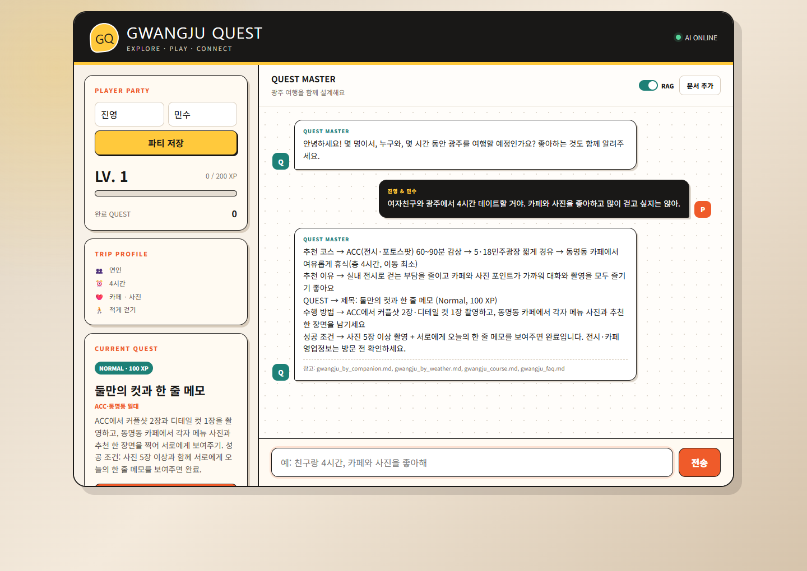
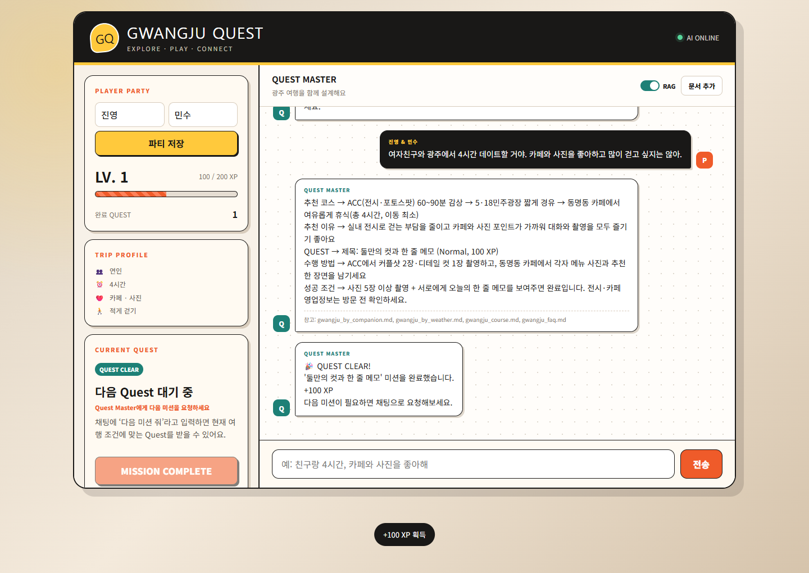

# SSAFY 16기 1학기 관통 프로젝트

SSAFY 16기 Java Track에서 진행하는 관통 프로젝트를 **하나의 저장소에서 차수별로 기록**합니다. 1차 Java 프로젝트부터 이후 웹, 데이터베이스와 Spring 프로젝트까지 하나의 성장 흐름으로 누적할 예정입니다.

## 프로젝트 목록

| 차수 | 프로젝트 | 주제 | 핵심 기술 | 문서 |
|---:|---|---|---|---|
| 1차 | EnjoyTrip Java | 공공 관광데이터 조회 및 여행 기록 애플리케이션 | Java, Swing, SAX, MVC | [프로젝트 폴더](projects/01-enjoytrip-java/) |
| 2차 | Gwangju Quest | RAG 기반 광주 여행 코스·현장 Quest 챗봇 | FastAPI, OpenAI API, LangChain, ChromaDB, Vanilla JS | [프로젝트 폴더](projects/02-gwangju-quest-chatbot/) |

## 진행 흐름

```text
1차 Java 관광 데이터 처리
  └─ XML/CSV 파싱, MVC, Swing UI
      ↓
2차 생성형 AI 여행 챗봇
  └─ REST API, RAG, 문서 업로드, Quest·XP 웹 UI
      ↓
향후 관통 프로젝트
  └─ projects/03-..., projects/04-... 형태로 계속 추가
```

## 2차 프로젝트 미리보기

### RAG 기반 맞춤 여행 코스



사용자의 동행인, 시간, 취향과 걷기 선호를 대화에서 추출하고 광주 여행 문서를 검색해 맞춤 코스와 Quest를 생성합니다. 검색에 사용한 문서명도 답변의 출처로 표시합니다.

### Quest 완료와 XP 반영



Quest 완료 시 XP와 완료 횟수가 즉시 반영되며, Quest ID를 기준으로 중복 완료를 방지합니다.

## 저장소 구조

```text
.
├─ projects/
│  ├─ README.md                          # 차수별 폴더 규칙
│  ├─ 01-enjoytrip-java/                 # 1차 전체 제출물
│  │  ├─ EnjoyTrip_source_code/          # Java 구현 소스
│  │  ├─ execution_screenshots/          # 실제 실행 화면
│  │  └─ README.md                       # 실행 방법 및 기능 설명
│  └─ 02-gwangju-quest-chatbot/          # 2차 전체 제출물
│     ├─ clients/                        # 웹 UI
│     ├─ servers/                        # FastAPI·RAG 서버와 평가 결과
│     ├─ screenshots/                    # 실제 실행 화면
│     ├─ README.md                       # 실행 방법 및 기능 설명
│     └─ REFLECTION_REPORT.md            # 고찰 보고서
└─ README.md
```

## 차수별 기록 원칙

- 새 프로젝트는 `projects/차수-프로젝트명/`에 독립적으로 추가합니다.
- 각 프로젝트에는 실행 방법, 주요 기능, 폴더 구조와 실행 화면을 포함한 `README.md`를 둡니다.
- 별도 고찰·평가 결과가 있으면 프로젝트 폴더 안에 함께 보관합니다.
- API 키, `.env`, 가상환경, 빌드 결과와 로컬 벡터 DB는 커밋하지 않습니다.

## 바로가기

- [1차 EnjoyTrip 실행 방법과 기능](projects/01-enjoytrip-java/README.md)
- [2차 Gwangju Quest 실행 방법과 기능](projects/02-gwangju-quest-chatbot/README.md)
- [2차 고찰 보고서](projects/02-gwangju-quest-chatbot/REFLECTION_REPORT.md)
- [2차 구현 및 개선 기록](projects/02-gwangju-quest-chatbot/PROGRESS_AND_NEXT_STEPS.md)
