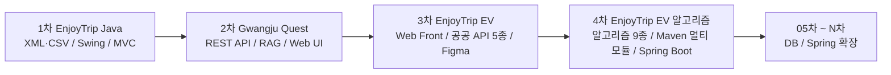
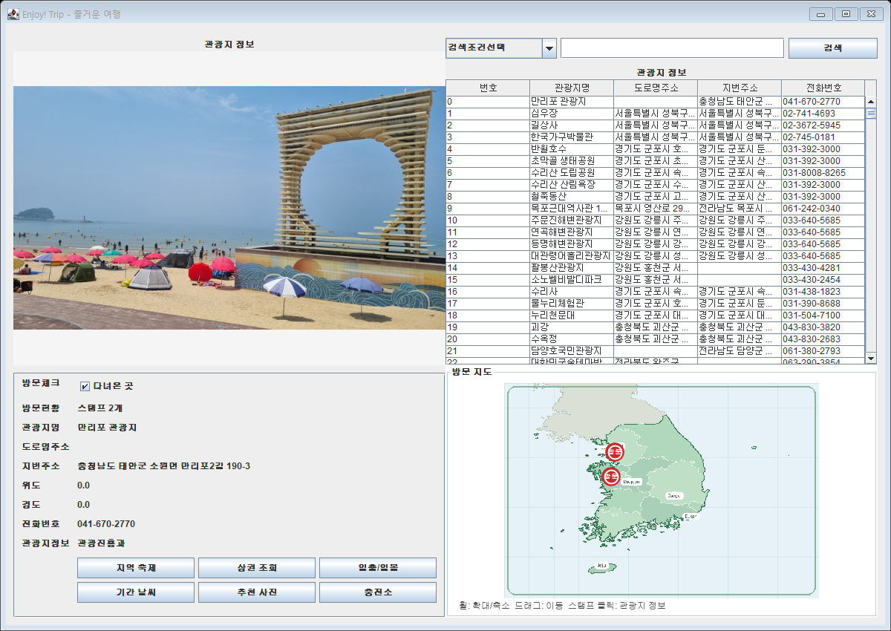

# SSAFY 16기 1학기 관통 프로젝트

SSAFY 16기 Java Track에서 진행하는 관통 프로젝트를 **하나의 저장소에서 차수별로 기록하는 성장 아카이브**입니다. 10차 이상의 프로젝트가 쌓여도 찾기 쉽도록 각 차수의 전체 소스 코드, 실행 방법, 실제 실행 화면과 고찰·평가 자료를 동일한 규칙의 독립 폴더에 보관합니다.

## 현재 진행 현황

| 차수 | 프로젝트 | 주제 | 상태 | 완료 시점 |
|---:|---|---|:---:|---|
| 1차 | [EnjoyTrip Java](projects/01-enjoytrip-java/) | 공공 관광데이터 기반 Swing 애플리케이션 | ✅ 완료 | 2026-07-30 |
| 2차 | [Gwangju Quest](projects/02-gwangju-quest-chatbot/) | RAG 기반 광주 여행 Quest 챗봇 | ✅ 완료 | 2026-09-04 |
| 3차 | [EnjoyTrip EV](projects/03-enjoytrip-ev-frontend/) | 공공 API 기반 전기차 드라이브 여행 웹 플래너 | ✅ 완료 | 2026-10-02 |
| 4차 | [EnjoyTrip EV 알고리즘](projects/04-enjoytrip-ev-algorithm/) | 알고리즘 9종 + 재사용 가능한 Java 모듈과 Spring Boot 백엔드 | ✅ 완료 | 2026-10-15 |
| 05차 ~ N차 | EnjoyTrip 확장 | 데이터베이스·백엔드를 단계적으로 결합 | ⏳ 예정 | 차수별 갱신 |

## 프로젝트 성장 흐름



1차에서는 공공데이터를 Java 객체로 변환하고 데스크톱 UI에 표현하는 흐름을 구현했습니다. 2차에서는 같은 여행 도메인을 웹으로 확장하면서 생성형 AI API, 벡터 검색과 상태 기반 Quest 시스템을 결합했습니다. 3차에서는 서버 없이 HTML·CSS·JavaScript 만으로 관광·충전소·지도·길찾기·날씨 공공 API 를 브라우저에서 직접 연동하고, 1차에서 데이터로만 다뤘던 전기차 충전소를 여행 동선과 결합했습니다. 4차에서는 3차에서 사용자가 직접 정하던 방문 순서와 고정 규칙이던 충전 지점을 알고리즘(TSP·Dijkstra 등 9종)으로 바꾸고, 다음 백엔드 차수에서 그대로 쓰도록 순수 Java 알고리즘 모듈과 Spring Boot 백엔드로 나눴습니다.

---

## 1차 · EnjoyTrip Java

공공 관광데이터 XML을 SAX로 파싱해 관광지 목록과 상세 정보를 제공하는 Java Swing 애플리케이션입니다.

### 핵심 구현

- 관광지명·주소 조건 검색 및 상세 이미지 조회
- 지역 축제, 주변 상권, 날씨와 전기차 충전소 정보 제공
- 방문한 관광지를 지도 스탬프로 기록하고 파일에 저장
- Swing 이벤트 처리와 `View → Service → DAO` 계층 분리
- 전체 관광지 735건 로딩 및 검색 스모크 테스트



### 기술과 문서

| 구분 | 내용 |
|---|---|
| 기술 | Java, Swing, SAX Parser, MVC, XML, CSV |
| 팀 | 김현호, 김진영 |
| 상세 설명 | [1차 README](projects/01-enjoytrip-java/README.md) |
| 구현 소스 | [EnjoyTrip Java 소스](projects/01-enjoytrip-java/EnjoyTrip_source_code/EnjoyTrip_0730/) |
| 실행 화면 | [스크린샷 모음](projects/01-enjoytrip-java/execution_screenshots/) |
| 실행 영상 | [데모 영상과 자막](projects/01-enjoytrip-java/EnjoyTrip_demo_video_with_subtitles/) |
| 원본 | [SSAFY GitLab 저장소](https://lab.ssafy.com/hno130/trip_java_gwangju_03/-/tree/824215d7d1ae35163f9fdc03d8aaddd484aeabb2/) |

---

## 2차 · Gwangju Quest

사용자의 동행인, 일정, 이동수단과 취향을 대화에서 파악하고 광주 여행 문서를 검색해 맞춤 코스와 현장 Quest를 제안하는 RAG 챗봇입니다.

### 핵심 구현

- FastAPI `/chat` API와 구조화 JSON 응답
- 최근 대화와 여행 프로필을 이용한 후속 질문 문맥 유지
- 광주 여행 Markdown 13개와 ChromaDB 기반 RAG 검색
- `txt`, `md`, `pdf` 업로드 후 즉시 청킹·임베딩
- AI Quest와 화면 카드 동기화, 중복 완료 방지와 XP·Level 계산
- 데스크톱·모바일 반응형 UI와 채팅 내부 자동 스크롤
- RAGAS를 이용한 기준선·개선형 응답 품질 비교


### RAGAS 개선 결과

생성 모델과 임베딩 모델은 동일하게 유지하고, 공식 관광 데이터 추가와 Markdown 제목 기반 청킹, 검색 설정을 개선했습니다.

| 지표 | 기준선 | 개선형 | 변화 |
|---|---:|---:|---:|
| Faithfulness | 0.2964 | 0.6293 | +0.3330 |
| Answer Relevancy | 0.4495 | 0.6590 | +0.2095 |
| Context Recall | 0.3583 | 1.0000 | +0.6417 |
| Context Precision | 0.3500 | 0.9722 | +0.6222 |

### 기술과 문서

| 구분 | 내용 |
|---|---|
| Frontend | HTML5, CSS3, Vanilla JavaScript |
| Backend | Python, FastAPI, Uvicorn, Pydantic |
| AI·RAG | OpenAI API, LangChain, ChromaDB, PyMuPDF |
| 평가 | RAGAS, JSON 테스트셋, CSV 비교 결과 |
| 팀 | 진영, 민수 |
| 실행·기능 | [2차 README](projects/02-gwangju-quest-chatbot/README.md) |
| 고찰 | [생성형 AI·RAG 고찰 보고서](projects/02-gwangju-quest-chatbot/REFLECTION_REPORT.md) |
| 성능 평가 | [RAGAS 비교 결과](projects/02-gwangju-quest-chatbot/servers/ragas_gwangju_comparison.md) |
| 구현 기록 | [진행 현황과 개선 기록](projects/02-gwangju-quest-chatbot/PROGRESS_AND_NEXT_STEPS.md) |
| 원본 | [SSAFY GitLab 저장소](https://lab.ssafy.com/kjy164777/trip_chatbot_gwangju_03_jinyoung_minsu) |

---

## 3차 · EnjoyTrip EV

관광지를 고르면 동선에 맞춰 전기차 충전소까지 챙겨 주는 멀티 페이지 웹 여행 플래너입니다. Figma 로 먼저 설계하고 Bootstrap 5 반응형으로 구현했으며, 데이터는 `localStorage` 에 저장합니다.

### 핵심 구현

- 한국관광공사 API 로 지역·유형별 관광지 조회와 카카오맵 마커 연동 (2026 법정동 코드 개편 반영)
- 여행 계획: 드래그 앤 드롭 순서 변경, 카카오모빌리티 도로 경로·소요 시간, 항목별 경비 + 충전비 자동 계산, Markdown 내보내기
- 한국환경공단 실시간 충전소 — 정류지 반경 1km 충전기 상태와 주행가능거리 70% 기준 충전 추천 지점
- 관광지 7일 날씨·일출일몰(Open-Meteo)과 공공누리 사진, 일몰 이후 도착 경고
- 핫플레이스 사진 EXIF GPS 로 위치·날짜 자동 입력과 1km 방문 인증
- 회원·공지·자유게시판 CRUD, Chart.js 여행 통계, XSS 방지와 작성자 권한 확인
- 실행 화면 캡처·TTS 시연 영상을 크롬 DevTools Protocol 스크립트로 자동 제작


### 기술과 문서

| 구분 | 내용 |
|---|---|
| Frontend | HTML5, CSS3, JavaScript (ES Module), Bootstrap 5, Chart.js |
| 외부 API | 한국관광공사 KorService2, 한국환경공단 충전소, Kakao Maps, 카카오모빌리티 길찾기, Open-Meteo |
| 설계 | Figma 디자인 토큰·컴포넌트 → CSS 변수 |
| 팀 | 김진영, 강상민 |
| 상세 설명 | [3차 README](projects/03-enjoytrip-ev-frontend/README.md) |
| 요구사항 | [요구사항 기능 명세서](projects/03-enjoytrip-ev-frontend/docs/requirements.md) |
| 실행 화면 | [스크린샷 모음](projects/03-enjoytrip-ev-frontend/docs/screenshots/) |
| 실행 영상 | [TTS 시연 영상과 자막](projects/03-enjoytrip-ev-frontend/docs/demo/) |
| 발표 자료 | [발표 pptx](projects/03-enjoytrip-ev-frontend/docs/EnjoyTrip_EV_발표.pptx) |
| 원본 | [SSAFY GitLab 저장소](https://lab.ssafy.com/kjy164777/trip_frontend_gwangju_03) |

---

## 4차 · EnjoyTrip EV 알고리즘

3차 전기차 여행 플래너의 기능에 알고리즘 9개를 적용하고, 다음 BackEnd 관통에서 그대로 쓰도록 순수 Java 알고리즘 모듈과 Spring Boot 백엔드의 Maven 멀티 모듈로 구성했습니다.

### 핵심 구현

- **방문 순서 최적화**: Held-Karp 비트마스크 DP(≤15곳)·2-opt — 관광지 10곳 1,400.6km → 570.3km
- **충전소 경유 경로**: "충전소에서는 80% 까지 충전" 모델링으로 Dijkstra 최적 보장, 충전소 8,072곳에서 중앙값 17ms
- **검색**: Trie 자동완성(초성 포함), KMP 키워드 검색, 자모 단위 편집 거리 DP 오타 허용 검색(오타 1개 검색어 98.5% 찾음)
- **추천·정렬·보안**: 코사인 유사도 + 격자 공간 인덱스 + Top-K 힙, TimSort 직접 구현, PBKDF2 + salt + pepper
- **도로 거리**: 카카오모빌리티 길찾기로 직선 근사(평균 오차 11.3%)를 보완
- **검증**: 직접 구현한 알고리즘을 모두 완전탐색·JDK·RFC 테스트 벡터와 비교(검증 32개), 백엔드 MockMvc 테스트 13개
- **백엔드**: `controller → model/service → model/dao` 구조, DAO 인터페이스 뒤 CSV(다음 차수에 DB 로 교체), 자동 보안 리뷰 지적(DoS·자원 고갈) 재현 후 수정


### 기술과 문서

| 구분 | 내용 |
|---|---|
| Algorithm | 순수 Java (`algorithm-core`, 런타임 의존성 없음) — DP, 그래프, 문자열, 정렬, 공간 인덱스, 추천 |
| Backend | Java 17, Spring Boot 3.5.16, Maven 멀티 모듈 + Wrapper |
| Frontend | Leaflet + OpenStreetMap 시연 페이지, 의존성 없는 SVG 차트 |
| 팀 | 김진영, 최규정, 김정원 |
| 상세 설명 | [4차 README](projects/04-enjoytrip-ev-algorithm/README.md) |
| 기획서·성능 측정 | [알고리즘 적용 기획서 #1~#9](projects/04-enjoytrip-ev-algorithm/ALGORITHM-PLAN.md) |
| 선택 근거 | [알고리즘 선택 근거와 예상 질문](projects/04-enjoytrip-ev-algorithm/docs/algorithm-decisions.md) |
| 실행 화면 | [스크린샷 모음](projects/04-enjoytrip-ev-algorithm/screenshots/) |
| 원본 | [SSAFY GitLab 저장소](https://lab.ssafy.com/comkjo0512/trip_algo_Gwangju_03_KimJinyoung_ChoiGyujeong_KimJeongwon) |

---

## 차수별 기술 확장

| 영역 | 1차 | 2차 | 3차 | 4차 | 확장 방향 |
|---|---|---|---|---|---|
| 사용자 화면 | Java Swing | 반응형 Web UI | Figma 설계 · Bootstrap 멀티 페이지 | 지도 시연 페이지 · SVG 차트 | 컴포넌트 기반 SPA |
| 데이터 | XML·CSV 파일 | Markdown·PDF·Vector DB | 공공 API 5종 실시간 연동 · localStorage | 공공데이터 CSV(관광지 1,504·충전소 8,072) · DAO 인터페이스 | 관계형 DB와 외부 API |
| 애플리케이션 구조 | View·Service·DAO | Client·REST API·RAG | 페이지 스크립트 · core ES 모듈 | Maven 멀티 모듈 · Spring Boot (Controller·Service·DAO) | Spring 기반 계층형 서버 |
| 핵심 로직 | 검색·필터 | RAG 검색·Quest 상태 | API 조합 · 고정 규칙 | 알고리즘 9종 (DP·그래프·문자열·정렬·추천) | DB 공간 인덱스·전문 검색 |
| 사용자 상태 | 방문 기록 파일 | 프로필·Quest·XP 상태 | 회원·여행 계획·핫플·게시글 (브라우저 저장) | 비밀번호 해시(PBKDF2·salt·pepper) 준비 | 로그인과 영속 세션 |
| 품질 검증 | 컴파일·검색 스모크 테스트 | API 회귀 테스트·RAGAS | 브라우저 실동작 검증 · 화면·영상 자동화 | 완전탐색·표준 구현 비교 검증 · JUnit·MockMvc · 성능 측정 | 자동화 테스트와 CI |

## 저장소 구조

```text
.
├─ projects/
│  ├─ README.md                          # 차수별 폴더 작성 규칙
│  ├─ _template/                         # 다음 차수에서 복사할 README 양식
│  ├─ 01-enjoytrip-java/
│  │  ├─ EnjoyTrip_source_code/          # Java 구현 소스와 데이터
│  │  ├─ execution_screenshots/          # 실제 실행 화면
│  │  ├─ EnjoyTrip_demo_video_with_subtitles/
│  │  └─ README.md
│  ├─ 02-gwangju-quest-chatbot/
│  │  ├─ clients/                        # 웹 UI
│  │  ├─ servers/                        # FastAPI·RAG 서버와 평가 결과
│  │  ├─ screenshots/                    # 실제 실행 화면
│  │  ├─ README.md
│  │  ├─ REFLECTION_REPORT.md
│  │  └─ PROGRESS_AND_NEXT_STEPS.md
│  ├─ 03-enjoytrip-ev-frontend/
│  │  ├─ *.html · assets/                # 멀티 페이지 웹 (HTML·CSS·JS 모듈)
│  │  ├─ data/ · scripts/                # 더미 데이터, 키 생성·화면 캡처·시연 영상 스크립트
│  │  ├─ docs/                           # 요구사항 명세서, 실행 화면, 시연 영상, 발표 자료
│  │  └─ README.md
│  └─ 04-enjoytrip-ev-algorithm/
│     ├─ algorithm-core/ · algorithm-bench/ · backend/   # Maven 멀티 모듈 (알고리즘 · 측정 · Spring Boot)
│     ├─ data/ · scripts/                # 공공데이터 CSV, 실행·차트 스크립트
│     ├─ docs/                           # 알고리즘 선택 근거, 성능 측정 차트
│     ├─ screenshots/                    # 실제 실행 화면
│     ├─ ALGORITHM-PLAN.md               # 알고리즘 적용 기획서 + 성능 측정
│     └─ README.md
└─ README.md                             # 전체 프로젝트 인덱스
```

## 완료 시점 태그

| 차수 | Git 태그 | 설명 |
|---:|---|---|
| 1차 | [`project-01-20260730`](https://github.com/Jkim1647/SSAFY-16th-Semester-1-Comprehensive-Project/tree/project-01-20260730) | 1차 EnjoyTrip 완료 시점 |
| 2차 | [`project-02-20260904`](https://github.com/Jkim1647/SSAFY-16th-Semester-1-Comprehensive-Project/tree/project-02-20260904) | 2차 Gwangju Quest 완료 시점 |
| 3차 | [`project-03-20261002`](https://github.com/Jkim1647/SSAFY-16th-Semester-1-Comprehensive-Project/tree/project-03-20261002) | 3차 EnjoyTrip EV 완료 시점 |
| 4차 | [`project-04-20261015`](https://github.com/Jkim1647/SSAFY-16th-Semester-1-Comprehensive-Project/tree/project-04-20261015) | 4차 EnjoyTrip EV 알고리즘 완료 시점 |

## 다음 차수 추가 방법

1. [`projects/_template`](projects/_template/)을 복사해 `projects/NN-project-name/` 폴더를 만듭니다.
2. 소스 코드, 실행 화면과 과제 문서를 새 폴더 안에만 추가합니다.
3. 프로젝트 README의 개요, 요구사항, 실행 방법, 검증 결과와 회고를 작성합니다.
4. 이 메인 README의 `현재 진행 현황`과 `차수별 기술 확장` 표에 한 행을 추가합니다.
5. 완료 커밋에 `project-NN-YYYYMMDD` 태그를 생성합니다.

## 아카이브 원칙

- 새 프로젝트는 `projects/차수-프로젝트명/`에 독립적으로 추가합니다.
- 각 프로젝트에 실행 방법, 주요 기능, 폴더 구조와 실행 화면을 기록합니다.
- 요구사항에 고찰·평가가 포함되면 프로젝트 폴더 안에 원본 결과와 함께 보관합니다.
- 완료 시점은 `project-차수-날짜` 태그로 남깁니다.
- API 키, 토큰, `.env`, 가상환경, 빌드 캐시와 로컬 데이터베이스는 커밋하지 않습니다.

세부 폴더 규칙과 제출 전 확인 항목은 [프로젝트 관리 가이드](projects/README.md)에서 확인할 수 있습니다.
