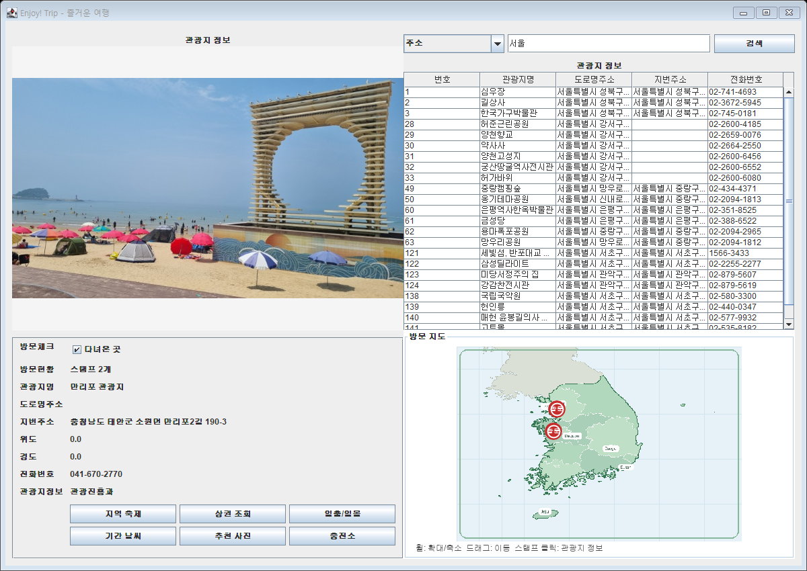
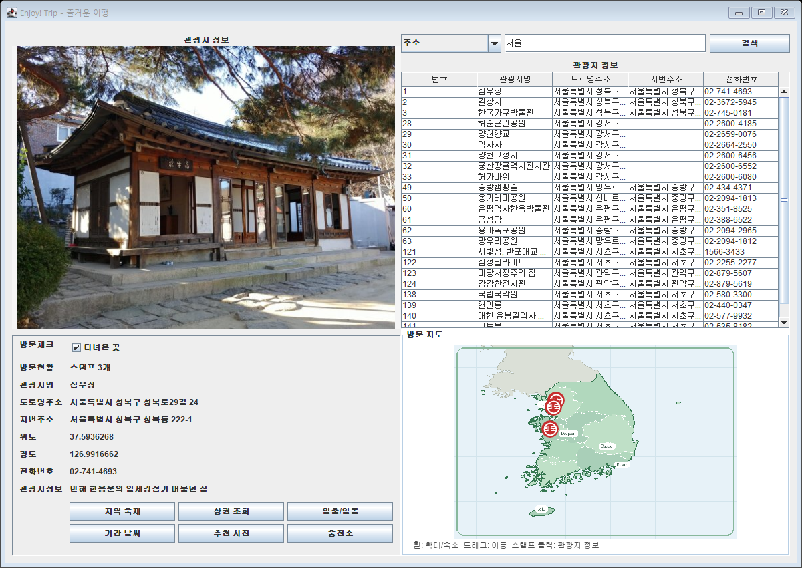
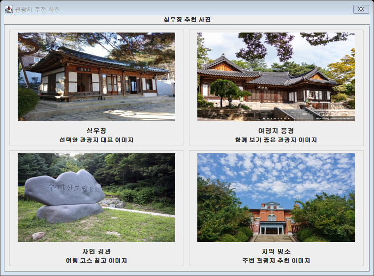

# EnjoyTrip Java Project

공공데이터를 활용한 관광지 정보 조회 Swing 애플리케이션입니다. XML 관광지 데이터를 파싱해 목록과 상세 정보를 제공하고, 검색/방문 기록/지도 스탬프/심화 정보 조회 기능을 구현했습니다.

- 원본 팀 저장소: [SSAFY GitLab - Trip_Java_Gwangju_03](https://lab.ssafy.com/hno130/trip_java_gwangju_03/-/tree/824215d7d1ae35163f9fdc03d8aaddd484aeabb2/)
- 진행 차수: 1차 관통 프로젝트

## 실행 화면

### 메인 화면과 관광지 상세 조회


### 주소 조건 검색



### 방문 기록과 지도 스탬프



### 추천 사진 팝업



## 실행 방법

### STS/Eclipse

1. `File > Open Projects from File System...` 선택
2. 프로젝트 폴더 `EnjoyTrip_Codex_0730` 선택
3. `src/com/ssafy/trip/Main.java` 실행
4. `Run As > Java Application`

### 배치 파일

프로젝트 루트의 `RunEnjoyTrip.bat`을 더블클릭합니다.

### 명령어

```powershell
cd EnjoyTrip_Codex_0730
java -cp bin com.ssafy.trip.Main
```

## 구현 기능

| 요구사항 | 기능 | 구현 내용 |
| --- | --- | --- |
| F101 | 관광지 정보 조회 | XML 관광지 데이터를 SAX로 파싱하고 Swing JTable에 목록 표시 |
| F102 | 관광지 정보 조건 검색 | 관광지명/주소 조건으로 목록 검색 |
| F103 | 관광지 정보 상세 조회 | 관광지 목록 행 클릭 시 왼쪽 상세 정보와 이미지 표시 |
| F104 | 지역 축제 정보 조회 | 선택 관광지 주소 기반 지역 축제 정보 팝업 표시 |
| F105 | 주변 상권 정보 조회 | 선택 관광지 주소 기반 주변 상권 정보 팝업 표시 |
| F106 | 관광지 날씨 | 시작일/종료일 입력 후 기간별 날씨 표 표시 |
| F107 | 관광지 사진 | 관광지/지역 기준 추천 사진 갤러리 표시 |
| F108 | 일출/일몰시각 | 선택 관광지 좌표 또는 주소 기반 대표 좌표로 일출/일몰 계산 |
| F109 | 전기자동차 충전소 | 관광지 주변 전기차 충전소 위치와 충전 상태 표시 |
| 추가 | 방문 체크와 지도 스탬프 | 다녀온 곳 체크 시 지도에 스탬프 표시 및 파일 저장 |
| 추가 | 지도 상호작용 | 스탬프 클릭 시 상세 조회, 마우스 휠 확대/축소, 드래그 이동 |

## 주요 사용 방법

- 오른쪽 관광지 목록에서 행을 클릭하면 왼쪽에 상세 정보가 표시됩니다.
- 상단 검색 조건에서 `관광지명` 또는 `주소`를 선택하고 검색어를 입력하면 목록이 필터링됩니다.
- 왼쪽 상세 정보의 `다녀온 곳`을 체크하면 오른쪽 지도에 방문 스탬프가 표시됩니다.
- 지도 스탬프를 클릭하면 해당 관광지 상세 정보로 이동합니다.
- 지도에서 마우스 휠을 사용하면 확대/축소되고, 확대된 상태에서 드래그로 지도를 이동할 수 있습니다.
- `지역 축제`, `상권 조회`, `일출/일몰`, `기간 날씨`, `추천 사진`, `충전소` 버튼으로 추가 정보를 조회합니다.

## 주요 클래스

| 클래스 | 역할 |
| --- | --- |
| `com.ssafy.trip.Main` | 프로그램 시작점 |
| `com.ssafy.trip.view.TripInfoView` | Swing 화면 구성과 이벤트 처리 |
| `com.ssafy.trip.model.dto.TripDto` | 관광지 상세 정보 DTO |
| `com.ssafy.trip.model.dto.TripSearchDto` | 관광지 검색 조건 DTO |
| `com.ssafy.trip.model.service.TripServiceImpl` | 서비스 계층 구현 |
| `com.ssafy.trip.model.dao.TripDaoImpl` | 관광지 목록/상세 조회 DAO |
| `com.ssafy.trip.util.TouristDestinationSAXParser` | XML 파일 로딩 |
| `com.ssafy.trip.util.TouristDestinationSAXHandler` | XML 관광지 데이터 파싱 |

## 데이터 및 리소스

| 파일 | 내용 |
| --- | --- |
| `res/전국관광지정보표준데이터.xml` | 관광지 원본 XML 데이터 |
| `res/지역축제정보.csv` | 지역 축제 샘플 데이터 |
| `res/상권정보.csv` | 주변 상권 샘플 데이터 |
| `res/관광지날씨.csv` | 기간별 날씨 계산용 지역 프로필 |
| `res/추천사진.csv` | 추천 사진 매핑 데이터 |
| `res/전기차충전소.csv` | 전기차 충전소 위치/상태 데이터 |
| `res/visited-trips.txt` | 방문 체크 저장 파일 |
| `img/korea_map.png` | 방문 스탬프용 한국 지도 이미지 |
| `img/image01.jpg` ~ `img/image11.jpg` | 관광지 및 추천 사진 이미지 |

## 구현 포인트

- 검색 버튼 이벤트는 Lambda 표현식으로 등록했습니다.
- SAX Parser/Handler를 사용해 XML 관광지 데이터를 Java 객체로 변환합니다.
- MVC 흐름에 맞춰 View -> Service -> DAO 구조로 관광지 정보를 조회합니다.
- 상세 이미지가 잘리지 않도록 전용 이미지 패널에서 원본 비율을 유지해 렌더링합니다.
- 방문 기록은 `res/visited-trips.txt`에 저장해 재실행 후에도 유지합니다.
- 지도 이미지는 오프라인에서도 보이도록 프로젝트 내부 리소스로 포함했습니다.

## 검증 결과

- 전체 Java 소스 컴파일 성공
- 관광지 XML 로딩 확인
- 전체 목록 조회, 관광지명 검색, 주소 검색, 상세 조회 스모크 테스트 통과

```text
total=735, first=만리포 관광지, nameMatches=1, addressMatches=24
```
