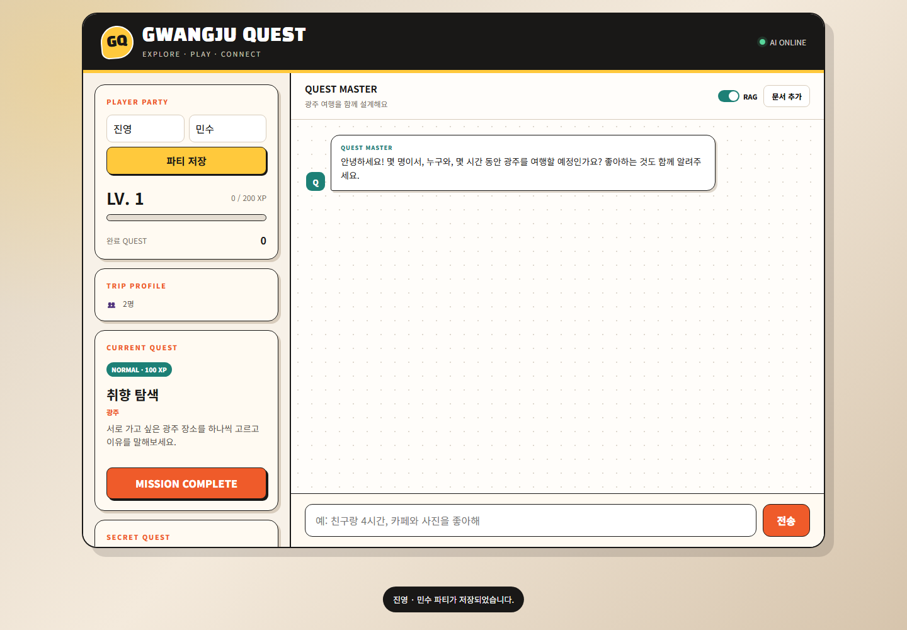
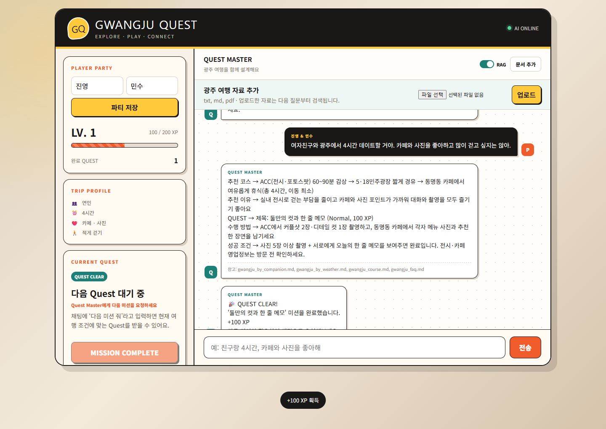
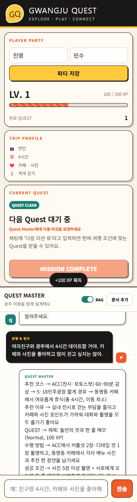

# Gwangju Quest

광주 여행 조건을 대화로 파악하고, RAG 기반 코스와 현장 Quest를 제안하는 AI 여행 챗봇입니다. AI가 만든 Quest와 화면 왼쪽의 `CURRENT QUEST` 카드가 같은 상태를 사용하며, 완료 시 XP와 Level이 실제 게임 상태에 반영됩니다.

## 팀원

| 팀원 | 주요 역할 |
|---|---|
| 진영 | 프론트엔드 UI, 여행 프로필 및 Quest 게임 상태 |
| 민수 | FastAPI, AI/RAG, 구조화 응답 및 테스트 |

## 실행 화면

### 1. 데스크톱 초기 화면



플레이어 파티, 레벨·XP, 여행 프로필, 현재 Quest와 AI 채팅을 한 화면에서 확인할 수 있습니다.

### 2. RAG 기반 맞춤 여행 코스와 Quest 생성


`연인`, `4시간`, `카페·사진`, `적게 걷기` 조건을 대화에서 추출해 프로필에 반영하고, 조건에 맞는 코스와 Quest를 생성합니다. 답변 아래에는 검색에 사용된 광주 여행 문서가 출처로 표시됩니다.

### 3. Quest 완료와 XP 반영


`MISSION COMPLETE`를 누르면 완료 Quest 수와 XP가 즉시 증가하고, 채팅에도 완료 결과가 추가됩니다. 같은 Quest의 중복 완료는 Quest ID로 차단합니다.

### 4. RAG 문서 업로드



`문서 추가` 패널에서 `txt`, `md`, `pdf` 파일을 업로드할 수 있습니다. 서버는 문서를 청킹하고 ChromaDB에 임베딩해 이후 질문부터 검색 근거로 사용합니다.

### 5. 모바일 반응형 대화 화면



좁은 화면에서는 게임 정보와 채팅 영역이 세로로 재배치되며, 긴 대화도 채팅 영역 안에서 스크롤할 수 있습니다.

## 주요 기능

| 구분 | 기능 |
|---|---|
| AI Chat | `fetch`와 JSON 기반 FastAPI 챗봇, Enter/버튼 전송, 오류 메시지 |
| Conversation | 최근 대화 최대 12개 관리, 후속 질문 문맥 유지 |
| Trip Profile | 관계, 시간, 이동수단, 취향, 걷기 선호, 날씨, 현재 지역 누적 |
| AI Quest | AI가 만든 Quest를 왼쪽 카드와 동기화 |
| Game | Quest ID 기반 중복 완료 방지, XP·Level·완료 수 계산 |
| Intent | 자연어 Quest 완료와 여행 종료 의도 처리 |
| RAG | 광주 여행 Markdown 13개 문서, 제목 기반 청킹, 출처 표시 |
| Upload | txt, md, pdf 업로드와 즉시 임베딩 |
| Secret Quest | 플레이어별 비밀 미션 생성 및 펼치기/숨기기 |
| Responsive UI | 데스크톱·모바일 레이아웃과 채팅 내부 자동 스크롤 |

## 기술 스택

- Frontend: HTML5, CSS3, Vanilla JavaScript
- Backend: Python, FastAPI, Uvicorn, Pydantic
- AI: OpenAI Chat API, LangChain
- RAG: OpenAI Embeddings, ChromaDB, PyMuPDF
- Evaluation: RAGAS, 테스트 질문 JSON/CSV

## 폴더 구조

```text
.
├─ clients/
│  ├─ index.html              # 최종 사용자 화면
│  ├─ index_v0.html           # 초기 화면 참고본
│  ├─ script.js               # 채팅·프로필·Quest·XP 상태
│  └─ style.css               # 반응형 UI 및 채팅 스크롤
├─ servers/
│  ├─ data/                   # 광주 RAG Markdown 원문
│  ├─ main.py                 # FastAPI, RAG, 구조화 응답
│  ├─ prompt.py               # Quest Master 프롬프트
│  ├─ eval_gwangju_ragas.py   # 기준선·개선형 RAGAS 비교
│  ├─ gwangju_test_cases.json # 광주 평가 질문 10개
│  ├─ ragas_gwangju_baseline.csv
│  ├─ ragas_gwangju_improved.csv
│  ├─ ragas_gwangju_comparison.md
│  ├─ requirements.txt
│  └─ .env.example
├─ screenshots/               # 실행 화면
├─ REFLECTION_REPORT.md       # 고찰 보고서
├─ PROGRESS_AND_NEXT_STEPS.md # 구현·검증 상세 기록
├─ README.md
└─ .gitignore
```

`servers/.env`, `servers/.venv`, `servers/chroma_data`는 보안과 용량 문제로 Git에 포함하지 않습니다.

## 실행 방법

### 1. 백엔드 실행

PowerShell에서 다음 명령을 실행합니다.

```powershell
cd servers
python -m venv .venv
.\.venv\Scripts\Activate.ps1
pip install -r requirements.txt
Copy-Item .env.example .env
```

생성된 `.env`에 OpenAI API 키를 입력합니다.

```dotenv
OPENAI_API_KEY=your_api_key_here
GPT_MODEL=gpt-5-mini
EMBEDDING_MODEL_NAME=text-embedding-3-small
```

서버를 시작합니다.

```powershell
python main.py
```

- API 서버: `http://127.0.0.1:8000`
- 상태 확인: `http://127.0.0.1:8000/health`
- Swagger UI: `http://127.0.0.1:8000/docs`

### 2. 프론트엔드 실행

새 PowerShell을 열고 실행합니다.

```powershell
cd clients
python -m http.server 5500
```

브라우저에서 `http://127.0.0.1:5500`을 엽니다. HTML 파일을 직접 여는 방식은 CORS 정책 때문에 권장하지 않습니다.

## 사용 방법

1. 플레이어 이름을 입력하고 `파티 저장`을 누릅니다.
2. 관계, 시간, 이동수단, 취향 등을 자연어로 입력합니다.
3. AI 답변과 함께 왼쪽 `TRIP PROFILE`과 `CURRENT QUEST`가 갱신됩니다.
4. 현장에서 Quest를 수행한 뒤 `MISSION COMPLETE`를 누르거나 `미션 성공했어`라고 입력합니다.
5. XP와 완료 수가 반영된 뒤 `다음 미션 줘`로 새로운 Quest를 받습니다.
6. `오늘은 여기까지`를 입력하면 현재 XP와 여행 성향을 기반으로 종료 요약을 받습니다.

## `/chat` API

기존 필드를 유지하면서 여행 상태용 선택 필드를 추가했습니다.

### 요청 예시

```json
{
  "message": "여자친구랑 광주에서 4시간 놀 거야. 카페랑 사진 좋아해.",
  "use_rag": true,
  "history": [],
  "profile": {
    "players": ["진영", "민수"],
    "playerCount": 2,
    "preferences": []
  },
  "completed_quests": [],
  "game_state": {
    "xp": 0,
    "level": 1,
    "completedQuestCount": 0,
    "currentQuest": "취향 탐색",
    "currentQuestSource": "fallback"
  }
}
```

### 응답 예시

```json
{
  "response": "동명동에서 두 사람의 카페 취향을 맞혀보세요.",
  "answer": "동명동에서 두 사람의 카페 취향을 맞혀보세요.",
  "source": "gwangju_quest_ideas.md",
  "rag_used": true,
  "profile_updates": {
    "companionType": "연인",
    "duration": "4시간",
    "preferences": ["카페", "사진"]
  },
  "quest": {
    "id": "ai-example-01",
    "title": "커플 포토 큐레이터",
    "description": "서로의 베스트 사진을 골라 이유를 말해보세요.",
    "difficulty": "NORMAL",
    "xp": 100,
    "location": "동명동",
    "status": "active"
  },
  "intent": "NONE"
}
```

구조화 JSON 검증에 실패해도 기존 `response` 텍스트를 반환하도록 fallback을 적용했습니다.

## RAG 데이터

`servers/data/gwangju_*.md` 13개 문서를 자동으로 읽습니다. 자체 구성한 여행 가이드 12개에 광주광역시 관광 공식 홈페이지와 공공데이터포털 자료를 정제한 `gwangju_public_official.md`를 추가했습니다. 공식 데이터에는 제공기관, 수집일, 원본 URL과 변동 정보 재확인 원칙을 기록했습니다.

- 관광지와 권역별 특징
- 친구·연인·가족·혼자 여행
- 2시간·4시간·반나절·하루 코스
- 날씨와 걷기 조건
- 카페·음식·문화·자연 취향
- 대중교통과 이동 동선
- 관계·장소별 Quest 아이디어
- 자연어 FAQ

Markdown 문서는 제목 경계를 먼저 보존한 다음 긴 섹션만 450자 단위, 60자 중첩으로 분할합니다. txt·pdf는 같은 크기의 재귀 분할을 사용합니다. 관련도 `0.20` 이상인 최대 5개 청크를 답변 근거로 사용합니다.

## F207 RAGAS 성능 개선

같은 광주 질문 10개와 같은 생성·임베딩 모델을 사용해 기준선과 개선형을 비교했습니다. 따라서 모델 변경 효과가 아니라 데이터·청킹·검색 설정 변경 효과를 관찰했습니다.

| 구분 | 기준선 | 개선형 |
|---|---|---|
| 데이터 | 기존 광주 문서 12개 | 기존 문서 + 공식 관광 데이터 |
| 청킹 | 고정 700자, 중첩 100자 | Markdown 제목 보존 + 450자, 중첩 60자 |
| 검색 | top-k 4, 임계값 0.25 | top-k 5, 임계값 0.20 |
| 평가 청크 수 | 56 | 237 |

| RAGAS 지표 | 기준선 | 개선형 | 변화 |
|---|---:|---:|---:|
| Faithfulness | 0.2964 | 0.6293 | +0.3330 |
| Answer Relevancy | 0.4495 | 0.6590 | +0.2095 |
| Context Recall | 0.3583 | 1.0000 | +0.6417 |
| Context Precision | 0.3500 | 0.9722 | +0.6222 |

공식 주소·운영정보·코스처럼 기존 문서에 부족했던 질문의 검색 품질이 크게 개선됐습니다. 다만 일부 추천형 질문에서는 답변이 모범답안보다 구체적인 Quest를 추가하면서 Faithfulness 또는 Answer Relevancy가 낮아졌습니다. 세부 결과는 [RAGAS 비교 보고서](servers/ragas_gwangju_comparison.md)와 두 CSV에서 확인할 수 있습니다.

평가는 생성형 모델을 심사자로 사용하므로 재실행 시 소폭 달라질 수 있습니다. 또한 공식 데이터 추가와 청킹·검색 설정을 함께 바꿨기 때문에 전체 향상분을 하나의 요인에만 귀속할 수 없습니다.

## API 목록

| Method | Endpoint | 설명 |
|---|---|---|
| GET | `/health` | AI 및 RAG 준비 상태 |
| POST | `/chat` | 대화, 프로필 추출, Quest 생성 |
| POST | `/upload` | txt/md/pdf 문서 업로드 |
| POST | `/reset-db` | 기본 광주 문서 재색인 |

## 검증 결과

- JavaScript `node --check` 통과
- Python `py_compile` 통과
- 서버 `ai_ready=true`, `rag_ready=true`
- 기준선 56개, 개선형 237개 평가 청크 생성 확인
- 광주 질문 10개 기준 RAGAS 네 지표 모두 평균 상승
- 실제 ChromaDB를 13개 문서·237개 청크로 재색인하고 공식 데이터 포함 확인
- ACC 주소·수요일 운영시간 질의에서 `gwangju_public_official.md` 검색 및 RAG 응답 확인
- 연속 대화의 프로필 누적 확인
- AI Quest 제목과 왼쪽 카드 일치 확인
- 완료 버튼 재클릭 시 XP 중복 지급 없음
- `미션 성공했어` 자연어 완료 확인
- Send 버튼과 Enter 전송 확인
- Markdown 업로드 및 잘못된 확장자 오류 확인
- 데스크톱 채팅 내부 스크롤과 모바일 화면 확인

상세 테스트 기록은 [PROGRESS_AND_NEXT_STEPS.md](PROGRESS_AND_NEXT_STEPS.md)를 참고합니다.

## 보안 및 주의사항

- 실제 API 키가 있는 `.env`는 커밋하지 않습니다.
- 정확한 영업시간, 요금, 휴무일, 행사 일정은 방문 전 공식 정보를 확인해야 합니다.
- 업로드 문서는 프로젝트 서버에 저장되고 임베딩되므로 민감한 문서를 업로드하지 않습니다.
- 현재 대화와 게임 상태는 브라우저 메모리에만 저장되어 새로고침하면 초기화됩니다.

## 향후 개선

1. 여행 종료 결과 카드 UI
2. Secret Quest 개별 완료 처리
3. 출처 파일을 읽기 쉬운 링크/배지로 표시
4. `localStorage` 기반 상태 복원
5. 장소·권역 메타데이터를 이용한 혼합 검색
6. 브라우저 통합 테스트 자동화
