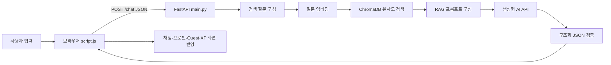

# Gwangju Quest 고찰 보고서

## 1. 프로젝트 개요

Gwangju Quest는 광주 여행 정보를 제공하는 RAG 챗봇에 Quest와 XP 요소를 결합한 서비스다. 사용자가 동행인, 여행 시간, 이동수단, 취향, 날씨와 현재 지역을 자연어로 입력하면 챗봇이 조건에 맞는 광주 코스와 대화형 미션을 제안한다.

이번 프로젝트에서는 단순히 생성형 AI의 답변을 화면에 출력하는 데 그치지 않고 다음 과정을 직접 구현하고 확인했다.

1. 브라우저에서 사용자 질문과 여행 상태 수집
2. `fetch`를 이용한 FastAPI `/chat` 요청
3. 광주 여행 문서 검색과 RAG 문맥 구성
4. 생성형 AI API 호출 및 구조화 JSON 응답 생성
5. 화면의 채팅, 여행 프로필, Quest 카드와 XP 상태 갱신

본 보고서는 프로젝트 명세서에서 요구한 다음 다섯 항목을 중심으로 작성했다.

- 생성형 AI API 호출 흐름에 대한 이해
- 문서 업로드 전·후 AI 응답의 차이
- RAG 적용 시 장점과 한계
- 데이터 문서의 품질이 응답에 미치는 영향
- 향후 개선 또는 확장 가능성

---

## 2. 생성형 AI API 호출 흐름에 대한 이해

### 2.1 전체 호출 흐름



프론트엔드는 사용자가 입력한 현재 질문뿐 아니라 최근 대화, 여행 프로필, 현재 게임 상태와 완료한 Quest를 JSON으로 묶어 `/chat`에 전송한다. 서버는 Pydantic 모델을 통해 요청 형식을 검증한다. `use_rag=true`이면 현재 질문과 최근 사용자 발화를 조합해 검색 질문을 만들고, 이를 임베딩 벡터로 변환해 ChromaDB에서 관련 문서를 검색한다.

검색 점수가 기준을 넘는 문서가 있으면 서버는 검색 문맥, 게임 상태, 여행 프로필, 완료 Quest와 질문을 `RAG_PROMPT`에 넣어 생성형 AI API를 호출한다. 관련 문서가 없으면 `GENERAL_PROMPT`를 사용하며 응답의 출처를 `일반 AI 응답 (관련 문서 없음)`으로 표시한다. 이를 통해 사용자는 현재 답변이 저장 문서를 참고했는지 구분할 수 있다.

AI 응답은 다음과 같은 구조화 JSON을 목표로 한다.

```json
{
  "response": "사용자에게 표시할 답변",
  "profile_updates": {
    "companionType": "연인",
    "duration": "4시간",
    "preferences": ["카페", "사진"]
  },
  "quest": {
    "title": "동명동 포토 챌린지",
    "difficulty": "NORMAL",
    "xp": 100,
    "status": "active"
  },
  "intent": "NONE"
}
```

생성형 AI는 같은 프롬프트에도 필드를 생략하거나 JSON 밖의 문장을 반환할 수 있다. 따라서 서버는 Pydantic 구조 검증, 필드별 부분 복구, 규칙 기반 프로필 추출, 답변 문자열에서 Quest 복구, 최종 텍스트 fallback을 순서대로 적용한다. 이 과정에서 생성형 AI API는 일반 함수처럼 항상 동일한 형식을 반환하는 시스템이 아니므로 실제 서비스에서는 검증과 예외 처리가 필수라는 점을 이해했다.

### 2.2 오류 처리와 상태 관리

네트워크 오류, HTTP 오류와 JSON 파싱 오류는 프론트엔드에서 사용자 메시지로 표시한다. 서버가 정상 답변을 반환해도 화면의 Quest와 AI가 설명한 Quest가 다르면 서비스 상태가 불일치하므로 최종 구현에서는 `state.currentQuest`를 하나의 기준 상태로 사용했다. AI가 반환한 Quest, 왼쪽 Quest 카드와 완료 버튼이 모두 같은 객체를 참조하도록 해 화면과 내부 상태를 일치시켰다.

XP와 완료 상태는 AI가 직접 수정하지 않는다. 브라우저가 Quest ID와 완료 목록을 관리하고 동일 Quest를 다시 완료하려는 요청을 차단한다. 생성형 AI는 추천과 설명을 담당하고, 점수처럼 정확성이 필요한 상태는 애플리케이션 코드가 담당하도록 역할을 나눈 것이다.

---

## 3. 문서 업로드 전·후 AI 응답의 차이

### 3.1 문서 업로드 처리 과정

사용자는 웹 화면에서 `txt`, `md`, `pdf` 파일을 선택해 `/upload`로 전송할 수 있다. 서버는 허용된 확장자인지 확인한 뒤 `servers/data`에 저장한다. Markdown과 텍스트 파일은 UTF-8 텍스트로 읽고 PDF는 PyMuPDF 기반 로더로 페이지 텍스트를 추출한다.

Markdown 문서는 제목 경계를 먼저 보존하고 긴 섹션만 450자 단위와 60자 중첩으로 분할한다. txt와 pdf는 같은 크기의 재귀 분할을 사용한다. 생성된 청크는 `text-embedding-3-large`로 임베딩되어 ChromaDB에 즉시 추가되므로 이후 질문부터 새 문서가 검색 대상이 된다.

### 3.2 업로드 전 응답

관련 문서가 없거나 검색 점수가 임계값을 넘지 못하면 답변은 모델의 일반 지식에 의존한다. 이 경우 다음 특징이 나타났다.

- 장소가 구체적이지 않거나 광주의 실제 권역 연결이 약하다.
- 공식 주소, 운영시간과 코스 순서를 정확히 답하기 어렵다.
- 답변의 근거가 되는 문서를 사용자에게 보여주기 어렵다.
- 모델이 알고 있는 과거 정보나 추정이 섞일 가능성이 있다.

예를 들어 기존 광주 문서에는 ACC의 정확한 수요일 운영시간이나 무등산의 한국관광 100선 연속 선정 횟수가 충분히 기록되어 있지 않았다. 이 질문들은 기준선 검색에서 모범답안을 뒷받침하는 문맥을 찾지 못하거나 일반적인 설명만 생성했다.

### 3.3 업로드 후 응답

광주광역시 관광 공식 홈페이지와 공공데이터포털 정보를 정리한 `gwangju_public_official.md`를 추가한 후에는 주소, 운영정보, 공식 추천 코스와 다국어 오디오 가이드가 검색 문맥에 포함됐다.

실제 서버에 개선 문서를 반영하고 ChromaDB를 재색인한 뒤 다음 질문을 확인했다.

> 국립아시아문화전당 주소와 수요일 운영시간, 휴무일을 알려줘.

응답에는 광주광역시 동구 문화전당로 38, 수요일 내부시설 10:00~20:00, 매주 월요일과 1월 1일 휴무가 포함됐다. 출처에는 `gwangju_public_official.md`가 표시됐으며 변동 가능성을 고려해 방문 전에 공식 안내를 다시 확인하라는 문장도 제공됐다.

문서 추가 전에는 모델이 일반 지식을 이용해 답을 만들었다면, 추가 후에는 프로젝트가 보유한 문서의 내용을 우선 근거로 답했다. 문서 업로드는 단순히 답변 내용을 늘리는 기능이 아니라 챗봇이 사용할 수 있는 지식의 범위와 답변 근거를 사용자가 직접 바꾸는 기능이라는 점을 확인했다.

---

## 4. RAG 적용 시 장점과 한계

### 4.1 장점

첫째, 서비스 주제에 맞는 구체적인 답변을 만들 수 있다. 광주 관광지, 권역, 동행자, 여행 시간, 날씨, 교통과 Quest 문서를 분리해 구성하면서 `연인`, `4시간`, `비`, `많이 걷기 싫어`와 같은 여러 조건을 반영할 수 있었다.

둘째, 모델을 다시 학습시키지 않고도 지식을 갱신할 수 있다. 문서를 추가하고 벡터 DB를 재색인하면 새 정보가 다음 답변부터 사용된다. 공식 관광 데이터를 추가했을 때 주소와 공식 코스 질문의 검색 품질이 바로 개선됐다.

셋째, 답변의 근거를 확인할 수 있다. 서버는 사용한 문서 파일명을 `source`에 포함한다. 사용자는 답변이 문서를 참고했는지, 관련 문서가 없어 일반 AI 응답으로 전환됐는지를 확인할 수 있다.

넷째, 생성형 AI의 환각을 줄이는 데 도움이 된다. 프롬프트에 검색 문서를 우선 사용하고 문서에 없는 운영시간·가격·행사를 단정하지 말도록 지정했다. 특히 변동 정보에는 공식 페이지 재확인 안내를 추가해 잘못된 확정 표현을 줄였다.

### 4.2 한계

RAG가 적용됐다고 해서 모든 답변이 사실이 되는 것은 아니다. 검색 문서가 정확해도 모델이 문서에 없는 설명이나 Quest 행동을 추가할 수 있다. 실제 평가에서 양림동 공식 코스는 정확히 검색됐지만 모델이 근거에 없는 세부 미션을 덧붙여 Faithfulness 점수가 일부 낮아졌다.

벡터 유사도는 의미적으로 관련된 문서를 항상 높은 점수로 찾는 것도 아니다. 짧은 질문, 고유명사와 여러 조건이 결합된 질문에서는 필요한 문서가 임계값 아래로 제외될 수 있다. 임계값을 너무 높이면 필요한 정보를 놓치고, 너무 낮추면 관련 없는 문맥이 함께 들어가 답변 품질이 낮아진다.

문서에 잘못되거나 오래된 정보가 있으면 RAG는 그 정보를 근거로 더 자신 있게 잘못 답할 수 있다. 운영시간, 휴무일, 요금, 행사와 교통정보처럼 변동성이 큰 데이터는 수집일과 출처를 기록하고 주기적으로 갱신해야 한다.

현재 검색은 최대 5개 청크를 사용하는 벡터 검색이다. 장소명 키워드가 정확한 질문에는 키워드 검색이 더 유리할 수 있고, 권역이나 접근성 같은 조건은 메타데이터 필터가 더 적합할 수 있다. 따라서 벡터 검색만으로 모든 검색 문제를 해결하기에는 한계가 있다.

---

## 5. 데이터 문서의 품질이 응답에 미치는 영향

### 5.1 데이터 구성 과정

초기에는 관광지 설명이 짧고 일반적이어서 복합 조건 질문에서 적절한 근거를 찾기 어려웠다. 이를 개선하기 위해 관광지, 코스, 권역, 동행자, 시간, 날씨, 카페, 음식, 교통, Quest와 FAQ 등 검색 의도별로 12개 Markdown 문서를 구성했다. 여기에 공식 관광정보의 주소, 운영시간, 공식 추천 코스와 오디오 가이드 정보를 정리한 문서 1개를 추가해 총 13개 문서를 사용했다.

공식 데이터 문서에는 다음 정보를 함께 기록했다.

- 제공기관과 수집일
- 원본 페이지 URL
- 주소, 연락처, 운영시간과 공식 코스
- 변동 정보는 방문 전 공식 페이지에서 다시 확인해야 한다는 원칙

원문을 무조건 길게 저장하기보다 사용자가 실제로 질문할 수 있는 단위로 제목과 내용을 정리했다. 같은 장소라도 `관광지 상세`, `연인 코스`, `비 오는 날`, `저보행 조건`은 서로 검색 의도가 다르므로 역할별 문서와 섹션으로 나누었다.

### 5.2 청킹 방식 개선

기준선은 문서를 700자 단위, 100자 중첩으로 나누었다. 이 방식은 구현이 단순하지만 Markdown 제목과 내용이 분리되거나 하나의 청크에 여러 장소와 조건이 섞일 수 있었다.

개선형은 Markdown의 `#`, `##`, `###` 제목 경계를 먼저 기준으로 분리한 후 450자를 넘는 섹션만 60자 중첩으로 다시 나누었다. 제목과 본문이 함께 유지되면서 `1913 송정역시장 운영시간`, `원도심 역사문화투어`, `양림동 오디오 가이드`처럼 질문 의도가 뚜렷한 검색에서 필요한 문맥을 찾기 쉬워졌다.

검색 결과 수는 4개에서 5개로 늘리고 관련도 임계값은 0.25에서 0.20으로 조정했다. 복합 질문에서 서로 다른 역할의 문서를 함께 참고할 수 있도록 재현율을 높이는 방향이었다.

### 5.3 RAGAS 전·후 성능 평가

기존 `ragas_eval_results.csv`는 `SSAFY_GUIDE.md` 규정 질문을 평가한 자료였기 때문에 광주 여행 챗봇의 성능 근거로 적합하지 않았다. 광주 관광지, 공식 코스, 날씨, 동행자, 접근성, 오디오 가이드와 Quest를 포함한 질문 10개와 모범답안을 새로 작성했다.

두 실험에서 생성 모델 `gpt-5-mini`와 임베딩 모델 `text-embedding-3-large`를 동일하게 유지했다. 모델까지 동시에 변경하면 데이터와 청킹 개선 효과를 구분하기 어렵기 때문이다.

| 구분 | 기준선 | 개선형 |
|---|---|---|
| 데이터 | 광주 Markdown 12개 | 기존 문서 + 공식 관광 데이터, 총 13개 |
| 청킹 | 재귀 분할 700자, 중첩 100자 | 제목 보존 후 450자, 중첩 60자 |
| 검색 | top-k 4, 임계값 0.25 | top-k 5, 임계값 0.20 |
| 평가 청크 수 | 56개 | 237개 |

| RAGAS 지표 | 기준선 | 개선형 | 변화 |
|---|---:|---:|---:|
| Faithfulness | 0.2964 | 0.6293 | +0.3330 |
| Answer Relevancy | 0.4495 | 0.6590 | +0.2095 |
| Context Recall | 0.3583 | 1.0000 | +0.6417 |
| Context Precision | 0.3500 | 0.9722 | +0.6222 |

가장 큰 개선은 Context Recall과 Context Precision에서 나타났다. 공식 정보가 부족했던 기준선에서는 ACC 운영시간, 공식 코스 순서, 무등산 한국관광 100선 선정 정보와 다국어 오디오 가이드 질문의 근거를 찾지 못했다. 공식 데이터와 제목 기반 청킹을 적용한 뒤에는 10개 질문 모두 모범답안을 뒷받침하는 문맥을 찾았다.

Faithfulness와 Answer Relevancy도 평균적으로 상승했지만 모든 질문이 좋아진 것은 아니다. 양림동 코스 질문은 모델이 문서에 없는 세부 Quest를 추가하면서 Faithfulness가 0.50에서 0.40으로 낮아졌다. 부모님 저보행 코스는 실용적인 답변이었지만 모범답안보다 ACC 한 곳에 집중해 평가 점수가 낮아졌다. 데이터 품질과 검색 성능이 좋아져도 생성 단계의 지시 준수와 평가 정답의 범위가 함께 설계돼야 한다는 의미다.

이번 평가는 공식 데이터, 청킹, top-k와 임계값을 함께 바꾼 통합 비교다. 따라서 전체 향상분을 하나의 변수에만 귀속할 수 없다. 또한 RAGAS는 생성형 모델을 평가자로 사용하므로 재실행할 때 점수가 소폭 달라질 수 있다.

---

## 6. 향후 개선 또는 확장 가능성

### 6.1 RAG 검색 개선

첫째, 데이터 추가, 청킹 크기, 중첩, top-k와 임계값을 한 번에 하나씩 변경하는 ablation 평가가 필요하다. 현재 결과는 통합 개선 효과를 보여주지만 각 요소의 기여도를 분리해 설명할 수 없다.

둘째, 벡터 검색과 키워드 검색을 결합한 하이브리드 검색을 적용할 수 있다. `ACC`, `1913 송정역시장` 같은 정확한 장소명은 키워드 검색으로 찾고, `비 오는 날 연인과 갈 곳`처럼 의미 중심 질문은 벡터 검색으로 찾으면 검색 안정성을 높일 수 있다.

셋째, 문서에 장소, 자치구, 실내외, 동행자, 소요시간과 접근성 메타데이터를 추가할 수 있다. 사용자 프로필과 메타데이터를 이용해 후보를 먼저 좁힌 뒤 의미 검색을 수행하면 관련 없는 문맥을 줄일 수 있다.

### 6.2 생성 답변 개선

사실 확인 질문과 창작 Quest 질문의 프롬프트를 분리할 필요가 있다. 주소와 운영시간 질문에는 검색 문서 밖의 내용을 추가하지 않도록 제한하고, Quest 생성에서는 창작된 행동과 문서에서 확인한 사실을 구분해 표시하면 Faithfulness를 높일 수 있다.

답변의 각 사실 옆에 파일명이나 공식 URL을 표시하는 인용 기능도 추가할 수 있다. 현재는 답변 전체에 사용된 파일명만 표시하므로 어떤 문장이 어느 문서에서 나온 것인지 즉시 확인하기 어렵다.

### 6.3 데이터 운영 개선

운영시간, 행사, 요금, 날씨와 교통정보는 정적 Markdown만으로 최신성을 유지하기 어렵다. 공공데이터 API 또는 공식 API를 주기적으로 호출해 갱신하고 데이터에 기준 시각과 만료 시간을 저장하는 구조가 필요하다. 데이터가 갱신되면 변경된 문서만 다시 임베딩해 비용과 시간을 줄일 수 있다.

문서 수가 크게 늘어나면 현재처럼 모든 청크를 한 번에 적재하기보다 일정 개수로 나누어 배치 임베딩하고 실패한 배치만 재시도하도록 개선할 수 있다.

### 6.4 서비스 기능 확장

- `localStorage` 또는 서버 세션을 이용한 여행 상태 복원
- 여행 종료 후 코스, 완료 Quest와 XP를 정리한 결과 카드 저장
- Secret Quest별 완료 확인과 별도 XP 처리
- 지도 API를 이용한 실제 이동거리와 순서 시각화
- 날씨와 운영정보를 반영한 실시간 코스 재계산
- 브라우저 통합 테스트와 반복 RAGAS 평가 자동화

---

## 7. 종합 고찰

이번 프로젝트를 통해 생성형 AI 챗봇의 품질은 모델 하나만으로 결정되지 않는다는 점을 확인했다. 사용자의 요청을 정확히 전달하는 API 구조, 관련 근거를 찾는 검색 설정, 검색하기 쉬운 문서 구조, 생성 결과를 검증하는 서버 코드와 화면 상태 관리가 함께 동작해야 일관된 서비스가 된다.

문서 업로드 전에는 모델이 가진 일반 지식에 의존했지만 공식 데이터를 추가한 후에는 광주 주소, 운영시간과 공식 코스를 근거와 함께 답할 수 있었다. RAGAS 평가에서도 검색 문맥의 재현율과 정밀도가 크게 상승했다. 반면 검색이 정확해도 모델이 근거 밖의 Quest를 덧붙이는 문제는 남았다. 이는 RAG가 환각을 완전히 제거하는 기술이 아니라 답변이 참고할 근거를 제공해 위험을 줄이는 기술임을 보여준다.

가장 중요한 교훈은 데이터의 양보다 목적에 맞는 구조와 출처가 중요하다는 것이다. 공식 출처, 수집일, 명확한 제목과 사용자 질문에 가까운 표현을 갖춘 문서가 실제 검색 성능을 높였다. 앞으로는 검색과 생성 단계를 더 세분화하고 데이터 최신성을 관리해 추천의 재미와 정보의 신뢰성을 모두 갖춘 광주 여행 Quest 서비스로 확장할 수 있다.
