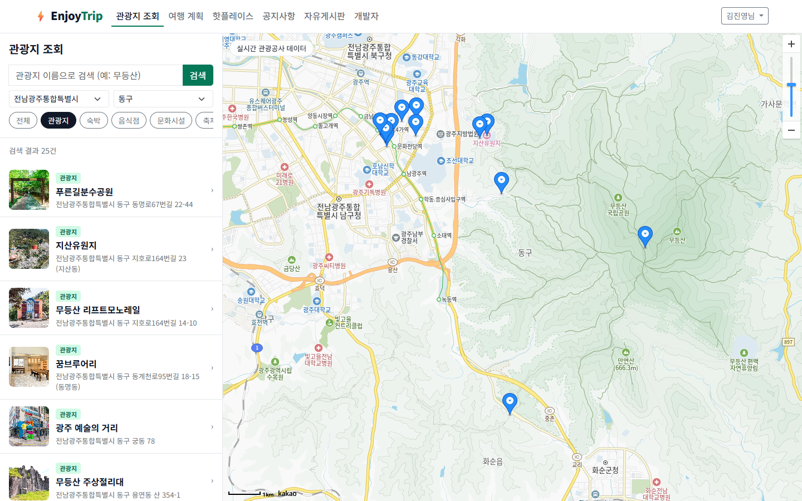
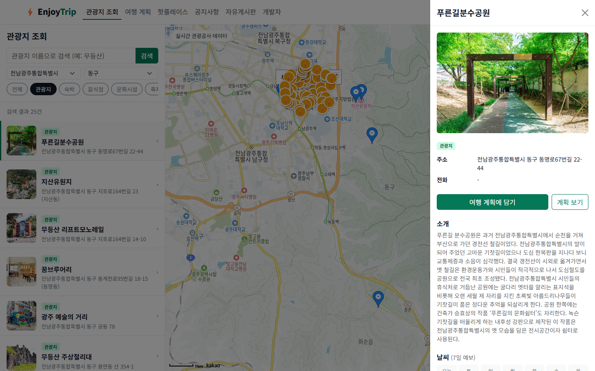
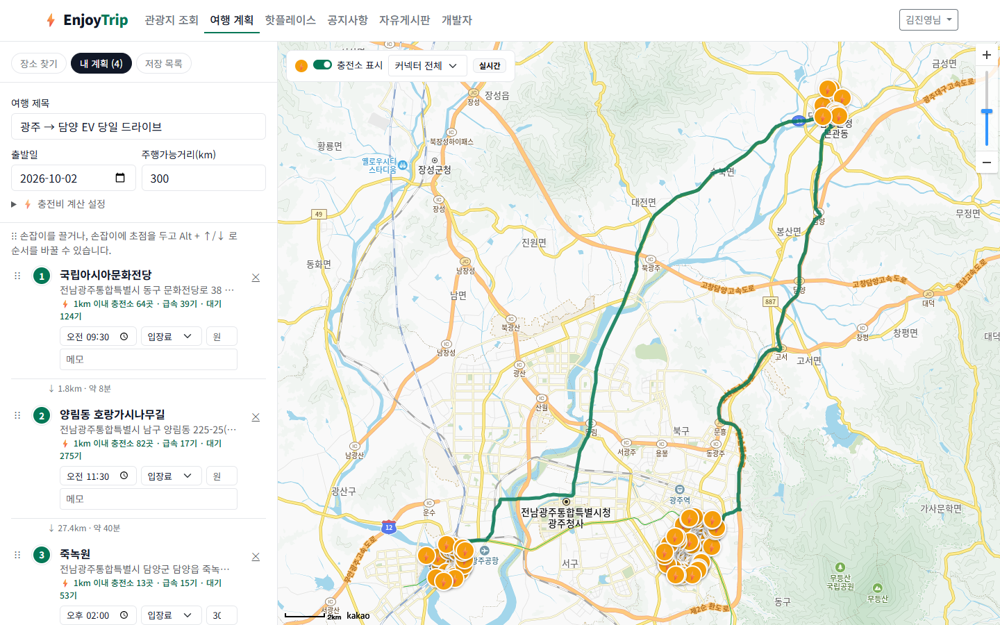
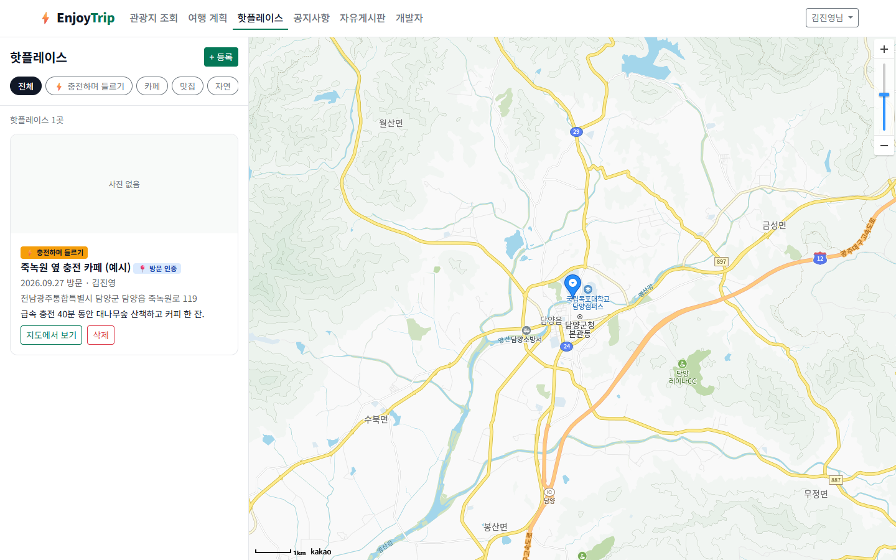
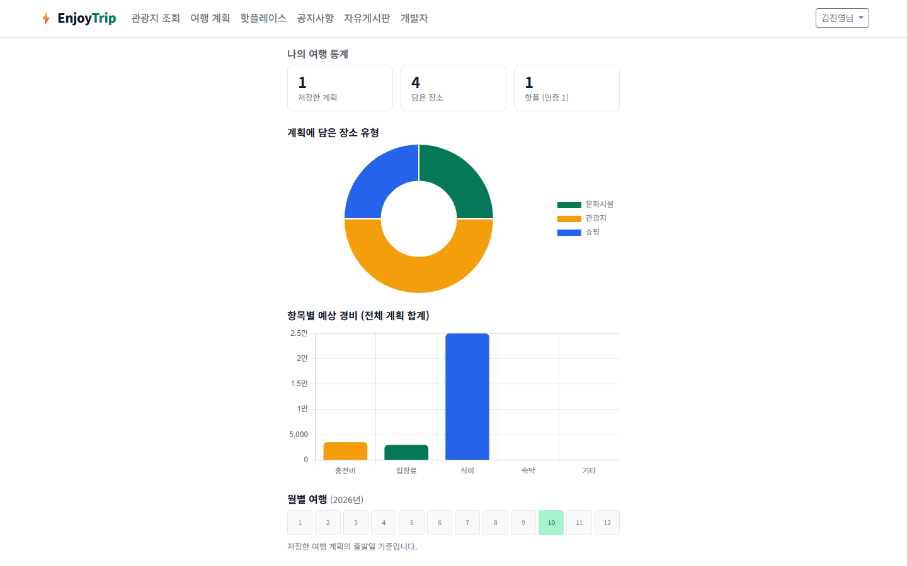
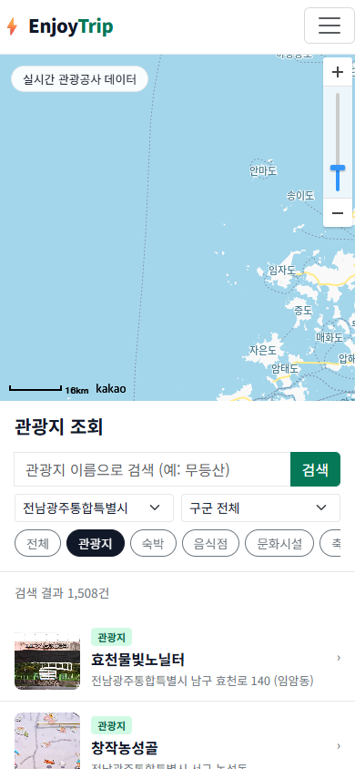

# 3차 · EnjoyTrip EV

관광지를 고르면 동선에 맞춰 전기차 충전소까지 챙겨 주는, 백엔드 없는 멀티 페이지 웹 여행 플래너입니다.

## 프로젝트 정보

| 항목 | 내용 |
|---|---|
| 진행 차수 | 3차 관통 프로젝트 (Web Front) |
| 진행 기간 | 2026-10-02 |
| 팀원 | 김진영 (팀장 · 지도·여행 데이터), 강상민 (회원·커뮤니티) |
| 원본 저장소 | [SSAFY GitLab](https://lab.ssafy.com/kjy164777/trip_frontend_gwangju_03) |
| 화면 설계 | Figma「EnjoyTrip EV - 화면 설계 (광주 3반)」 — 컬러 토큰·컴포넌트와 화면 11개 |

## 목표

- 한 주 동안 배운 HTML5·CSS3·JavaScript(DOM, 이벤트, Promise·fetch, 모듈)만으로 동작하는 웹 서비스를 만든다.
- 1차의 공공 관광데이터와 2차의 웹 UI를 이어받아, **실제 공공 API 5종을 브라우저에서 직접 연동**한다.
- 1차에서 데이터로만 다뤘던 전기차 충전소를 **여행 동선과 결합**해 "충전 걱정 없는 드라이브 여행"이라는 팀 컨셉을 구현한다.
- Figma로 먼저 설계하고(디자인 토큰 → CSS 변수), Bootstrap 5로 반응형 UI를 구축한다.
- AI를 '제3의 팀원'(분석가·리뷰어·테스트 파트너)으로 쓰고, 활용 내역을 커밋 메시지에 남긴다.

## 주요 기능

| 요구사항 | 기능 | 구현 내용 |
|---|---|---|
| F101~F103 | 관광지 조회 | 법정동 시도·구군 + 8개 콘텐츠 유형 + 키워드, 목록·카카오맵 마커 연동, 상세 개요 |
| F104 | 여행 계획 | 담기, 드래그 앤 드롭·키보드 순서 변경, 카카오모빌리티 도로 경로·소요 시간, 항목별 경비 + 충전비 자동 계산, 저장·불러오기, Markdown 내보내기 |
| F105 | 핫플레이스 | 지도 클릭·주소로 위치, 사진(800px 리사이즈·EXIF 제거), 사진 GPS 기반 **방문 인증**(1km 이내) |
| F107·F108 | 회원 | 가입(실시간 유효성·중복 확인), 로그인·로그아웃, 비밀번호 찾기, 정보 수정·탈퇴, Chart.js 여행 통계 |
| F109·F110 | 커뮤니티 | 공지사항(관리자)·자유게시판 CRUD, 검색, 페이지네이션, 작성자 권한 |
| F111~F113 | 날씨·사진·일출일몰 | Open-Meteo 7일 예보·일출일몰, 관광공사 추천 사진(공공누리 1·3유형), 일몰 이후 도착 경고 |
| F114 | 전기차 충전소 | 한국환경공단 실시간 API — 반경 1km 충전소·충전기 상태, 커넥터 필터, 주행가능거리 70% 기준 **충전 추천 지점** |
| F115 | 개발자 소개 | 팀원 역할 분담, 사용 기술, 페이지 구성 |
| F106 | 뉴스 크롤링 | ❌ 서버·DB 가 필요해 백엔드 단계로 이관 |

전체 요구사항(비기능 NF101~NF107 포함)과 상태: [docs/requirements.md](docs/requirements.md)

## 기술 스택

- Frontend: HTML5, CSS3, JavaScript (ES Module), Bootstrap 5, Chart.js, exifr
- Backend: 없음 (데이터는 `localStorage`)
- 외부 API: 한국관광공사 KorService2, 한국환경공단 전기차 충전소, Kakao Maps JavaScript SDK, 카카오모빌리티 길찾기, Open-Meteo
- Design: Figma (변수·텍스트 스타일·컴포넌트), Noto Sans KR
- Test·Tool: 크롬 DevTools Protocol 기반 화면 캡처·시연 영상 자동화 스크립트, ffmpeg, edge-tts

## 실행 화면

### 1. 관광지 조회



시도·구군과 유형 칩으로 관광지를 찾으면 목록과 카카오 지도 마커가 함께 바뀝니다. 2026년 법정동 코드 개편(광주·전남 → `12` 전남광주통합특별시)을 API 응답 그대로 반영했습니다.

### 2. 관광지 상세 — 날씨·사진·충전소



소개, 7일 날씨와 일출·일몰, 관광공사 추천 사진, 반경 1km 전기차 충전소(실시간)를 한 패널에서 보고 바로 여행 계획에 담습니다.

### 3. 여행 계획 + 경로 위 충전소



카카오모빌리티 도로 경로와 구간별 소요 시간, 정류지별 충전소 수와 사용 가능 충전기 수, 주행가능거리 기준 충전 추천 지점, 항목별 경비와 충전비 합계를 보여 줍니다.

### 4. 핫플레이스 — 사진 위치 방문 인증



사진 EXIF 의 GPS·촬영일로 위치와 날짜를 채우고, 등록 위치가 촬영 위치에서 1km 이내면 `📍 방문 인증` 배지를 붙입니다.

### 5. 마이페이지 여행 통계



저장한 계획을 바탕으로 장소 유형 비율, 항목별 경비(충전비 포함), 월별 여행 히트맵을 Chart.js 로 표시합니다.

### 6. 모바일



991px 이하에서는 지도 위·목록 아래 배치로 바뀌고, 375px 에서도 가로 스크롤이 생기지 않습니다.

전체 실행 화면 10장: [docs/screenshots](docs/screenshots/)

### 시연 영상

- [시연 영상 (3분 32초, TTS 내레이션·자막)](docs/demo/enjoytrip-ev-demo.mp4) · [srt 자막](docs/demo/enjoytrip-ev-demo.srt) · [내레이션 대본](docs/demo/narration.md)
- [발표 자료 (pptx, 16장)](docs/EnjoyTrip_EV_발표.pptx)

## 폴더 구조

```text
.
├─ index.html · attraction.html · plan.html · hotplace.html
├─ board.html · board-view.html · board-write.html
├─ login.html · signup.html · mypage.html · find-password.html · developers.html
├─ assets/
│  ├─ css/style.css          Figma 토큰과 같은 이름의 CSS 변수 + 지도 앱형 레이아웃
│  └─ js/
│     ├─ core/               tour-api · ev-api · kakao · route · weather · auth · storage · board · plan-store · layout · util · config
│     └─ pages/              페이지별 스크립트
├─ data/                     API 키가 없을 때 쓰는 더미 관광지·충전소 데이터
├─ scripts/
│  ├─ env.mjs                .env → assets/js/keys.js 생성
│  ├─ screenshots.mjs        실행 화면 자동 캡처
│  └─ demo-video.mjs         시연 영상 자동 제작 (화면 녹화 + TTS)
├─ docs/                     요구사항 명세서, 실행 화면, 시연 영상, 발표 자료
├─ .env.example
└─ README.md
```

## 실행 방법

### 1. 환경 설정

`.env.example` 을 `.env` 로 복사해 키를 넣고, 브라우저용 모듈로 변환합니다. (`.env` 와 생성된 `assets/js/keys.js` 는 커밋하지 않습니다)

| 키 | 용도 |
|---|---|
| `DATA_GO_KR_API_KEY` | 공공데이터포털 — 한국관광공사 국문 관광정보 서비스_GW |
| `EV_API_KEY` (선택) | 충전소 API 를 다른 계정으로 승인받은 경우 그 계정 키 (없으면 위 키 사용) |
| `KAKAO_MAP_KEY` | 카카오 JavaScript 키 — 앱 설정 > 플랫폼 > Web 에 실행 주소 등록 |
| `KAKAO_REST_KEY` (선택) | 카카오모빌리티 도로 경로 (없으면 직선거리) |

```shell
npm run env
```

키가 없거나 API 호출이 실패하면 `data/` 의 더미 데이터로 자동 전환되므로 키 없이도 화면을 확인할 수 있습니다.

### 2. 실행

VS Code Live Server 등으로 이 폴더를 열고 `index.html` 을 엽니다. ES Module 을 쓰므로 `file://` 로 직접 열면 동작하지 않습니다. 공지사항 작성 권한은 아이디 `admin` 으로 가입한 계정에만 있습니다(데모용 규칙).

## 검증 결과

- 관광공사·충전소·카카오맵·길찾기·Open-Meteo 를 실제 키로 호출해 응답 형식과 브라우저 CORS 를 확인했습니다. (예: 국립아시아문화전당 반경 1km 충전소 64곳)
- 회원가입 유효성, 로그인 실패, 정보 수정·탈퇴, 비밀번호 재설정, 게시판 권한(일반 회원의 공지 작성 차단)을 브라우저에서 직접 수행해 확인했습니다.
- 게시글 제목·본문에 `<script>`·`` 를 넣어도 글자로만 출력되는 것(XSS 방지)을 확인했습니다.
- 여행 계획의 드래그 앤 드롭·키보드 순서 변경, 충전비(거리 ÷ 전비 × 단가), 충전 추천 지점 계산을 값으로 검증했습니다.
- 위치 정보가 있는 테스트 사진으로 EXIF 자동 입력·방문 인증, 저장된 사진의 EXIF 제거를 확인했습니다.
- 375px 모바일 폭에서 모든 주요 페이지의 가로 넘침이 없음을 확인했습니다.

알려진 제한사항

- `KAKAO_REST_KEY` 가 브라우저에 노출됩니다. 실서비스라면 서버를 거쳐 호출해야 합니다.
- 충전비 기본 전비(5km/kWh)·단가(347원/kWh)는 예시값입니다.
- 날씨는 Open-Meteo 예보 범위(오늘부터 16일)만 표시합니다.
- 데이터가 브라우저 `localStorage` 에만 있어 기기 간에 공유되지 않습니다.

## 고찰과 다음 개선

- **실제 데이터가 설계를 바꾼다**: 더미 데이터로는 몰랐던 2026년 법정동 코드 개편(광주 29 → 12), 계정별로 다른 공공데이터 인증키, 카카오 도메인 등록 같은 문제를 실제 연동에서 발견했습니다. 지역 코드를 하드코딩하지 않고 API 응답을 신뢰하는 구조로 바꿨습니다.
- **프론트 단독의 한계**: 비밀번호 해시·권한 확인을 클라이언트에서 해도 결국 우회 가능하고, REST 키도 노출됩니다. 다음 차수에서 DB 와 Spring 서버로 인증·권한·키 보관을 옮기는 것이 자연스러운 확장입니다.
- **AI 를 주도적으로 쓰기**: AI 에게 아이디어(컨셉·디자인 후보)와 리뷰를 받되, 실습 예제 코드의 동기 로딩·`var`·좌표 미검증을 비판적으로 고치고, 테스트로 재현한 뒤 반영했습니다. 그 과정을 커밋 메시지의 'AI 활용' 항목으로 남겼습니다.
- **다음 차수에서 이어갈 것**: 회원·계획·핫플·게시판을 관계형 DB 로 옮기고, 뉴스 크롤링(F106)을 서버에서 구현하며, 충전소 마커 클러스터링과 다일(多日) 여행 계획을 추가합니다.

## 관련 문서

- [요구사항 기능 명세서](docs/requirements.md)
- [발표 자료 (pptx)](docs/EnjoyTrip_EV_발표.pptx)
- [시연 영상 내레이션 대본](docs/demo/narration.md)
- [원본 저장소 README 와 커밋 기록 (SSAFY GitLab)](https://lab.ssafy.com/kjy164777/trip_frontend_gwangju_03)
