# EnjoyTrip EV — 알고리즘 PJT

SSAFY 16기 광주 3반 · 관통 프로젝트 4회차 (Algorithm) · 김진영, 최규정, 김정원

- 저장소: https://lab.ssafy.com/comkjo0512/trip_algo_Gwangju_03_KimJinyoung_ChoiGyujeong_KimJeongwon

3회차(Web Front)에서 만든 전기차 드라이브 여행 플래너 **EnjoyTrip EV**에 알고리즘 9개를 적용했습니다.

| # | 적용 서비스 | 알고리즘 | 시간 복잡도 |
|---|---|---|---|
| 1 | 여행 계획 **방문 순서 자동 최적화** | Held-Karp 비트마스크 DP (경유지 15곳 이하, 최적해) / 최근접 이웃 + 2-opt (16곳 이상, 근사해) | O(n²·2ⁿ) / O(n²·반복 횟수) |
| 2 | 배터리 잔량을 고려한 **충전소 경유 경로** | Dijkstra (충전 정책을 반영한 그래프 모델, 회랑·급속 필터로 정점 축소) | O(V²) |
| 3 | 회원 **비밀번호 안전 저장** | PBKDF2-HMAC-SHA256 직접 구현 + salt + pepper + 키 스트레칭 | O(반복 횟수) |
| 4 | 검색창 **자동완성 (초성 검색 포함)** | Trie + 노드별 Top-K 캐시 | 조회 O(P + K) |
| 5 | 관광지 **키워드 검색과 하이라이트** | KMP 문자열 검색 | O(N + M) |
| 6 | 관광지 목록 **다중 조건 정렬** | TimSort 직접 구현 (자연 run, 이진 삽입 정렬, run 스택 병합) | O(n log n), 정렬된 입력 O(n) |
| 7 | 취향·거리·충전 편의 기반 **관광지 추천** | 코사인 유사도 + 격자 공간 인덱스 + Top-K 최소 힙 | O(N log K) |
| 8 | **실제 도로 거리** 반영 | 카카오모빌리티 길찾기 + 캐시 + 실패 시 대체 (`DistanceCalculator` 교체) | 호출 n(n-1)/2 회 |
| 9 | **오타 허용 검색** ("국림공원" → 국립공원, 한/영 전환 오타) | 자모 단위 편집 거리 DP + 자모 3-gram 역색인 필터 + 두벌식 오토마타 | 후보당 O(M·N) |

#1·#2는 처음 기획한 핵심 기능이고, #3~#8은 강사님이 예시로 든 주제(비밀번호 보호, 자동 검색어, 패턴 매칭, 정렬, 추천, 하버사인 대신 도로 거리)를 EV 여행 서비스에 맞게 구현한 것입니다. #9는 KMP(#5)가 정확히 같은 글자만 찾는 한계를 DP(편집 거리)로 보완했습니다.
명세서의 목표인 "Big-O 이론 분석과 성능 테스트를 통한 정확도·시간·메모리 평가"는 알고리즘마다 [성능 측정](#성능-측정)으로 확인했습니다.
**각 알고리즘을 왜 골랐는지, 다른 방법은 왜 안 썼는지, 언제 바꿔야 하는지**는 [알고리즘 선택 근거](docs/algorithm-decisions.md)에 정리했습니다(예상 질문과 답변 포함).

모든 알고리즘은 **다음 BackEnd 관통에서 그대로 쓸 수 있도록** Spring 등 프레임워크에 의존하지 않는 순수 Java 모듈 `algorithm-core`로 분리했습니다(런타임 의존성 없음, Java 8 문법). MVC의 Model(서비스·유틸) 계층에 해당하며, 그 자체로 단위 테스트할 수 있습니다.
레포는 Maven 멀티 모듈이고, `backend`(Spring Boot 3.5) 모듈이 `algorithm-core`를 의존성으로 가져다 `@Bean`으로 등록해 REST API와 시연 페이지를 제공합니다. 자세한 구조는 [프로젝트 구조](#프로젝트-구조)와 [BackEnd 구조](#backend-구조)에 있습니다.

## 알고리즘을 적용한 곳

3회차 프론트의 여행 계획(F104)과 충전소(F114)에는 다음 문제가 있었습니다.

| 기존 기능 | 문제 | 적용 알고리즘 |
|---|---|---|
| F104 여행 계획: 담은 장소의 방문 순서 | 사용자가 드래그 앤 드롭으로 순서를 직접 정함. 장소가 많아지면 동선이 꼬여 같은 길을 오가게 됨 | #1 방문 순서 최적화 (TSP) |
| F114 충전소: 충전 추천 지점 | "주행 가능 거리의 70%를 지나면 충전" 같은 고정 규칙. 충전소 위치·출력이나 실제 잔량을 고려하지 않아 불필요하게 충전하거나, 충전소가 드문 구간에서 잔량이 부족할 수 있음 | #2 충전소 경유 경로 (Dijkstra) |
| F107·F108 회원가입·로그인 | 3회차는 백엔드가 없어 비밀번호를 브라우저 저장소에 그대로 저장 | #3 비밀번호 해시 |
| F101 관광지 조회: 검색 | 지역·유형 필터만 있고 이름으로 찾을 수 없음. 한글 초성 입력 미지원 | #4 자동완성, #5 KMP 검색 |
| F101 관광지 조회: 목록 순서 | API가 준 순서 그대로. 가까운 순·충전소 많은 순 정렬 없음 | #6 TimSort |
| (신규) 관광지 추천 | 어디를 갈지 정하지 못한 사용자에게 제안할 기능이 없음 | #7 추천 |
| F104·#1·#2 거리 계산 | 직선거리 × 1.3 근사는 섬·해안에서 실제 도로 거리와 크게 다름 | #8 도로 거리 |
| #5 키워드 검색 | 한 글자만 틀려도("국림공원") 결과가 0건. 한/영 전환을 잊고 친 "ekadid"도 못 찾음 | #9 오타 허용 검색 |

두 알고리즘은 `EvTripPlanner`에서 하나의 흐름으로 묶입니다. 방문 순서를 먼저 정하고(#1), 정해진 순서의 각 구간에 충전소를 끼워 넣습니다(#2). 앞 구간에 도착했을 때의 잔량이 다음 구간의 출발 잔량이 됩니다.

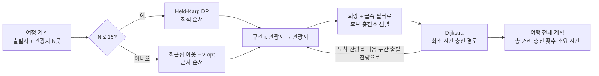

---

## 알고리즘 적용 기획서 #1

- **내용**: 비트마스크 DP와 2-opt를 이용한 여행 계획 방문 순서 자동 최적화 서비스
- **적용 알고리즘**: Held-Karp 알고리즘 (비트마스크 동적계획법), 최근접 이웃 + 2-opt 지역 탐색

### 알고리즘 개요

여러 관광지를 한 번씩 들르는 가장 짧은 순서를 찾는 문제는 **외판원 문제(TSP)** 입니다. 경유지가 n곳이면 가능한 순서가 n!개라서 모두 비교하는 완전탐색은 n=10만 돼도 약 363만 가지를 확인해야 합니다.

- **Held-Karp (비트마스크 DP)**: `dp[mask][j]` = 출발지에서 시작해 집합 `mask`에 속한 관광지를 모두 들르고 관광지 `j`에서 끝나는 최소 거리. 방문한 순서가 아니라 **방문한 집합과 마지막 위치**만 상태로 두기 때문에 같은 부분 문제를 다시 풀지 않습니다.
  `dp[mask | (1<<k)][k] = min(dp[mask][j] + dist[j][k])` 로 채우고, 마지막 위치를 기록한 `parent` 배열로 경로를 복원합니다.
  시간 O(n²·2ⁿ), 메모리 O(n·2ⁿ). 최적해가 보장됩니다.
- **최근접 이웃 + 2-opt**: 경유지가 많아 DP 테이블이 감당할 수 없으면, 매번 가장 가까운 미방문 관광지로 가는 탐욕법으로 초기 경로를 만들고, 두 간선 (a,b)·(c,d)를 (a,c)·(b,d)로 바꿨을 때 짧아지면 그 사이 구간을 뒤집는 2-opt를 개선이 없을 때까지 반복합니다. 경로가 교차하는 부분이 풀립니다. 최적해 보장은 없지만 아래 측정에서 최적해 대비 평균 +1% 안쪽이었습니다.

### 적용 서비스: 여행 계획 "순서 최적화" 버튼

여행 계획에 관광지를 담은 뒤 "순서 최적화"를 누르면 출발지에서 가장 짧게 도는 순서로 바꿔 줍니다. "출발지로 돌아오기"를 켜면 순환 경로(당일치기·숙소 복귀), 끄면 열린 경로(마지막 관광지에서 종료)로 계산합니다.

### 적용 서비스 개발 개요

- `RouteOptimizer.optimize(start, stops, returnToStart)`가 진입점입니다. 출발지를 0번으로 고정한 (n+1)×(n+1) 거리 행렬을 한 번 만든 뒤, 경유지 수에 따라 방법을 고릅니다.
  - 0~1곳: 계산하지 않음 (`TRIVIAL`)
  - 2~15곳: Held-Karp (`HELD_KARP`). n=15에서 DP 테이블이 약 5.6MB, 수 ms 안에 끝나 API 응답에 부담이 없습니다.
  - 16곳 이상: 최근접 이웃 + 2-opt (`NEAREST_NEIGHBOR_2OPT`). 500곳도 20ms 안팎입니다.
  - 기준값 15는 생성자 인자로 바꿀 수 있고, 메모리 폭증을 막기 위해 최대 20으로 제한합니다.
- DP 전이는 남은 관광지 집합 `full & ~mask`에서 `Integer.numberOfTrailingZeros`로 비트를 하나씩 꺼내 순회해, 이미 방문한 관광지를 건너뛰는 비용을 없앴습니다. 열린 경로·순환 경로 차이는 마지막에 출발지 복귀 거리를 더하는지만 다릅니다.
- 2-opt는 열린 경로의 마지막 구간을 뒤집을 때 뒤쪽 간선이 없다는 점을 따로 처리했습니다. 출발지(인덱스 0)는 항상 고정입니다.
- 거리는 `DistanceCalculator` 인터페이스로 분리했습니다. 기본 구현 `HaversineDistance`는 하버사인 공식 직선거리에 우회 계수 1.3을 곱해 도로 거리를 근사합니다. BackEnd에서 카카오모빌리티 길찾기 결과로 바꿔 끼울 수 있습니다.
- 검증: 무작위 실제 좌표 400건(n=1~9, 열린/순환)에서 **Held-Karp 결과가 완전탐색 최적값과 모두 일치**했고, 근사 결과는 항상 모든 관광지를 한 번씩 방문하는 순열이며 2-opt가 최근접 이웃보다 길어지지 않음을 테스트로 확인했습니다.

---

## 알고리즘 적용 기획서 #2

- **내용**: Dijkstra 알고리즘을 이용한 전기차 충전소 경유 최소 시간 경로 서비스
- **적용 알고리즘**: Dijkstra 최단 경로 (조밀 그래프용 O(V²) 배열 구현) + 회랑·출력 기반 후보 축소

### 알고리즘 개요

Dijkstra 알고리즘은 간선 가중치가 음수가 아닌 그래프에서 한 출발점으로부터 각 정점까지의 최단 거리를 구합니다. 아직 확정되지 않은 정점 중 거리가 가장 짧은 정점을 확정하고, 그 정점에서 나가는 간선으로 이웃의 거리를 갱신(relax)하는 과정을 반복합니다.

전기차 경로를 그래프로 바꾸는 방법은 다음과 같습니다.

- **정점**: 출발지, 후보 충전소, 도착지
- **간선 u→v**: u를 떠날 때의 잔량(SOC)으로 v까지 가도 **최소 잔량(기본 10%) 이상이 남을 때만** 존재
- **가중치**: 주행 시간 + (v가 충전소면) 목표 잔량(기본 80%)까지 충전 시간 + 충전 1회 고정 소요 시간(5분)

충전소에서는 **항상 목표 잔량까지 충전하고 떠난다**는 정책을 두면, 충전소를 떠날 때 잔량이 어떤 경로로 왔든 같아집니다. 그래서 간선 가중치가 (u, v)만으로 정해지고 모두 0 이상이므로, 잔량을 상태에 넣지 않고도 Dijkstra로 최적해를 구할 수 있습니다. 단, 이 최적은 **탐색한 후보 충전소 집합 안에서**의 최적입니다(아래 필터 참고). 도착했을 때 이미 목표 잔량 이상인 충전소는 들를 이유가 없어 간선을 만들지 않습니다.
충전 시간은 충전소 출력과 차량 최대 출력 중 낮은 값으로 계산해서(80%까지 선형 근사), 같은 위치라면 출력이 높은 급속 충전소를 고르게 됩니다.

### 적용 서비스: 여행 계획 "충전 계획" (구간별 충전소 자동 추천)

여행 계획에서 차량 정보(배터리 용량·전비)와 출발 잔량을 입력하면, 각 구간에 들러야 할 충전소, 그곳에 도착했을 때 잔량, 충전 시간, 최종 도착 잔량을 알려 줍니다. 잔량으로 충분한 구간은 충전하지 않고, 어떤 충전소로도 도착할 수 없으면 "도달 불가"로 표시합니다.

### 적용 서비스 개발 개요

- `EvRoutePlanner.plan(origin, destination, startSoc, stations, vehicle)`이 진입점입니다. 차량 제원과 충전 정책은 `VehicleSpec`(배터리 kWh, 전비 km/kWh, 최대 충전 kW, 최소·목표 잔량, 평균 속도, 충전 효율, 1회 고정 소요 시간)으로 받습니다.
- **충전소 8,072곳(광주·전남 실데이터)** 을 모두 정점으로 두면 간선이 최대 V²≈6,500만 개입니다. 간선 리스트를 만들지 않고 필요할 때 거리를 계산하는 **암묵적 그래프**로 두었고, 간선이 V²에 가까운 조밀 그래프라 우선순위 큐(O(E log V) = O(V² log V)) 대신 **배열에서 최솟값을 찾는 O(V²) Dijkstra**를 썼습니다. 작업 메모리는 정점 수에 비례하는 배열 4개(O(V))뿐입니다.
- 탐색 전에 정점 수를 줄이는 필터 두 가지를 적용합니다.
  1. **회랑 필터**: `출발지→충전소→도착지` 거리가 직행 거리보다 `max(직행×30%, 20km)` 넘게 길어지는 충전소를 제외 (타원 영역)
  2. **급속 필터**: 출력 50kW 미만 완속 충전소를 제외 (여행 중 경유 충전은 급속 위주라는 가정)
  - 필터를 통과한 후보로 경로가 없을 때만 **회랑 안 전체(완속 포함) → 전체 충전소** 순으로 넓혀 다시 탐색하므로, 필터 때문에 갈 수 있는 길을 못 찾는 경우는 생기지 않습니다.
  - 반대로 필터 후보로 경로가 **있으면** 그대로 돌려주므로, 필터에서 빠진 충전소를 거치는 더 빠른 경로가 있어도 찾지 않습니다. 즉 기본 설정은 **도달 가능성은 보장하지만, 전체 충전소 기준 최소 시간은 보장하지 않습니다**(테스트에 회랑 밖 350kW 충전소가 더 빠른 예시를 넣었습니다). 실데이터 무작위 179쌍에서는 전체 탐색과 결과가 모두 같았습니다. 전체 기준 최적이 꼭 필요하면 `new EvRoutePlanner(distance, Double.POSITIVE_INFINITY, 0, 0)` 으로 필터를 끄면 됩니다(쌍당 수 초).
  - 데모 시나리오(11개 구간) 기준으로 계산 시간이 약 0.96초 → 0.11~0.12초로 줄었고, 결과(총 소요 시간)는 같았습니다.
- 넓힌 탐색은 느리므로(전체 충전소 기준 수 초), 출발지에서 닿는 충전소가 없거나 도착지에 닿는 충전소가 없는 명백한 불가능 입력은 탐색 전에 O(V) 사전 검사로 바로 "도달 불가"를 돌려줍니다.
- 여러 관광지를 도는 여행은 `EvTripPlanner`가 #1로 순서를 정한 뒤 구간마다 이 플래너를 호출하고, 앞 구간 도착 잔량을 다음 구간 출발 잔량으로 넘깁니다.
- 검증: 손으로 계산한 기대값(충전소 도착 잔량 12.5%, 충전 40.5분, 도착 잔량 42.5% 등)과 일치하는지 확인했고, 무작위 300건에서 **충전소 방문 순서를 모두 시도하는 완전탐색(DFS)의 최소 시간과 Dijkstra 결과가 모두 일치**했습니다.

---

## 알고리즘 적용 기획서 #3

- **내용**: PBKDF2 키 스트레칭과 salt·pepper를 이용한 회원 비밀번호 안전 저장 서비스
- **적용 알고리즘**: PBKDF2-HMAC-SHA256 (RFC 8018) 직접 구현, 사용자별 salt, 서버 pepper

### 알고리즘 개요

비밀번호는 평문으로 저장하면 안 되고, 되돌릴 수 없는 **단방향 해시**로 저장해야 합니다. 그런데 해시만 쓰면 두 가지 공격에 약합니다.

- **레인보우 테이블**: 해시는 같은 입력이면 같은 출력이 나오므로, 자주 쓰는 비밀번호의 해시를 미리 계산해 두고 유출된 해시와 비교하면 평문을 알아낼 수 있습니다. → 사용자마다 다른 난수 **salt**를 비밀번호에 붙여 해시하면, 같은 비밀번호라도 해시가 달라져 미리 만든 테이블이 쓸모없어집니다. salt는 비밀이 아니라서 해시와 함께 저장합니다.
- **무차별 대입**: 해시 함수는 원래 빠른 탐색용이라 1초에 수십억 번 계산할 수 있습니다. → **키 스트레칭**: 같은 연산을 수십만 번 반복해 해시 한 번에 드는 비용을 일부러 키웁니다. PBKDF2는 `Ti = U1 ^ U2 ^ … ^ Uc`, `U1 = HMAC(P, salt || i)`, `Uj = HMAC(P, U(j-1))` 를 c번(반복 횟수) 계산합니다.
- **pepper**: 서버 설정(환경 변수)에만 있는 공용 비밀 값입니다. DB만 유출되면 pepper를 몰라 해시를 다시 계산할 수 없습니다.

PBKDF2, bcrypt, scrypt, Argon2 같은 함수를 KDF(Key Derivation Function)라고 부릅니다. 메모리를 많이 쓰게 해 GPU 병렬 공격을 막는 Argon2가 가장 권장되지만, JDK에 없어 외부 라이브러리가 필요합니다. 이번에는 의존성 없이 원리를 구현할 수 있는 PBKDF2를 직접 만들었습니다.

### 적용 서비스: 회원가입·로그인

회원가입 때 `pbkdf2_sha256$600000$salt$hash` 형식의 문자열만 DB에 저장하고, 로그인 때 입력한 비밀번호를 같은 salt·반복 횟수로 다시 계산해 비교합니다.

### 적용 서비스 개발 개요

- `Pbkdf2.derive()`: HMAC을 반복하는 PBKDF2를 직접 구현했습니다. **RFC 7914의 공식 테스트 벡터**(반복 1회·80,000회)와 일치하고, JDK 내장 `PBKDF2WithHmacSHA256`과 무작위 200건이 모두 같은지 테스트로 확인했습니다.
- `PasswordHasher`
  - `hash()`: `SecureRandom`으로 16바이트 salt를 만듭니다. pepper는 `HMAC(pepper, 비밀번호)`로 섞고, PBKDF2를 600,000회 반복합니다(OWASP Password Storage Cheat Sheet 권고값).
  - `verify()`: 저장된 반복 횟수와 salt로 다시 계산합니다. 비교에 걸리는 시간으로 정보가 새지 않도록 `MessageDigest.isEqual`로 **상수 시간 비교**를 합니다.
  - `needsRehash()`: 나중에 반복 횟수 기준을 올리면, 로그인에 성공한 순간 새 기준으로 다시 저장할지 판단합니다.
  - 빈 비밀번호와 128자 초과는 거부하고, 형식이 깨진 저장값은 `false`가 아니라 예외로 알립니다.
- BackEnd에서는 pepper를 `ENJOYTRIP_PEPPER` 환경 변수로 주입합니다. Argon2로 바꾸려면 Spring Security의 `Argon2PasswordEncoder`를 쓰면 됩니다.

---

## 알고리즘 적용 기획서 #4

- **내용**: Trie를 이용한 관광지 검색창 자동완성 서비스 (한글 초성 검색 포함)
- **적용 알고리즘**: Trie(접두어 트리) + 노드별 Top-K 캐시

### 알고리즘 개요

Trie는 문자열을 한 글자씩 트리 경로로 저장하는 자료구조입니다. "담양"을 넣으면 루트 → "담" → "양" 노드가 생기고, 같은 접두어를 가진 문자열은 경로를 공유합니다. 접두어 P로 시작하는 문자열을 찾으려면 P의 길이만큼만 내려가면 되므로, 전체 데이터 수와 관계없이 빠릅니다.

자동완성은 결국 "그 접두어 아래의 모든 항목 중 상위 K개"를 보여주는 것입니다. 매번 하위 트리를 모두 돌면 짧은 접두어("광")에서 느려지므로, **각 노드에 점수 상위 K개를 미리 저장**해 두었습니다. 삽입할 때 지나가는 노드마다 목록을 갱신하고(O(L·K)), 조회는 접두어 노드의 목록을 꺼내기만 합니다(O(P + K)).

### 적용 서비스: 관광지 검색창 자동완성

검색창에 입력할 때마다 관광지 이름 후보를 보여줍니다. EV 여행자를 위해 점수는 **반경 3km 안의 급속 충전소 수**로 정해, 충전하기 좋은 곳이 먼저 나옵니다.

### 적용 서비스 개발 개요

- `AutocompleteTrie<T>`: 어떤 타입이든 담을 수 있는 제네릭 Trie입니다. `add(이름, 항목, 점수)`, `suggest(접두어, 개수)`를 제공합니다.
- **단어 단위 검색**: 이름 전체와, 띄어쓰기·괄호로 나뉜 두 번째 이후 단어도 키로 넣습니다. 그래서 "오동도"로도 "한려해상국립공원 (오동도)"를 찾습니다. 같은 항목이 한 노드에 두 번 들어가지 않게 막았습니다.
- **초성 검색**: 완성형 한글을 `(글자 - '가') / 588`로 초성 번호로 바꿔 별도의 초성 Trie에 넣습니다. 입력이 자음으로만 이루어져 있으면 초성 Trie에서 찾습니다(예: "ㄷㅇ" → 담양…).
- 공백·기호를 지우고 소문자로 맞추는 정규화를 넣었습니다.
- 검증: 무작위 이름 2,000개와 질의 500개(초성 포함)에서 **완전탐색(전체 필터 + 정렬)과 결과가 모두 일치**했습니다.

---

## 알고리즘 적용 기획서 #5

- **내용**: KMP 알고리즘을 이용한 관광지 키워드 검색과 하이라이트 서비스
- **적용 알고리즘**: KMP(Knuth-Morris-Pratt) 문자열 검색

### 알고리즘 개요

본문(길이 N)에서 패턴(길이 M)을 찾을 때, 단순 비교는 어긋날 때마다 본문 위치를 한 칸 뒤로 옮겨 처음부터 다시 비교하므로 최악 O(N·M)입니다. KMP는 패턴의 **실패 함수**를 먼저 만듭니다. `fail[i]`는 `pattern[0..i]`에서 접두사이면서 접미사인 가장 긴 부분의 길이입니다. 비교가 어긋나면 본문 위치는 그대로 두고 패턴 위치만 `fail` 값으로 옮기므로, 이미 맞춘 글자를 다시 비교하지 않고 O(N + M)에 모든 등장 위치를 찾습니다.

### 적용 서비스: 관광지 키워드 검색

검색창에서 Enter를 누르면 관광지 이름과 주소 전체에서 키워드가 들어간 곳을 찾고, 찾은 위치를 강조 표시합니다. 자동완성(#4)은 앞부분만 찾지만, KMP는 "국립공원"처럼 이름 중간에 있는 단어도 찾습니다. 나중에 게시판 본문 검색에도 같은 코드를 씁니다.

### 적용 서비스 개발 개요

- `KmpMatcher`: 생성자에서 실패 함수를 한 번 만들고, `findAll(본문)`으로 겹치는 등장까지 모든 시작 위치를 돌려줍니다. 하나의 키워드로 관광지 1,504곳을 모두 검색하므로 실패 함수를 재사용합니다.
- `KeywordSearcher<T>`: 항목에서 검색할 필드(이름, 주소 …)를 우선순위대로 꺼내 검색합니다. 순위는 이름에서 찾은 것 → 등장 횟수가 많은 것 → 더 앞에서 등장한 것 순입니다. 대소문자를 무시하되, 하이라이트 위치가 원문과 맞도록 글자 수가 바뀌지 않는 소문자 변환을 썼습니다.
- 검증: 실패 함수 예제(`ABABCABAB` → `0,0,1,2,0,1,2,3,4`), 겹치는 등장, 그리고 무작위 문자열 2,000건에서 **단순 비교와 결과가 모두 일치**하는지 확인했습니다.

---

## 알고리즘 적용 기획서 #6

- **내용**: TimSort를 이용한 관광지 목록 다중 조건 정렬 서비스
- **적용 알고리즘**: TimSort (하이브리드 안정 정렬: 이진 삽입 정렬 + 병합 정렬) 직접 구현

### 알고리즘 개요

TimSort는 실제 데이터에는 **이미 정렬된 구간이 많다**는 점에서 출발한 하이브리드 정렬로, Python과 Java의 객체 정렬에 쓰입니다.

1. **자연 run 찾기**: 앞에서부터 이미 오름차순인 구간을 run으로 잡고, 엄격한 내림차순 구간은 뒤집습니다.
2. **minRun**: run이 너무 짧으면 minRun(16~32) 길이까지 늘리고, 늘린 부분은 **이진 삽입 정렬**로 정렬합니다. 작은 배열에서는 삽입 정렬이 빠르고 캐시 지역성이 좋습니다. 삽입 위치는 upper bound로 찾아 같은 값의 순서를 지킵니다.
3. **run 스택**: 만든 run을 스택에 쌓고, 위의 세 run 길이가 `A > B + C`, `B > C`를 만족하지 않으면 인접한 두 run을 병합합니다. 비슷한 크기끼리 병합되어 병합 비용이 균형을 이룹니다.
4. **병합**: 왼쪽 run 앞부분 중 오른쪽 첫 원소 이하인 원소(upper bound)와, 오른쪽 run 뒷부분 중 왼쪽 마지막 원소 이상인 원소(lower bound)는 이미 제자리라 건너뛰고, 나머지만 병합합니다.

최악·평균 O(n log n), 이미 정렬된 입력은 비교 n-1번으로 O(n)입니다. 같은 값의 원래 순서가 유지되는 **안정 정렬**입니다.

### 적용 서비스: 관광지 목록 정렬 ("가까운 순 / 충전소 많은 순 / 이름순")

관광지 목록을 기준 위치에서 가까운 순, 주변 급속 충전소가 많은 순, 이름순으로 정렬합니다.

### 적용 서비스 개발 개요

- `TimSort.sort(배열 또는 List, Comparator)`: JDK 구현을 참고해 run 탐지, minRun 계산, 이진 삽입 정렬, run 스택 불변식(2단계 아래까지 검사하는 수정판), 병합 전 범위 줄이기를 구현했습니다. JDK의 galloping(지수 탐색) 모드는 생략했습니다.
- **안정 정렬 활용**: 이름순으로 먼저 정렬한 뒤 거리나 충전소 수로 다시 정렬하면, 기준 값이 같은 관광지끼리는 이름순이 그대로 유지됩니다. 비교 함수를 복잡하게 만들지 않고 다중 조건 정렬을 할 수 있습니다.
- 검증: 크기 14종(0, 1, 31, 32, 33 … 40,000)과 패턴 6종(무작위, 정렬됨, 역순, 톱니, 중복 많음, 앞쪽만 정렬)에서 **JDK `Arrays.sort`와 결과·안정성(같은 키의 원래 순서)이 모두 일치**했습니다. 정렬된 10,000개는 비교를 정확히 9,999번 했습니다.

---

## 알고리즘 적용 기획서 #7

- **내용**: 코사인 유사도와 격자 공간 인덱스를 이용한 취향·거리·충전 편의 기반 관광지 추천 서비스
- **적용 알고리즘**: 코사인 유사도(콘텐츠 기반 추천), 격자(그리드) 공간 인덱스, Top-K 최소 힙

### 알고리즘 개요

- **코사인 유사도**: 관광지를 분류 코드(대·중·소분류, 예: 자연관광 > 자연경관(하천·해양) > 섬) 특징 벡터로 나타냅니다. 사용자 취향 벡터는 찜·방문한 관광지 벡터의 합에 직접 고른 선호 분류를 더해 만듭니다. `cos θ = (u·v) / (|u||v|)`는 두 벡터의 방향(취향)이 얼마나 같은지를 0~1로 나타냅니다. 크기로 나누므로 찜을 많이 한 사람과 적게 한 사람을 공평하게 비교합니다.
- **격자 공간 인덱스**: 지도를 2km 칸으로 나누고 충전소를 칸에 넣어 둡니다. "관광지 반경 3km 안의 급속 충전소 수"를 셀 때 주변 칸만 확인하면 되므로, 모든 충전소와 거리를 계산하지 않아도 됩니다. 최근접 k개 검색은 가운데 칸부터 고리 모양으로 넓혀 가다가, 다음 고리까지의 최소 거리가 현재 k번째 거리보다 멀면 멈춥니다.
- **Top-K 최소 힙**: 1,504곳 전체를 정렬(O(N log N))하지 않고, 크기 K인 최소 힙을 유지하며 더 높은 점수가 나오면 맨 위(가장 낮은 점수)를 바꿉니다. O(N log K)입니다.

### 적용 서비스: 관광지 추천

좋아하는 분류(자연·역사·체험 …)를 고르거나 관광지를 찜하고, "취향 / 가까움 / 충전 편의" 중 무엇을 중요하게 볼지 가중치를 정하면 상위 10곳을 추천합니다. 추천 이유를 보여주도록 세부 점수(취향·가까움·충전)도 함께 돌려줍니다.

### 적용 서비스 개발 개요

- 최종 점수 = 가중 평균(`취향 cos`, `exp(-거리/30km)`, `min(1, 반경 3km 급속 충전소 수 / 5)`). 기준 위치가 없으면 거리 점수는 빼고 계산합니다. 찜한 곳과 제외할 곳은 결과에서 뺍니다.
- `SpotRecommender<T>`: 생성할 때 특징 벡터(단위 벡터)와 충전소 수를 미리 계산합니다. 요청마다 가중치가 바뀌는 경우를 위해 `withWeights()`로 미리 계산한 값을 공유하는 새 추천기를 만듭니다.
- `GridIndex<T>`: 위도에 따라 경도 1칸의 실제 km가 달라지는 점을 반영해 행·열 방향 칸 수를 따로 계산합니다.
- 검증: 무작위 점 3,000개, 질의 200건에서 **격자 반경 검색·최근접 k가 완전탐색과 일치**했습니다. 또 Top-K 힙 결과가 전체 정렬 상위 K와 같은지, 같은 분류를 찜하면 그 분류가 위로 오는지(코사인 1), 충전 가중치만 주면 충전소가 많은 순인지 확인했습니다.

---

## 알고리즘 적용 기획서 #8

- **내용**: 카카오모빌리티 길찾기를 이용한 실제 도로 거리 반영 서비스
- **적용 알고리즘**: 외부 경로 탐색 API + 대칭 캐시(메모이제이션) + 실패 시 대체 계산, 전략 패턴으로 거리 계산 교체

### 알고리즘 개요

하버사인 공식은 위경도로 지구 표면의 직선(대원) 거리를 구합니다. 바다나 산을 가로지르는 "날아가는 거리"라서 실제 도로 거리와 차이가 납니다. 실제 도로 거리는 도로망 그래프에서 최단 경로를 구해야 하는데, 전국 도로망 데이터와 실시간 교통을 직접 다루기는 어렵습니다. 그래서 카카오모빌리티 길찾기 API를 쓰고, 같은 두 지점은 다시 묻지 않도록 결과를 캐시합니다.

### 적용 서비스: 방문 순서 최적화(#1)의 거리 계산

`DistanceCalculator` 인터페이스만 바꿔 끼우면 #1의 거리 행렬이 실제 도로 거리로 만들어집니다. 알고리즘 코드는 그대로입니다.

### 적용 서비스 개발 개요

- `KakaoRoadDistance implements DistanceCalculator`: `GET /v1/directions?origin=…&destination=…&summary=true` 응답의 `routes[0].summary.distance`(m)를 km로 바꿉니다. `result_code`가 0이 아니면(경로 없음 등) 실패로 처리합니다.
- 알고리즘들이 대칭 거리를 가정하므로 (a,b)와 (b,a)를 같은 키로 캐시합니다. 관광지 n곳의 거리 행렬은 n(n-1)/2번만 호출합니다.
- 키 오류, 네트워크 오류, 경로 없음일 때는 하버사인 × 1.3으로 대신 계산합니다. 조용히 넘어가지 않도록 호출 수, 대체 횟수, 마지막 오류를 기록해 응답에 표시할 수 있게 했습니다. REST 키는 코드에 넣지 않고 환경 변수 `KAKAO_REST_KEY`로 받습니다.
- #2 충전 경로는 후보 충전소가 수백 곳이라 쌍마다 API를 호출할 수 없어, 계속 직선 근사를 씁니다(아래 한계 참고).

---

## 알고리즘 적용 기획서 #9

- **내용**: 편집 거리 DP를 이용한 오타 허용 관광지 검색 서비스 ("혹시 ○○을 찾으셨나요?")
- **적용 알고리즘**: 편집 거리(Damerau-Levenshtein, OSA) 동적계획법의 부분 문자열 변형, 자모 3-gram 역색인 필터(q-gram 보조정리), 두벌식 자모 조합 오토마타

### 알고리즘 개요

KMP(#5)는 검색어가 본문에 **정확히 그대로** 있어야 찾습니다. "국림공원"처럼 한 글자만 틀려도 0건입니다. 오타를 허용하려면 "얼마나 비슷한가"를 재야 합니다.

- **편집 거리 DP**: 한 문자열을 다른 문자열로 바꾸는 데 필요한 삽입·삭제·교체(+ 인접 두 글자 맞바꿈)의 최소 횟수입니다. `dp[i][j]` = 검색어 앞 i글자를 본문 앞 j글자에 맞추는 최소 편집 수로 채웁니다. 첫 행을 모두 0으로 두면 "본문 어디서 시작해도 비용 0"이 되어, 검색어와 **가장 가까운 본문의 부분**을 찾습니다(이름 일부만 쳐도 됨). O(M·N)입니다.
- **자모 단위 비교**: 글자 단위로 보면 '림'과 '립'은 그냥 다른 글자지만, 실제 오타는 받침 하나만 틀린 경우가 많습니다. 그래서 한글을 두벌식 자판의 키 입력 단위로 풀어서(국 → ㄱ ㅜ ㄱ, 왕 → ㅇ ㅗ ㅏ ㅇ) 비교합니다. "받침 하나 틀림" = 거리 1이 됩니다.
- **3-gram 필터**: 모든 관광지와 DP를 돌리면 느리므로, 자모 3개씩 묶은 3-gram 역색인으로 후보를 먼저 줄입니다. 편집 한 번은 검색어의 3-gram을 최대 4개 깨뜨리므로, 거리 k 이하인 항목은 검색어의 서로 다른 3-gram 중 최소 (개수 − 4k)개를 반드시 가집니다(q-gram 보조정리). 이 조건을 못 넘는 항목은 답이 될 수 없어 **정답을 놓치지 않고** 제외합니다.
- **두벌식 오토마타**: 한/영 전환을 잊고 친 "ekadid"를 자판 위치대로 ㄷ ㅏ ㅁ ㅇ ㅑ ㅇ 으로 바꾼 뒤, 받침이 다음 모음을 만나면 초성으로 넘어가는 규칙으로 조합해 "담양"으로 되돌립니다.

### 적용 서비스: 관광지 검색의 3단계 처리

1. KMP로 정확히 찾습니다. 있으면 그대로 보여 줍니다.
2. 없고 검색어가 영문이면 한/영 전환 오타로 보고 한글로 바꿔 다시 정확히 찾습니다 ("rnrflqrhddnjs" → 국립공원 8곳).
3. 그래도 없으면 오타 허용 검색으로 가장 가까운 곳들을 보여 주고 "혹시 **국립공원**을 찾으셨나요?"를 띄웁니다. 제안을 누르면 그 말로 다시 검색합니다.

자동완성(#4)도 결과가 없으면 한/영 전환 오타를 고쳐 다시 찾습니다("ekadid" → 담양…).

### 적용 서비스 개발 개요

- `Hangul`: 완성형 한글 ↔ 키 입력 자모 분해·조합. 겹모음·겹받침도 실제로 누르는 키 2개로 나눕니다(뷁 = ㅂ ㅜ ㅔ ㄹ ㄱ). 분해할 때 각 자모가 원문의 몇 번째 글자에서 왔는지 기록해 하이라이트 위치를 계산합니다. 공백·기호는 건너뛰어 띄어쓰기 차이는 오타로 세지 않습니다.
- `EditDistance.bestSubstring()`: 부분 문자열 편집 거리 DP. 경로의 시작 위치를 함께 저장해 "맞은 구간"을 돌려줍니다. 한 행의 최솟값이 허용 거리를 넘으면 그 아래도 넘으므로 계산을 일찍 멈춥니다.
- `FuzzySearcher<T>`: 3-gram 역색인으로 후보를 고르고 DP로 정밀 비교합니다. 허용 거리는 검색어 길이에 비례합니다(자모 3키 이하 0, 7키 이하 1, 12키 이하 2, 그 이상 3). 짧은 검색어에서 엉뚱한 결과가 나오지 않게 하려는 것입니다. 결과는 거리 → 이름 우선 → 이름이 짧은 순입니다.
- 검증: 완성형 11,172자 전부와 무작위 문자열 2,000개의 분해→조합 왕복, 영타 변환 왕복 2,000개, 부분 문자열 편집 거리가 **모든 부분 문자열을 다 비교한 완전탐색과 같은지**(3,000건), 3-gram 필터를 쓴 결과가 **필터 없이 전부 비교한 결과와 같은지**(무작위 오타 500건)를 테스트로 확인했습니다.

---

## 성능 측정

실제 광주·전남 관광지 좌표에서 무작위로 뽑아 측정했습니다. JIT 워밍업 후 여러 번 실행한 중앙값입니다. (Java 1.8.0_192, Windows 11, `sh scripts/run.sh bench`)

차트는 `node scripts/charts.mjs` 로 시연 페이지의 `bench-data.js` 와 `demo-result.js`(backend/src/main/resources/static) 에서 만들고, 시연 페이지의 "결과" 탭에서도 같은 차트를 마우스를 올려 값과 함께 볼 수 있습니다. 파란 막대가 이번에 구현한 알고리즘, 회색 막대가 비교 대상입니다.

### #1 방문 순서 최적화

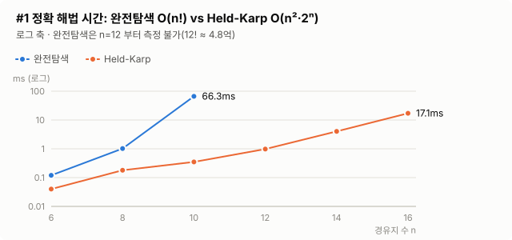

완전탐색 O(n!)과 Held-Karp O(n²·2ⁿ) 비교

| 경유지 n | 완전탐색 (ms) | Held-Karp (ms) | DP 테이블 메모리 |
|---:|---:|---:|---:|
| 6 | 0.12 | 0.04 | 4.5 KB |
| 8 | 1.02 | 0.18 | 24.0 KB |
| 10 | 66.31 | 0.35 | 120.0 KB |
| 12 | - | 0.98 | 576.0 KB |
| 14 | - | 4.03 | 2.6 MB |
| 16 | - | 17.10 | 12.0 MB |

- 완전탐색은 n이 2 늘 때마다 수십 배씩 느려져 n=12부터는 측정에서 뺐습니다(12! ≈ 4.8억). Held-Karp는 n=14에서도 4ms입니다.
- n이 1 늘 때마다 Held-Karp의 메모리가 2배 넘게 늘어나므로(n=20이면 약 240MB), 정확 해법은 15곳까지만 쓰고 그 이상은 근사 해법으로 넘깁니다.

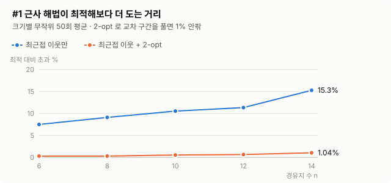

근사 해법 품질 (Held-Karp 최적해 대비 초과 거리, 크기별 50회 평균)

| 경유지 n | 최근접 이웃만 | 최근접 이웃 + 2-opt | 2-opt가 최적해와 같은 비율 |
|---:|---:|---:|---:|
| 6 | +7.50% | +0.29% | 86% |
| 8 | +9.10% | +0.30% | 90% |
| 10 | +10.54% | +0.54% | 76% |
| 12 | +11.34% | +0.65% | 72% |
| 14 | +15.27% | +1.04% | 60% |

- 탐욕법(최근접 이웃)만 쓰면 7~15% 더 돌지만, 2-opt를 더하면 1% 안팎으로 줄어듭니다.

근사 해법 시간 (거리 행렬 생성 포함)

| 경유지 n | 20 | 50 | 100 | 200 | 500 |
|---|---:|---:|---:|---:|---:|
| 시간 (ms) | 0.06 | 0.39 | 1.38 | 3.32 | 18.07 |

### #2 충전소 경유 경로

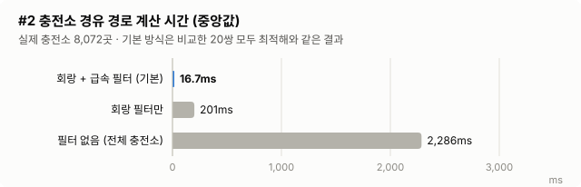

실제 충전소 8,072곳, 무작위 관광지 출발·도착 100쌍, 출발 잔량 20%(충전이 필요한 경우가 많도록 낮게 설정). 필터를 끈 탐색은 쌍당 수 초가 걸려 앞 20쌍에서만 1회씩 측정해 최적해 기준으로 삼았습니다.

| 방식 | 측정 쌍 | 평균 후보 수 | 중앙값 (ms) | 최댓값 (ms) | 최적해와 같은 비율 | 최대 손해 |
|---|---:|---:|---:|---:|---:|---:|
| **회랑 + 급속 필터 (기본)** | 100 | 639 | **16.65** | **264.12** | 20/20 | +0.00% |
| 회랑 필터만 | 20 | 2,686 | 200.76 | 3,207.47 | 20/20 | +0.00% |
| 필터 없음 (전체 충전소) | 20 | 8,072 | 2,286.06 | 5,163.32 | 기준 | - |

- 도달 가능 99/100쌍, 그중 83쌍은 충전이 필요했습니다.
- 정점 수를 1/12 정도로 줄이면 O(V²) 특성대로 시간은 약 1/100 이상 줄었고, 비교한 20쌍 모두 최적해(총 소요 시간)와 같았습니다. 이후 추가로 무작위 159쌍(이 중 120쌍은 120km 이상 장거리, 출발 잔량 12~31%)을 비교했을 때도 모두 같았습니다. 다만 이는 측정 결과이고, 필터 구조상 전체 최적이 보장되지는 않습니다.
- 처음 측정에서는 도달 불가능한 1쌍 때문에 기본 방식의 최댓값이 **18.7초**였습니다. 필터를 통과한 후보로 실패하면 범위를 넓혀 전체 충전소까지 탐색하기 때문입니다. 출발지에서 첫 충전소, 마지막 충전소에서 도착지까지 닿는지 먼저 보는 **O(V) 사전 검사**를 넣어 264ms로 줄였습니다.
- Dijkstra 작업 메모리는 전체 충전소 기준으로도 약 166KB입니다. 간선을 저장하지 않는 O(V) 구조이기 때문입니다.

### #3 비밀번호 해시 (반복 횟수에 따른 해시 1회 시간, `sh scripts/run.sh bench2`)

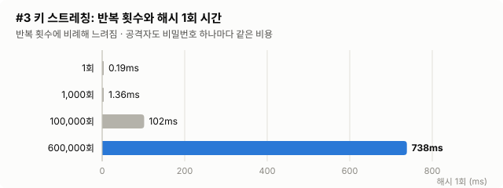

| 반복 횟수 | 해시 1회 (ms) | 공격자가 CPU 1코어로 1초에 시도할 수 있는 비밀번호 수 |
|---:|---:|---:|
| 1 | 0.192 | 약 5,200개 |
| 1,000 | 1.364 | 약 733개 |
| 100,000 | 101.757 | 약 10개 |
| 600,000 | 738.467 | 약 1개 |

- 반복 횟수에 정비례해 느려집니다. 로그인 한 번에 0.7초는 사용자에게는 견딜 만하지만, 공격자에게는 비밀번호 하나를 시도할 때마다 같은 비용이 듭니다.
- Java 8에서 측정한 값입니다. 같은 600,000회가 JDK 25 에서는 약 0.2초였습니다. 서버 성능에 맞춰 반복 횟수를 `enjoytrip.password.iterations` 설정으로 조정할 수 있습니다.

### #4 자동완성 (관광지 1,504곳, 무작위 검색어 2,000개, 초성 25%)

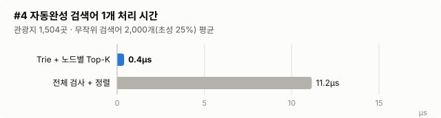

| 방식 | 검색어 2,000개 (ms) | 검색어 1개 평균 (µs) | 복잡도 |
|---|---:|---:|---|
| **Trie + 노드별 Top-K** | **0.79** | **0.40** | O(P + K) |
| 전체 검사 + 정렬 | 22.31 | 11.15 | O(N·P + M log M) |

- 노드 14,577개(일반 + 초성), 만드는 데 32ms가 듭니다. 서버 시작 때 한 번만 만듭니다.

### #5 KMP vs 단순 비교

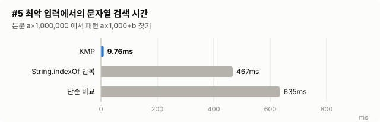

| 입력 | 본문 길이 N | 패턴 길이 M | KMP (ms) | 단순 비교 (ms) | String.indexOf 반복 (ms) |
|---|---:|---:|---:|---:|---:|
| 최악: a…a 에서 a…ab 찾기 | 1,000,000 | 1,001 | **9.76** | 635.06 | 467.47 |
| 실제: 관광지 이름+주소에서 "국립공원" | 49,997 | 4 | 0.74 | 0.68 | 0.02 |

- 앞부분이 계속 맞다가 마지막에 어긋나는 최악 입력에서 KMP는 O(N + M)이라 약 65배 빨랐습니다.
- 실제 주소처럼 짧은 패턴과 어긋남이 빨리 나는 본문에서는 차이가 없고, JDK `indexOf`(내부 최적화)가 가장 빠릅니다. KMP의 장점은 **최악의 경우를 보장**한다는 점입니다.

### #6 정렬 (Integer 100,000개, 비교 횟수 / 시간)

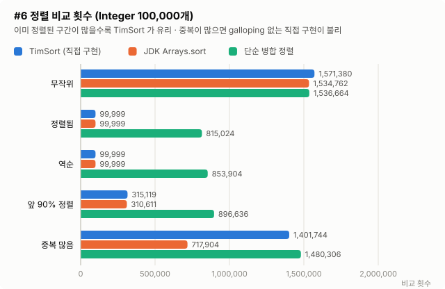

| 입력 | TimSort (직접 구현) | JDK Arrays.sort (TimSort) | 단순 병합 정렬 |
|---|---:|---:|---:|
| 무작위 | 1,571,380회 / 19.5 ms | 1,534,762회 / 49.0 ms | 1,536,664회 / 17.3 ms |
| 정렬됨 | **99,999회** / 1.3 ms | 99,999회 / 0.8 ms | 815,024회 / 4.3 ms |
| 역순 | **99,999회** / 1.0 ms | 99,999회 / 1.0 ms | 853,904회 / 5.0 ms |
| 앞 90% 정렬 + 뒤 10% 무작위 | 315,119회 / 2.2 ms | 310,611회 / 4.8 ms | 896,636회 / 5.1 ms |
| 중복 많음 (값 10종) | 1,401,744회 / 10.8 ms | 717,904회 / 13.3 ms | 1,480,306회 / 8.7 ms |

- 정렬된·역순 입력은 자연 run 하나로 끝나 비교 n-1번입니다. 단순 병합 정렬은 8배 넘게 비교합니다.
- 부분 정렬된 입력에서도 단순 병합 정렬의 1/3 수준으로 비교합니다.
- 중복이 많은 입력에서는 JDK보다 비교가 약 2배 많습니다. 생략한 galloping 모드가 같은 값이 길게 이어질 때 비교를 크게 줄이기 때문입니다.
- 시간은 비교 함수 호출을 세는 Comparator를 쓴 값이라 실제보다 느리고, 측정마다 흔들립니다. 비교 횟수가 더 믿을 만한 지표입니다.

### #7 추천

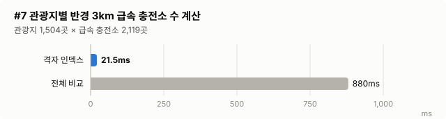

| 방식 | 관광지 1,504곳 × 급속 충전소 2,119곳의 반경 3km 개수 계산 (ms) | 복잡도 |
|---|---:|---|
| **격자 인덱스** (칸 2km, 만들기 12ms 별도) | **21.50** | O(N · 주변 칸의 충전소 수) |
| 전체 비교 | 880.34 | O(N · M) |

- 격자 인덱스로 약 41배 빨라졌습니다.
- 추천 1회(1,504곳 점수 계산)는 Top-10 힙 1.72ms, 전체 순위 정렬 2.10ms입니다. N이 작아 차이는 작지만, 관광지가 늘수록 log N과 log K의 차이가 커집니다.

### #8 도로 거리 (시연 관광지 10곳 + 출발지, 55쌍, 환경 변수 `KAKAO_REST_KEY` 필요)

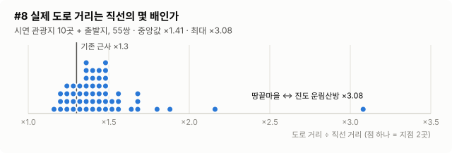

- API 호출 55회(대체 0회)였습니다. 도로/직선 거리 비율은 최소 1.16, **중앙값 1.42, 최대 3.07**로, ×1.3 근사의 평균 오차는 **11.3%** 였습니다. 진도·신안처럼 다리를 돌아가야 하는 섬 구간에서 차이가 컸습니다.
- 순서 최적화 결과를 실제 도로 거리로 쟀더니, 직선 근사로 정한 순서는 703.7km, 도로 거리로 정한 순서는 **693.2km**로 10.5km(1.5%) 짧았습니다. 도로 거리 기준으로는 순천 낙안읍성 → 순천만습지 → 향일암 → 오동도로 순서가 바뀌었습니다.

### #9 오타 허용 검색 (실제 관광지 이름 일부 3~6글자에 자모 오타 1개를 넣은 검색어 1,000개)


| 방법 | 원래 관광지를 찾은 비율 |
|---|---:|
| KMP 정확 일치 | 0.0% |
| **오타 허용 검색 (상위 10개 안)** | **98.5%** |
| 오타 허용 검색 (가장 가까운 거리 묶음 안) | 98.4% |

| 방식 | 검색어 1개 평균 (ms) | 평균 비교 항목 수 |
|---|---:|---:|
| 3-gram 필터 + 편집 거리 | 1.535 | 1,038 |
| 전체 항목 편집 거리 | 2.215 | 1,504 |

- 오타가 하나만 있어도 KMP 는 원래 관광지를 하나도 찾지 못했고, 오타 허용 검색은 98.5% 를 찾았습니다. 나머지 1.5% 는 오타 때문에 다른 관광지 이름과 더 가까워진 경우입니다(예: 짧은 검색어가 다른 이름의 일부와 똑같아짐).
- 3-gram 필터의 효과는 **작았습니다**(비교 대상 1,504 → 평균 1,038곳, 시간 약 30% 감소). 이번 검색어는 3~6글자로 짧은데 허용 오타 수는 길이에 비례해 1~3개라, 필터의 하한(3-gram 개수 − 4 × 허용 오타)이 0 이하가 되어 전부 비교하는 경우가 많기 때문입니다. 검색어가 길수록, 데이터가 많을수록 필터가 크게 줄여 줍니다. 관광지 1,504곳 규모에서는 필터가 없어도 1회 2ms 안팎입니다.

### 실데이터 시연 결과

광주송정역에서 출발해 광주·전남 관광지 10곳을 돌고 돌아오는 여행 (배터리 77.4kWh, 1회 충전 387km, 출발 잔량 60%, `sh scripts/run.sh demo`)

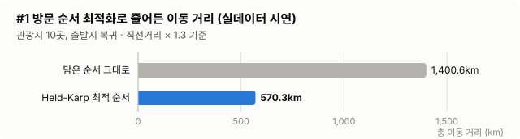

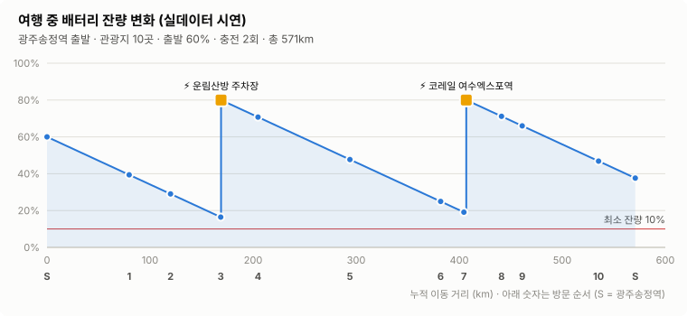

```text
데이터: 관광지 1,504곳, 충전소 8,072곳

[알고리즘 1] 관광지 방문 순서 최적화 (HELD_KARP)
  담은 순서   : 광주송정역 → 죽녹원 → 순천만습지 → 목포 해상케이블카 → 한려해상국립공원 (오동도) → 땅끝마을 → 순천 낙안읍성 → 증도(신안) → 대한다원 → 진도 운림산방 → 향일암(여수) → 출발지 (1400.6 km)
  최적화 순서 : 광주송정역 → 증도(신안) → 목포 해상케이블카 → 진도 운림산방 → 땅끝마을 → 대한다원 → 향일암(여수) → 한려해상국립공원 (오동도) → 순천만습지 → 순천 낙안읍성 → 죽녹원 → 출발지 (570.3 km)
  이동 거리 59.3% 감소

[알고리즘 2] 충전소 경유 계획 (배터리 77.4kWh, 1회 충전 387km, 출발 SOC 60%, 최소 잔량 10%, 목표 80%)
   1. 광주송정역 → 증도(신안) : 79.7 km, 도착 잔량 39.4%, 후보 충전소 622곳
   2. 증도(신안) → 목포 해상케이블카 : 40.1 km, 도착 잔량 29.0%, 후보 충전소 150곳
   3. 목포 해상케이블카 → 진도 운림산방 : 48.7 km, 도착 잔량 16.4%, 후보 충전소 200곳
   4. 진도 운림산방 → 땅끝마을 : 36.2 km, 도착 잔량 70.7%, 후보 충전소 41곳
      ⚡ 운림산방 주차장 (200kW) 16.4% → 80%, 21분
   5. 땅끝마을 → 대한다원 : 89.2 km, 도착 잔량 47.7%, 후보 충전소 214곳
   6. 대한다원 → 향일암(여수) : 88.0 km, 도착 잔량 24.9%, 후보 충전소 290곳
   7. 향일암(여수) → 한려해상국립공원 (오동도) : 22.6 km, 도착 잔량 19.1%, 후보 충전소 124곳
   8. 한려해상국립공원 (오동도) → 순천만습지 : 36.5 km, 도착 잔량 71.2%, 후보 충전소 380곳
      ⚡ 코레일 여수엑스포역 (200kW) 18.5% → 80%, 21분
   9. 순천만습지 → 순천 낙안읍성 : 20.1 km, 도착 잔량 66.0%, 후보 충전소 154곳
  10. 순천 낙안읍성 → 죽녹원 : 74.1 km, 도착 잔량 46.8%, 후보 충전소 486곳
  11. 죽녹원 → 광주송정역 : 35.6 km, 도착 잔량 37.6%, 후보 충전소 620곳

총 570.9 km, 충전 2회, 예상 소요 613분 (주행+충전), 계산 124 ms
```

- 담은 순서 그대로 돌면 1,400km를 넘지만, 순서 최적화로 570km로 줄었습니다(10곳이라 Held-Karp 최적해).
- 출발 잔량 60%로 출발해 진도 운림산방(200kW)과 여수엑스포역(200kW)에서 두 번 충전하면, 모든 구간에서 잔량 10% 이상을 지키며 돌아올 수 있습니다.

---

## 프로젝트 구조

Maven 멀티 모듈입니다. 알고리즘(`algorithm-core`)과 서버(`backend`)를 나눠, 알고리즘을 고치면 백엔드에 바로 반영되고 테스트도 한 번에 돌아갑니다.

```
pom.xml                         ← 부모 POM (Spring Boot 3.5.16 의존성 관리, Java 17)
mvnw, mvnw.cmd, .mvn/           ← Maven Wrapper (Maven 3.9.16 을 처음 실행할 때 자동으로 내려받음)
algorithm-core/                 ← 알고리즘 #1~#9 (런타임 의존성 없음, 다른 프로젝트에서 jar 로 써도 됨)
│ └ src/main/java/com/ssafy/enjoytrip/algorithm/
│     ├── geo/       Location, DistanceCalculator, HaversineDistance, KakaoRoadDistance (#8), GridIndex (#7)
│     ├── route/     RouteOptimizer (#1 Held-Karp / NN + 2-opt), RouteResult
│     ├── ev/        EvRoutePlanner (#2 Dijkstra), EvRoutePlan, VehicleSpec, ChargingStation
│     ├── trip/      EvTripPlanner (#1 + #2 통합), EvTripPlan
│     ├── security/  Pbkdf2, PasswordHasher (#3)
│     ├── search/    AutocompleteTrie (#4), KmpMatcher, KeywordSearcher (#5), FuzzySearcher, EditDistance, Hangul (#9), KoreanText
│     ├── sort/      TimSort (#6)
│     └── recommend/ SpotRecommender (#7)
│ └ src/test/java/              ← 정확성 검증 32개 (완전탐색·JDK·RFC 테스트 벡터와 비교, JUnit 으로 실행)
algorithm-bench/                ← 실데이터 콘솔 시연, 성능 측정, 시연 결과 내보내기 (백엔드에는 포함하지 않음)
backend/                        ← Spring Boot 3.5 백엔드 (아래 BackEnd 구조)
│ └ src/main/resources/static/  ← 시연 페이지 (index.html, style.css, app.js, charts.js, demo-result.js, bench-data.js)
data/                           ← 공공데이터 CSV (관광지 1,504곳 + 분류 코드, 충전소 8,072곳, 분류 이름표)
docs/algorithm-decisions.md     ← 알고리즘 선택 근거 (대안 비교, 바꿀 조건, 예상 질문과 답변)
docs/charts/                    ← README 차트 이미지 (node scripts/charts.mjs 로 생성)
scripts/run.sh, run.ps1         ← 자주 쓰는 명령 모음
```

## 실행 방법

**JDK 17 이상**이 필요합니다(Spring Boot 3.5 는 Java 17~25 지원). Maven 은 따로 설치하지 않아도 `mvnw` 가 처음 실행할 때 내려받습니다. 프로젝트 루트에서 실행합니다.

```bash
sh scripts/run.sh test     # 전체 테스트: algorithm-core 검증 32개 + backend 테스트 13개
sh scripts/run.sh server   # Spring Boot 백엔드 → http://localhost:5520
sh scripts/run.sh demo     # #1·#2 실데이터 콘솔 시연
sh scripts/run.sh bench    # #1·#2 성능 측정 (약 3~4분)
sh scripts/run.sh bench2   # #3~#9 성능 측정 (#8 은 KAKAO_REST_KEY 환경 변수가 있을 때만)
sh scripts/run.sh web      # #1·#2 시연 결과를 시연 페이지 데이터(demo-result.js)로 다시 내보내기
node scripts/charts.mjs    # README 차트 이미지(docs/charts/*.svg) 다시 만들기 (Node 18 이상)
```

Maven 명령을 직접 쓸 때는 `./mvnw verify`(전체 빌드·테스트), `./mvnw -DskipTests package` 후 `java -jar backend/target/backend-0.1.0-SNAPSHOT.jar` 입니다.
Windows PowerShell 에서는 `powershell -ExecutionPolicy Bypass -File scripts\run.ps1 server` 처럼 실행합니다.
STS/IntelliJ 에서는 루트의 `pom.xml` 을 Maven 프로젝트로 가져오면 세 모듈이 함께 열리고, `EnjoyTripApplication` 을 실행하면 됩니다(실행 위치가 `backend` 폴더여도 상위 폴더의 `data` 를 찾습니다).

| 환경 변수 | 필요한 경우 | 없으면 |
|---|---|---|
| `ENJOYTRIP_PEPPER` | 비밀번호 해시에 실제 pepper 를 쓸 때 (운영 필수) | 시연용 pepper 로 동작하고 시작할 때 경고 로그만 남김 |
| `KAKAO_REST_KEY` | `bench2` 에서 #8 도로 거리를 측정할 때 | #8 측정만 건너뜀 |

**시연 페이지** (`sh scripts/run.sh server` 후 http://localhost:5520): 백엔드가 정적 파일로 함께 제공하고, 각 탭이 백엔드 API 를 호출합니다.

| 탭 | 알고리즘 | 해 볼 것 |
|---|---|---|
| 경로·충전 | #1 #2 | 담은 순서와 최적 순서 비교, 구간별 충전 계획, 급속 충전소 2,119곳 겹쳐 보기 (콘솔 시연 결과를 표시) |
| 검색 | #4 #5 #9 | "ㄷㅇ"처럼 초성으로 자동완성, Enter로 "국립공원" 같은 단어를 이름·주소에서 찾고 하이라이트, "국림공원"·"무둥산"·"ekadid"처럼 틀려도 "혹시 ○○을 찾으셨나요?" |
| 추천 | #7 | 좋아하는 분류·찜한 관광지·가중치를 정하고 추천 받기, 지도 클릭으로 기준 위치 변경 |
| 정렬 | #6 | 가까운 순·충전소 많은 순·이름순, 분류 필터 |
| 비밀번호 | #3 | 해시 만들기(같은 비밀번호도 salt로 해시가 달라짐), 맞는/틀린 비밀번호 검증 |
| 결과 | 전체 | 실데이터 시연(배터리 잔량 변화, 이동 거리)과 알고리즘별 성능 측정 차트 12개, 마우스를 올리면 값 표시 |

지도는 API 키가 필요 없는 Leaflet + OpenStreetMap 을 씁니다. 백엔드는 시연용이라 `127.0.0.1` 에만 열리고(`application.yml` 의 `server.address`), 비밀번호는 로그에 남기지 않습니다.

## BackEnd 구조

`backend` 모듈은 EnjoyTrip 실습과 같은 `model/dto · model/dao · model/service` 구성입니다. 데이터는 지금 CSV 를 DAO 인터페이스 뒤에서 읽으므로, BackEnd 관통에서는 **DAO 구현만 MyBatis/JPA 로 바꾸면** 서비스와 컨트롤러는 그대로 씁니다.

```
backend/src/main/java/com/ssafy/enjoytrip/
├── EnjoyTripApplication.java
├── config/      AlgorithmConfig (알고리즘 Bean 등록), EnjoyTripProperties (enjoytrip.* 설정)
├── controller/  AttractionController, TripController, PasswordController, MetaController
├── model/dto/   AttractionDto (Location 상속), 요청·응답 record
├── model/dao/   AttractionDao, ChargingStationDao, CategoryCodeDao + CSV 구현 (CsvAttractionDao …)
├── model/service/ AttractionService (#4 #5 #6 #7 #9), TripPlanService (#1 #2), PasswordService (#3)
└── exception/   GlobalExceptionHandler (IllegalArgumentException → 400, 그 밖 → 500)
```

| 메서드 | URL | 설명 | 알고리즘 |
|---|---|---|---|
| POST | `/api/trips/plan` | 출발지 + 관광지 id 목록 → 최적 방문 순서 + 구간별 충전 계획 | #1 + #2 |
| GET | `/api/attractions/autocomplete?q=` | 검색창 자동완성 (초성 포함, 한/영 전환 오타 복원) | #4 #9 |
| GET | `/api/attractions/search?q=` | 이름·주소 키워드 검색 + 하이라이트 위치. 정확히 없으면 한/영 전환 오타 복원 → 오타 허용 검색 (`mode`, `correctedQuery`, `suggestion`) | #5 #9 |
| GET | `/api/attractions?by=distance` (`chargers`, `name`) | 관광지 목록 정렬, 분류 필터 | #6 |
| GET | `/api/attractions/recommend` | 찜·선호 분류·가중치 기반 추천 | #7 |
| POST | `/api/password/hash`, `/api/password/verify` | 비밀번호 해시 시연 (회원 기능이 생기면 회원가입·로그인 안으로 옮기고 삭제) | #3 |
| GET | `/api/meta` | 분류 목록·데이터 수 (화면 초기화용) | - |

**과도한 요청 방어**: 검색어는 30자까지만 받습니다(오타 허용 검색은 후보마다 검색어 길이에 비례하는 DP 표를 만들기 때문). 비밀번호 해시는 일부러 수백 ms 의 CPU 를 쓰므로 동시에 계산하는 개수를 CPU 코어 수의 절반으로 제한하고, 자리가 없으면 기다리지 않고 바로 429 로 돌려보냅니다(`enjoytrip.password.max-concurrent`). 기다리게 하면 요청 스레드가 묶여 다른 API 까지 멈출 수 있기 때문입니다. 검증할 저장값의 반복 횟수도 서버 설정값까지만 받아, 한 요청이 계산 자리를 오래 차지하지 못하게 합니다. 운영에서는 IP·계정별 요청 횟수 제한도 함께 둡니다.

`/api/trips/plan` 요청 예시 (콘솔 시연과 같은 결과: Held-Karp, 충전 2회, 총 570.9km):

```json
{"start": {"name": "광주송정역", "lat": 35.1378, "lng": 126.7932},
 "attractionIds": ["128834", "126730", "2606207", "128025", "129024", "127931", "575607", "127869", "126375", "127715"],
 "returnToStart": true, "startSoc": 60}
```

**BackEnd 관통에서 남은 일**

1. DB: `attraction`, `ev_station`, `category_code` 테이블을 만들고 `data/*.csv` 를 초기 데이터로 넣은 뒤, `CsvAttractionDao` 등을 MyBatis/JPA 구현으로 바꿉니다.
2. 회원: 회원가입·로그인 API 에서 `PasswordService` 를 쓰고(로그인 성공 시 `needsRehash` 면 다시 저장), 시연용 `/api/password/*` 는 지웁니다. 인증(세션/JWT)은 별도로 필요합니다.
3. 화면: 경로·충전 탭이 콘솔 시연 결과 대신 `/api/trips/plan` 을 호출하도록 바꾸고, 3회차 프론트의 여행 계획·검색 화면도 이 API 를 쓰게 연결합니다.
4. 데이터가 바뀌는 구조가 되면 `AttractionService` 의 Trie·추천기를 새로 만들어 참조를 바꿔 끼우는 갱신 방식을 넣습니다(지금은 시작할 때 한 번 만들고 읽기만 함).

## 한계와 개선 방향

- **거리 근사**: #8로 방문 순서(#1)에는 실제 도로 거리를 쓸 수 있습니다. 하지만 충전 경로(#2)는 후보 충전소가 수백 곳이라 쌍마다 API를 부를 수 없어 직선 × 1.3을 씁니다. 측정 결과 평균 오차가 11%라, 최소 잔량(10%)을 여유분으로 두었습니다. BackEnd에서는 자주 쓰는 구간의 도로 거리를 DB에 캐시해 점차 바꿔 갈 수 있습니다.
- **충전 경로 필터의 최적성**: 기본 설정(회랑 + 급속 필터)은 속도를 위해 후보를 줄이므로, 필터 밖 충전소를 거치는 더 빠른 경로를 놓칠 수 있습니다. 실데이터 179쌍에서는 차이가 없었지만, 보장하려면 필터를 끄거나, 필터 결과를 상한으로 두고 그보다 빨라질 수 없는 충전소만 빼는 방식(가지치기)으로 바꿔야 합니다.
- **TimSort galloping 생략**: 같은 값이 길게 이어지는 입력에서 JDK보다 비교가 약 2배 많습니다. 실제 서비스에서는 JDK `List.sort`를 쓰고, 이 구현은 원리를 이해하고 검증하는 용도로 둡니다.
- **비밀번호 KDF**: PBKDF2는 메모리를 적게 써서 GPU 병렬 공격에 Argon2보다 약합니다. BackEnd에서는 Spring Security의 `Argon2PasswordEncoder`로 바꾸는 것을 검토합니다(저장 형식에 알고리즘 이름이 들어 있어 섞여 있어도 구분할 수 있습니다).
- **추천 데이터**: 지금은 분류 코드만 특징으로 씁니다. BackEnd에서 회원들의 찜·방문 기록이 쌓이면, 비슷한 사용자가 좋아한 곳을 추천하는 협업 필터링을 더할 수 있습니다.
- **구간별 독립 계획**: 여행 전체 충전 계획을 구간마다 따로 세우므로, 앞 구간에서 미리 더 충전해야 다음 구간이 가능한 경우를 놓칠 수 있습니다. 개선하려면 (위치, 잔량 구간)을 정점으로 하는 상태 공간 Dijkstra로 여행 전체를 한 번에 풀어야 합니다.
- **충전 모델 단순화**: 80%까지 선형 충전, 충전소마다 같은 목표 잔량을 가정했습니다. 실시간 충전기 상태(충전 중·고장)는 BackEnd에서 API로 받아 후보에서 빼는 방식으로 반영할 예정입니다.
- **순서 최적화 기준**: 이동 거리만 최소화합니다. 관광지 운영 시간이나 사용자가 고정하고 싶은 순서(예: 마지막은 숙소)는 아직 반영하지 않습니다.

## 데이터 출처

- 한국관광공사_국문 관광정보 서비스_GW (`areaBasedList2`, 법정동 12 전남광주통합특별시, 관광지 유형 / `lclsSystmCode2` 분류 코드)
- 카카오모빌리티 길찾기 API (`/v1/directions`, #8 측정에만 사용, 결과는 저장하지 않음)
- 한국환경공단_전기자동차 충전소 정보 (`getChargerInfo`, zcode 12): 충전기 단위 응답을 충전소(statId) 단위로 묶고, 가장 빠른 충전기 출력을 `maxKw`로 저장
