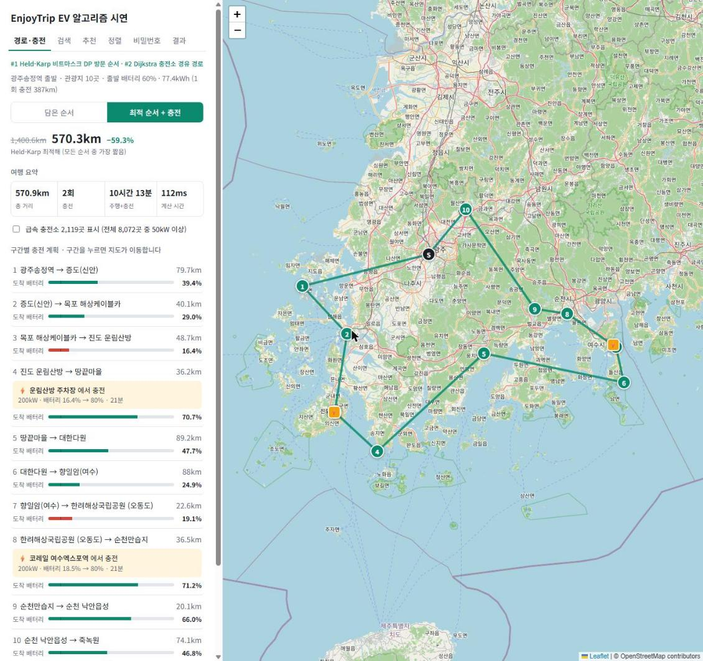
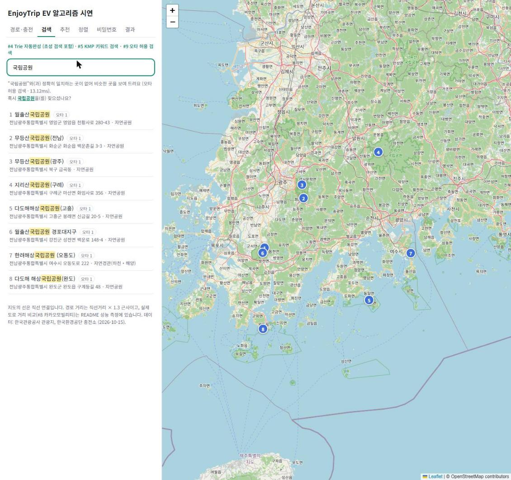
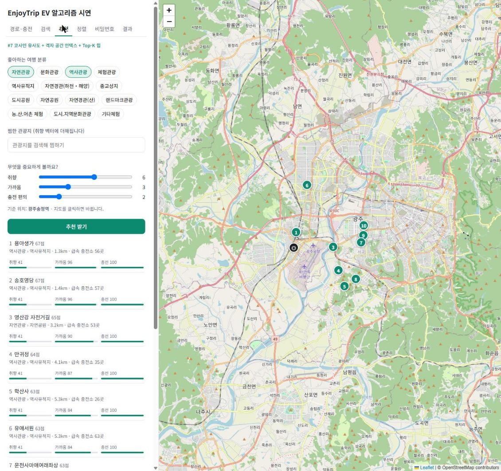
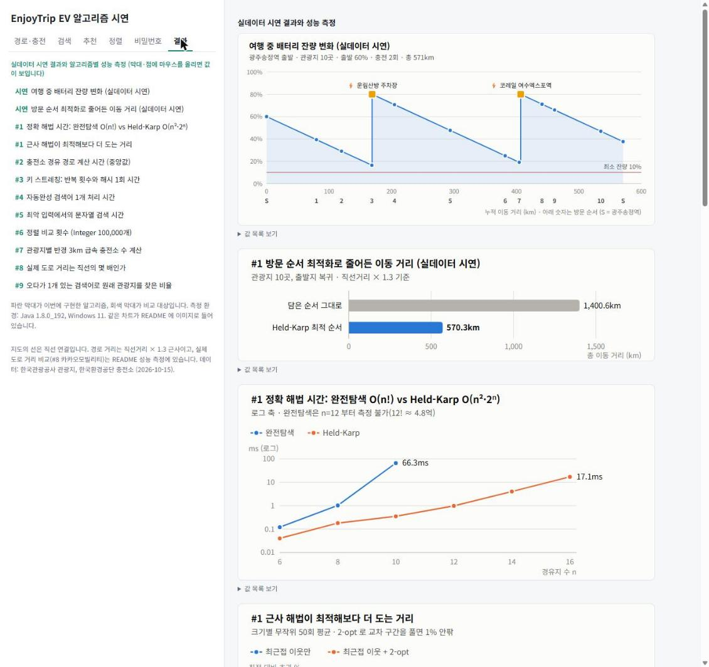

# 4차 · EnjoyTrip EV 알고리즘

3차 전기차 드라이브 여행 플래너에 알고리즘 9개를 적용하고, 다음 BackEnd 관통에서 그대로 쓸 수 있도록 순수 Java 알고리즘 모듈 + Spring Boot 백엔드의 Maven 멀티 모듈로 구성한 프로젝트입니다.

## 프로젝트 정보

| 항목 | 내용 |
|---|---|
| 진행 차수 | 4차 관통 프로젝트 (Algorithm) |
| 진행 기간 | 2026-10-15 |
| 팀원 | 김진영, 최규정, 김정원 |
| 원본 저장소 | [SSAFY GitLab](https://lab.ssafy.com/comkjo0512/trip_algo_Gwangju_03_KimJinyoung_ChoiGyujeong_KimJeongwon) (보관 시점 커밋 `14d0a73`) |

## 목표

- 기존 EnjoyTrip 기능 중 알고리즘이 필요한 곳을 찾아 **알고리즘 2개 이상**을 적용하고, 알고리즘마다 **적용 기획서**(내용·개요·적용 서비스·개발 개요)를 작성한다.
- 자료구조·알고리즘의 시간 복잡도를 이해하고, **Big-O 분석과 성능 측정**으로 정확도·시간·메모리를 평가한다.
- 강사님 안내에 따라 오늘 만든 알고리즘을 **다음 BackEnd 관통에서 재사용**할 수 있도록, 프레임워크에 의존하지 않는 Model 계층으로 만든다.
- 3차에서 사용자가 직접 정하던 방문 순서와 "주행 가능 거리 70% 에서 충전" 같은 고정 규칙을 알고리즘으로 바꾼다.

## 주요 기능

| # | 적용 서비스 | 알고리즘 | 측정 결과 |
|---|---|---|---|
| 1 | 여행 계획 방문 순서 자동 최적화 | Held-Karp 비트마스크 DP (≤15곳) + 최근접 이웃·2-opt | 관광지 10곳 1,400.6km → 570.3km (−59.3%), n=14 4ms |
| 2 | 배터리 잔량을 고려한 충전소 경유 경로 | Dijkstra (배열 O(V²)) + 회랑·급속 필터 | 충전소 8,072곳에서 중앙값 17ms (필터 없이 2.3초) |
| 3 | 회원 비밀번호 저장 | PBKDF2-HMAC-SHA256 직접 구현 + salt + pepper | RFC 7914 테스트 벡터·JDK 결과와 일치 |
| 4 | 검색창 자동완성 (초성 검색) | Trie + 노드별 Top-K | 검색어 1개 0.4µs (전체 검사 11µs) |
| 5 | 키워드 검색과 하이라이트 | KMP | 최악 입력에서 단순 비교보다 65배 빠름 |
| 6 | 관광지 목록 다중 조건 정렬 | TimSort 직접 구현 (안정 정렬) | 크기 14종 × 패턴 6종에서 JDK 정렬과 결과 동일 |
| 7 | 취향·거리·충전 편의 기반 추천 | 코사인 유사도 + 격자 공간 인덱스 + Top-K 힙 | 주변 충전소 계산 880ms → 21.5ms |
| 8 | 실제 도로 거리 반영 | 카카오모빌리티 길찾기 + 캐시 + 실패 대체 | 직선 × 1.3 근사의 평균 오차 11.3%, 섬 구간 최대 3배 |
| 9 | 오타 허용 검색 ("국림공원" → 국립공원) | 자모 단위 편집 거리 DP + 3-gram 필터 + 두벌식 오토마타 | 오타 1개 검색어에서 원래 관광지 찾기 KMP 0% → 98.5% |

백엔드(`backend` 모듈)는 위 알고리즘을 Spring Bean 으로 등록해 REST API(`/api/trips/plan`, `/api/attractions/*`)로 제공하고, 시연 페이지를 함께 띄웁니다.

## 기술 스택

- Frontend: HTML5, CSS3, JavaScript, Leaflet + OpenStreetMap (의존성 없는 SVG 차트 직접 구현)
- Backend: Java 17, Spring Boot 3.5.16 (Web), Maven 멀티 모듈 + Maven Wrapper
- Algorithm: 순수 Java (`algorithm-core`, 런타임 의존성 없음, Java 8 문법)
- Database: 없음 (공공데이터 CSV 를 DAO 인터페이스 뒤에서 읽음 → 다음 차수에서 MyBatis/JPA 로 교체)
- Data: 한국관광공사 관광지 1,504곳 + 분류 코드, 한국환경공단 충전소 8,072곳, 카카오모빌리티 길찾기 (측정용)
- Test·Tool: JUnit 5, Spring MockMvc, 완전탐색·JDK·RFC 테스트 벡터 비교 검증, Node 차트 생성 스크립트

## 실행 화면

### 경로·충전: 방문 순서 최적화(#1)와 충전 계획(#2)



광주송정역에서 관광지 10곳을 도는 여행입니다. 담은 순서(1,400.6km)를 Held-Karp 최적 순서(570.3km)로 바꾸고, 구간마다 배터리를 계산해 진도 운림산방과 여수엑스포역(각 200kW)에서만 충전합니다.

### 검색: 오타 허용 검색(#9)



"국림공원"은 정확히 일치하는 곳이 없어, 자모 단위 편집 거리로 가까운 8곳을 찾고 "혹시 국립공원을 찾으셨나요?"를 보여 줍니다. 맞은 부분은 하이라이트, 각 결과에 오타 수를 표시합니다.

### 추천: 코사인 유사도 + 격자 인덱스(#7)



선호 분류(자연·역사)와 가중치(취향·가까움·충전 편의)로 상위 10곳을 추천하고, 추천 이유가 되는 세부 점수를 막대로 보여 줍니다.

### 결과: 시연·성능 측정 차트



여행 중 배터리 잔량 변화와 알고리즘별 성능 측정 차트 12개입니다. 같은 차트가 [기획서](ALGORITHM-PLAN.md#성능-측정)에 이미지로 들어 있습니다.

## 폴더 구조

```text
.
├─ algorithm-core/      # 알고리즘 #1~#9 (런타임 의존성 없음) + 정확성 검증 32개
├─ algorithm-bench/     # 콘솔 시연, 성능 측정
├─ backend/             # Spring Boot 백엔드 (controller · model/service · model/dao) + 시연 페이지(static)
├─ data/                # 공공데이터 CSV (관광지, 충전소, 분류 코드)
├─ docs/
│  ├─ algorithm-decisions.md   # 알고리즘 선택 근거, 예상 질문과 답변
│  └─ charts/                  # 성능 측정 차트 이미지
├─ scripts/             # run.sh / run.ps1, 차트 생성 스크립트
├─ screenshots/         # 실제 실행 화면
├─ ALGORITHM-PLAN.md    # 알고리즘 적용 기획서 #1~#9 + 성능 측정 (원본 저장소의 README)
├─ pom.xml, mvnw        # Maven 멀티 모듈 + Wrapper
└─ README.md
```

## 실행 방법

### 1. 환경 설정

- **JDK 17 이상** (Spring Boot 3.5 는 Java 17~25 지원). Maven 은 따로 설치하지 않아도 `mvnw` 가 처음 실행할 때 내려받습니다.
- 환경 변수는 모두 선택입니다: `ENJOYTRIP_PEPPER`(없으면 시연용 pepper), `KAKAO_REST_KEY`(#8 도로 거리 측정에만 사용).

### 2. 실행

```shell
cd projects/04-enjoytrip-ev-algorithm
sh scripts/run.sh test     # 전체 테스트: 알고리즘 검증 32개 + 백엔드 테스트 13개
sh scripts/run.sh server   # 백엔드 + 시연 페이지 → http://localhost:5520
sh scripts/run.sh demo     # #1·#2 실데이터 콘솔 시연
sh scripts/run.sh bench    # #1·#2 성능 측정
sh scripts/run.sh bench2   # #3~#9 성능 측정
```

Windows PowerShell 에서는 `powershell -ExecutionPolicy Bypass -File scripts\run.ps1 server` 처럼 실행합니다.

## 검증 결과

- **정확성**: 직접 구현한 알고리즘을 모두 기준과 비교했습니다. Held-Karp = 완전탐색(400건), Dijkstra = 충전소 순서 완전탐색(300건), PBKDF2 = RFC 7914 벡터·JDK(200건), Trie = 필터+정렬 완전탐색(500건), KMP = 단순 비교(2,000건), TimSort = JDK 정렬(84조합, 안정성 포함), 격자 인덱스 = 전체 비교(200건), 편집 거리 = 모든 부분 문자열 비교(3,000건), 3-gram 필터 = 필터 없는 비교(500건).
- **백엔드**: MockMvc 로 API 13개 시나리오 확인. `/api/trips/plan` 결과가 콘솔 시연과 같고(570.9km, 충전 2회), 잘못된 입력은 400, 과도한 요청은 400·429 로 막습니다.
- **성능**: [기획서의 성능 측정](ALGORITHM-PLAN.md#성능-측정)에 표와 차트로 정리했습니다.
- **알려진 제한사항**
  - 충전 경로의 기본 필터는 도달 가능성은 보장하지만 전체 충전소 기준 최소 시간은 보장하지 않습니다(실데이터 179쌍에서는 모두 같았음).
  - 충전 계획을 구간별로 세워, 앞 구간에서 더 충전해야 하는 경우를 놓칠 수 있습니다.
  - 직접 구현한 TimSort 는 galloping 을 생략해 중복이 많은 입력에서 JDK 보다 비교가 약 2배 많습니다.
  - 오타 검색의 3-gram 필터는 짧은 검색어에서 효과가 작습니다(후보 1,504 → 평균 1,038곳).
  - 시연 페이지의 경로·충전 탭은 아직 콘솔 시연 결과를 표시합니다(`/api/trips/plan` 연결은 다음 차수).

## 고찰과 다음 개선

- **배운 점**: 같은 문제라도 입력 규모가 결정을 바꿉니다. 하루 여행 10곳이라는 조건 덕분에 NP-hard 인 TSP 를 정확히 풀 수 있었고, 충전소 8,072곳이라는 규모 때문에 Dijkstra 앞에 후보를 줄이는 단계가 필요했습니다. 상태가 있는 문제(배터리 잔량)도 "충전소에서는 항상 80% 까지 충전"처럼 모델링을 바꾸면 단순한 알고리즘으로 최적을 보장할 수 있었습니다.
- **검증 방식**: 직접 구현한 알고리즘은 "돌아간다"가 아니라 완전탐색·표준 구현과 결과가 같은지로 확인했고, 측정에서 불리한 결과(KMP 보다 빠른 `indexOf`, TimSort 비교 2배, 효과가 작은 필터)도 그대로 기록했습니다.
- **보안**: 커밋 후 자동 보안 리뷰가 찾은 문제(저장값 반복 횟수 DoS, 긴 검색어·동시 해시 요청의 자원 고갈, 추천 점수 NaN)를 재현해 고치고 회귀 테스트를 넣었습니다.
- **장점과 한계**: 알고리즘(`algorithm-core`)과 서버(`backend`)를 분리해 DB 가 생겨도 DAO 구현만 바꾸면 됩니다. 반면 지금은 데이터를 서버 메모리에 두는 구조라 데이터가 커지면 DB 공간 인덱스·전문 검색으로 옮겨야 합니다.
- **다음 차수**: MySQL 테이블과 MyBatis/JPA DAO, 회원가입·로그인에 `PasswordService` 연결(운영은 Argon2 검토), 경로·충전 탭과 3차 프론트를 `/api/trips/plan` 에 연결.

## 관련 문서

- 알고리즘 적용 기획서 + 성능 측정: [ALGORITHM-PLAN.md](ALGORITHM-PLAN.md)
- 알고리즘 선택 근거 (대안 비교, 바꿀 조건, 예상 질문과 답변): [docs/algorithm-decisions.md](docs/algorithm-decisions.md)
- 성능 측정 차트: [docs/charts/](docs/charts/)
