# EnjoyTrip EV — 충전까지 예약하는 전기차 여행 (Web Backend PJT)

> **아카이브 정보** · 5차 관통 프로젝트(Web Backend PJT, 2026-10-30) · 팀: 3인 (김진영 외 2명) · 원본: SSAFY GitLab (교육생 전용, 외부 접근 불가)
> 4차 알고리즘([04-enjoytrip-ev-algorithm](../04-enjoytrip-ev-algorithm/))을 Servlet/JSP MVC 웹으로 옮긴 차수이고, 다음 6차([06-enjoytrip-ev-db](../06-enjoytrip-ev-db/))에서 DB 를 다시 설계했다.

> 배터리 12%. 다음 충전소까지 38km. **자리는 남아 있을까요?**

SSAFY 16기 광주 3반 관통 프로젝트 5회차(Web Backend). 4회차 알고리즘 PJT 의 **EnjoyTrip EV**(방문 순서 최적화 + 충전소 경유 경로)를 이어서,
Servlet/JSP **MVC 웹 애플리케이션**으로 만들었다. 이번 회차의 팀 고유 주제는 **"연휴 전날 저녁, 충전소 예약이 몰릴 때 한 자리에 한 대만 확정되게 하기"** 다.

- 팀: 김진영 외 2명
- 기술: Java 17, Servlet 6.1 / JSP / JSTL, Tomcat 11, MySQL 8 (JDBC), Jackson 3, Kafka(선택), Bootstrap 5, Leaflet + OpenStreetMap
- 데이터: 한국관광공사 KorService2(광주·전남 관광지 3,664곳), 환경부 충전소(8,072곳), Open-Meteo(날씨·일출/일몰), Google News RSS

---

## 1. 실행 화면

| 메인 | 충전 티켓팅 시뮬레이션 |
|---|---|
| 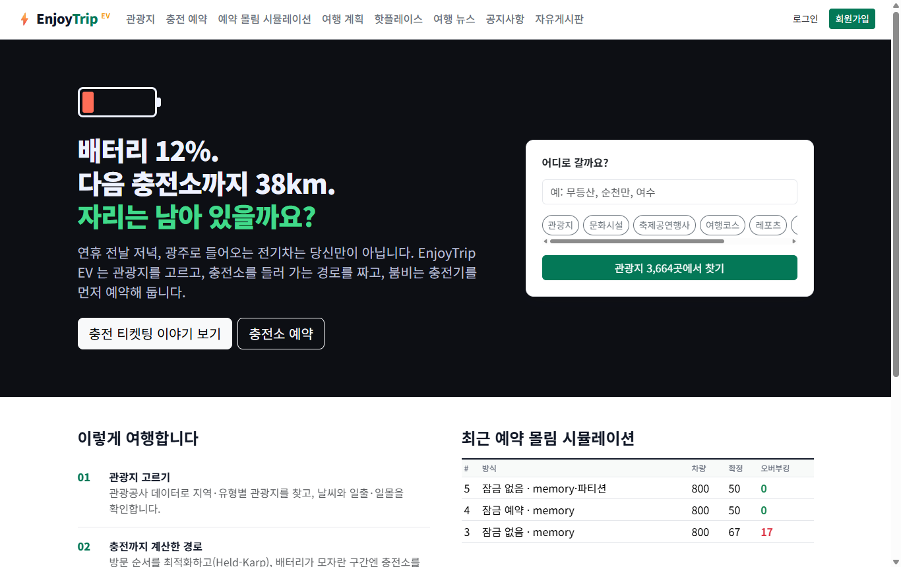 | 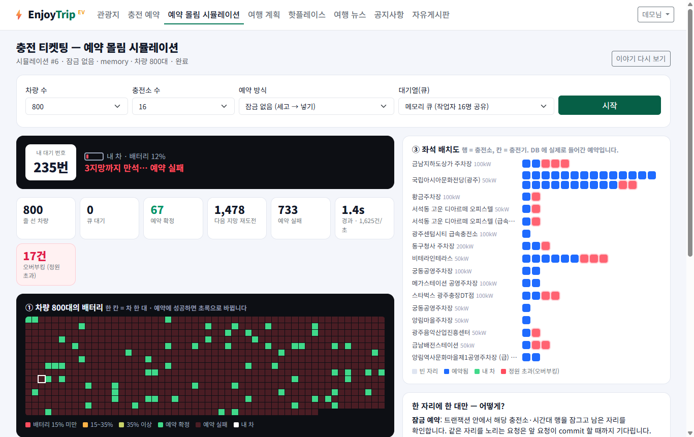 |
| **관광지 조회 (F101~F103)** | **충전소 시간대 예약 (F115)** |
| 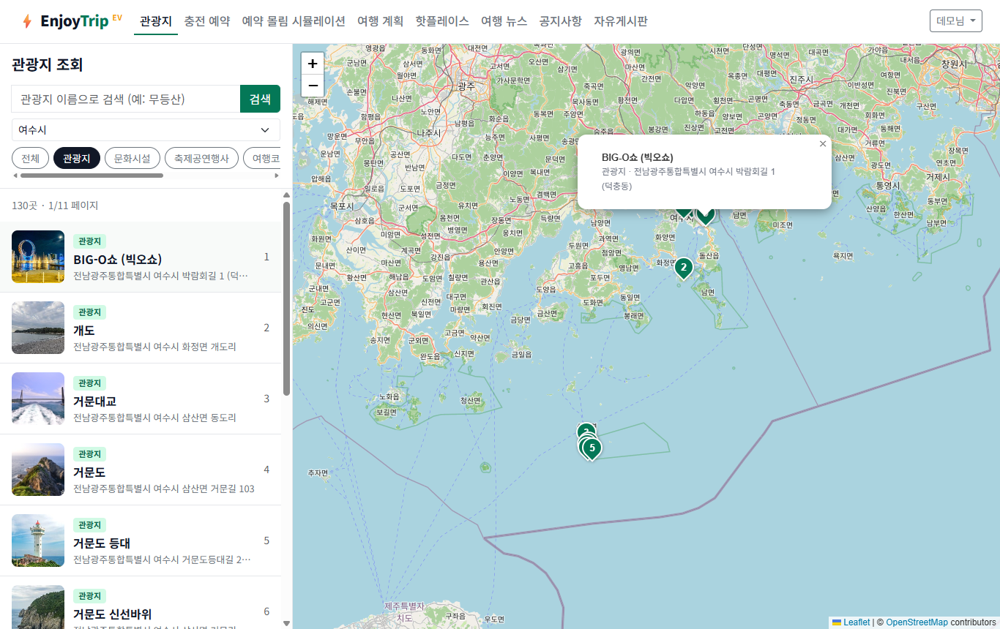 | 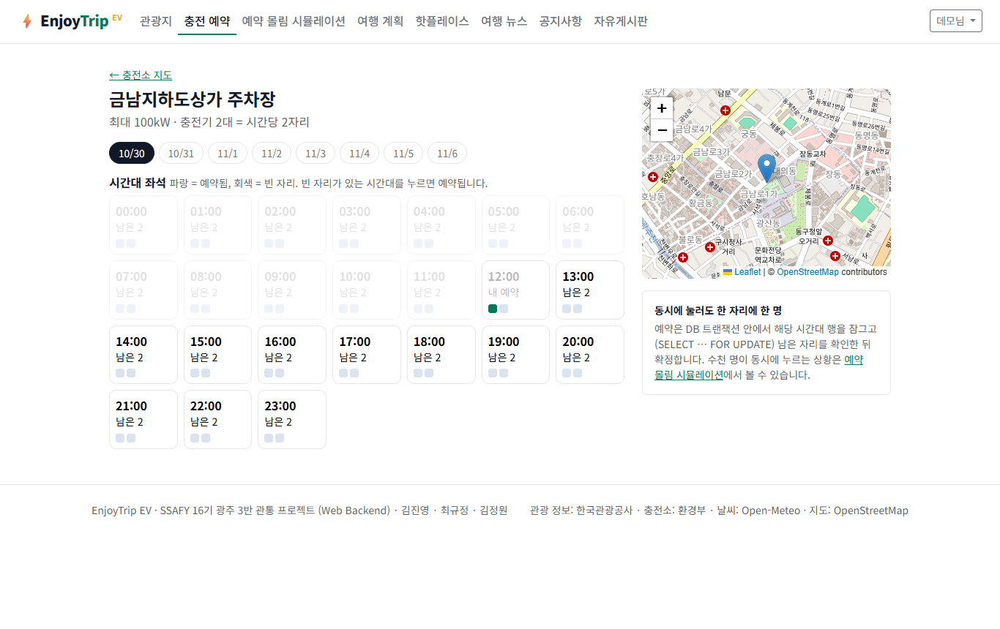 |
| **여행 계획 + 충전 경로 (F104)** | **회원가입 (F107, AJAX 이메일 확인)** |
| 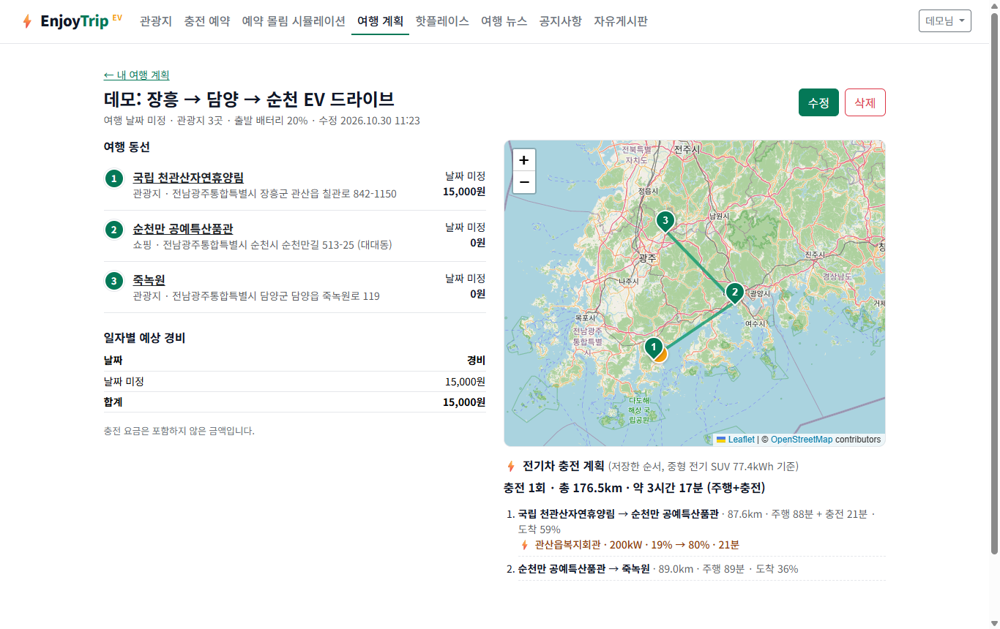 | 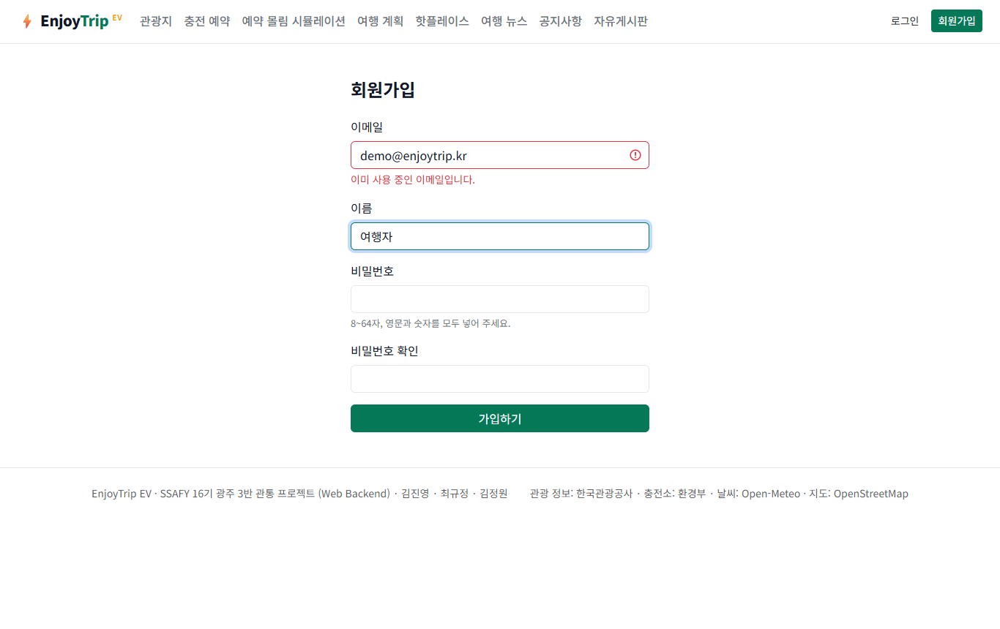 |
| **핫플레이스 (F105)** | **자유게시판 (F110) / 뉴스 (F106)** |
| 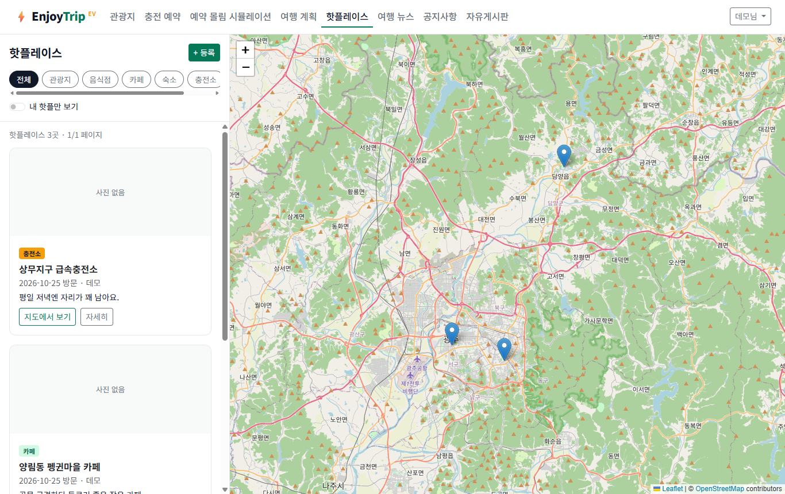 | 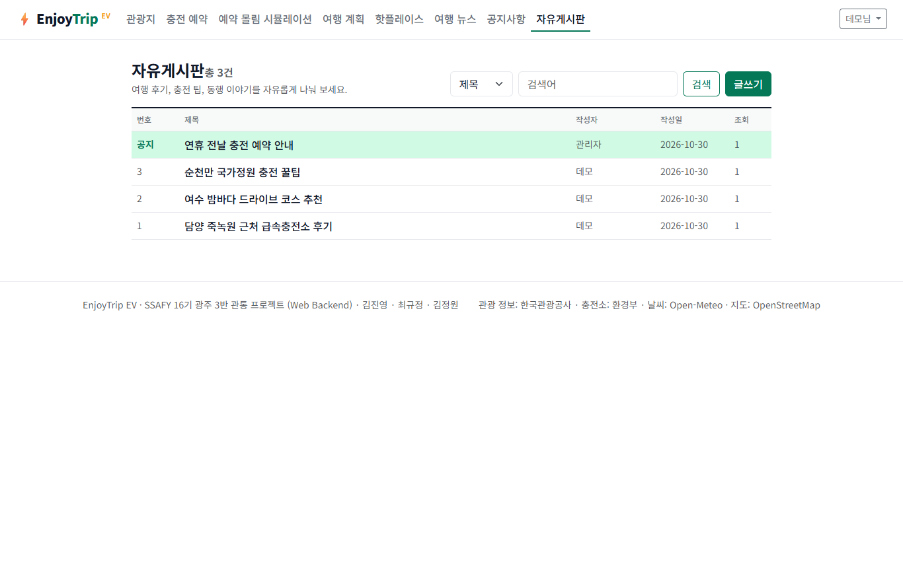 |

시뮬레이션은 이야기(인트로)로 시작한다 — "연휴 전날 오후 6시 40분 → 배터리 12% → 충전기는 수십 대뿐 → 충전도 이제 티켓팅입니다" → **예약 버튼 누르기**.

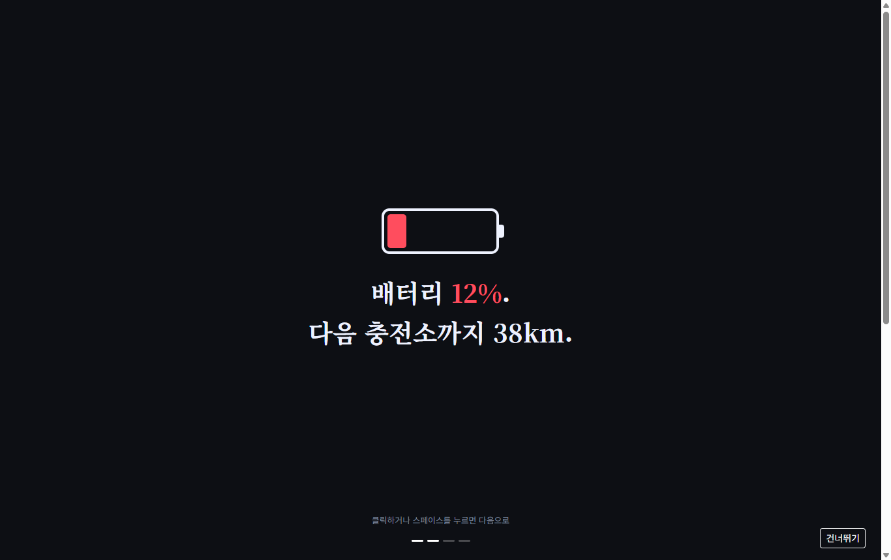

화면 방향: 레퍼런스(VastHorizon, Solar-Atlas)의 "이야기로 열고 시각화로 몰입시키는" 방식만 가져오고, 디자인은 EV 주제에 맞춰 ① 배터리 게이지(어두운 톤) → ③ 충전 티켓팅 좌석 배치도(밝은 톤)로 만들었다.

## 2. 요구사항

[개선된 요구사항 목록 → docs/requirements.md](docs/requirements.md)

| 구분 | 기능 | 상태 |
|---|---|---|
| 필수 | F101~F103 관광지 조회 · F107 회원 관리 · F108 로그인/로그아웃/비밀번호 찾기 | 완료 |
| 추가 | F104 여행 계획(드래그앤드롭·최적화·충전 경로) · F105 핫플레이스 · F111~F114 날씨/사진/일출일몰/충전소 | 완료 |
| 심화 | F106 뉴스 크롤링 · F109 공지사항 · F110 통합 게시판 | 완료 |
| 팀 고유 | **F115 충전기 시간대 예약 · F116 예약 몰림 시뮬레이션(메모리 큐 / Kafka)** | 완료 |

## 통합 게시판 확장 (2026-10-30)

공지사항과 자유게시판의 메뉴·목록을 `/board`로 통합했다. 공지는 관리자 전용 글 유형으로 유지하며 기존 `type=notice/free` URL도 필터로 사용할 수 있다.

좋아요·북마크·댓글·내 활동, 분류·정렬·검색 상태 유지, 신고·관리자 숨김/복구, 공지 고정 순서·기간을 지원한다.
기존 화면 이미지는 확장 이전 기록이다. 새 스키마는 앱 재시작 시 추가 생성되며 기존 글은 유지한다.

[게시판 사용 방법·구조·검증 명령](docs/board-community.md)

## 3. 핵심: 예약이 몰려도 한 자리에 한 대만

충전소 × 1시간 슬롯을 콘서트 좌석처럼 예약한다. 좌석 수 = 충전기 대수.

```sql
-- LOCKED (실제 서비스 경로): 트랜잭션 안에서 슬롯 행을 잠그고 남은 자리를 확인
SELECT capacity, booked FROM ev_slots WHERE run_id=? AND stat_id=? AND slot_start=? FOR UPDATE;
-- booked < capacity 일 때만
INSERT INTO ev_reservations (...) VALUES (...);
UPDATE ev_slots SET booked = booked + 1 WHERE ...;
COMMIT;
```

비교용 **NAIVE** 모드는 "몇 명 예약했지?"를 잠금 없이 센 뒤 넣는다. 세는 순간과 넣는 순간 사이에 다른 요청이 같은 숫자를 보고 끼어든다.

**시뮬레이션 결과** (가상 차량 800대, 도심 급속충전소 16곳 = 좌석 50, 0.4초 동안 몰림, 작업자 16명):

| 방식 | 대기열 | 확정 | 오버부킹 | 소요 |
|---|---|---|---|---|
| 잠금 없음 (NAIVE) | 메모리 큐(공유) | 67 | **17건** | 2.1s |
| **잠금 예약 (LOCKED)** | 메모리 큐(공유) | 50 | **0건** | 1.7s |
| 잠금 없음 | 메모리 큐 · **충전소별 줄** | 50 | **0건** | 3.3s |

- 세 번째 줄이 **Kafka 파티션**과 같은 원리다: 메시지 키 = 충전소 ID → 같은 충전소 요청은 한 파티션에 대기 번호 순으로 쌓이고 컨슈머 한 명이 차례로 처리 → 잠금 없이도 선착순·정원 준수. 대신 충전소 하나가 몰리면 그 줄만 길어진다.
- 실제 서비스 경로는 큐를 무엇으로 쓰든 **LOCKED** 로 처리해 DB 가 최종 정합성을 지킨다.
- 단위 테스트 `EvServiceConcurrencyTest`: 32개 스레드가 같은 순간 같은 슬롯을 예약 → LOCKED 는 확정 수 = 충전기 수, NAIVE 는 정원 초과를 재현.

시뮬레이션 흐름: 도심 기준 급속충전소 K곳 선택 → 차량마다 배터리 잔량·희망 충전소 1~3지망 결정(도심에 가까울수록 몰리는 지프 분포) → 차량이 큐에 줄을 섬(줄 선 순서 = 대기 번호) → 작업자가 `EvService.tryReserve` 로 **실제 DB 예약**(회원 예약과 같은 코드) → 만석이면 다음 지망으로 다시 줄 서기 → 끝나면 DB 에서 슬롯별 정원 초과를 집계. 화면은 250ms 마다 AJAX 로 상태를 받아 ① 배터리 격자, ③ 좌석 배치도, 로그를 그린다.

## 4. 아키텍처 (MVC)

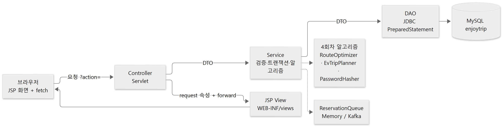

- **Controller**: `@WebServlet` 하나가 기능 하나, `action` 파라미터로 분기 (수업 BE_06 패턴). 공통 처리는 `ControllerHelper`(forward/redirect/JSON/로그인 확인/flash).
- **Service**: 싱글턴. 입력 검증(`ValidationException` → 화면 메시지), 트랜잭션 경계(예약·여행 계획 저장), 알고리즘 호출.
- **DAO**: 인터페이스 + `Jdbc*Dao` 구현. 다음 주 DB 관통에서 배울 JDBC 를 미리 적용했다(강사님 안내대로 인터페이스 뒤에 숨겨 두었으므로 구현만 바꾸면 된다).
- **View**: JSP 는 `WEB-INF/views` 아래 두어 컨트롤러를 거치지 않은 직접 접근을 막았다. 3회차 프론트(지도 중심 앱형) 디자인을 그대로 옮겼다.

## 5. Usecase Diagram

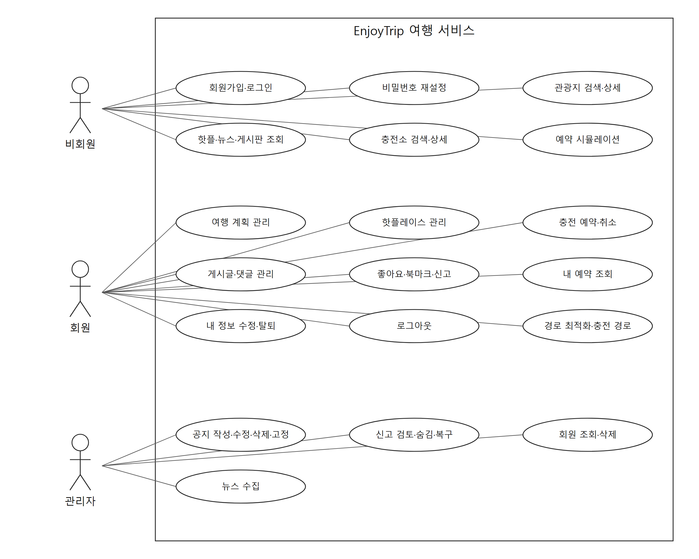

[SVG 원본](docs/diagrams/usecase.svg) · [그림 생성 코드](docs/diagrams/render_usecase.py)

## 6. Class Diagram

계층별 핵심 클래스만 표시 (전체: `src/main/java/com/ssafy/enjoytrip`).

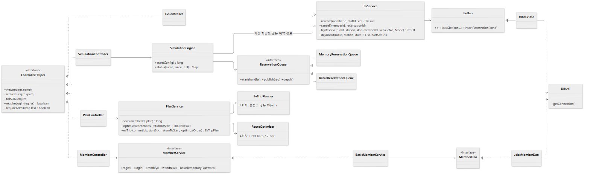

| 패키지 | 클래스 |
|---|---|
| controller | Main · Member · Attraction · Ev · Simulation · Plan · Hotplace · Board · News · Upload + `ControllerHelper` |
| model.service | `MemberService`/`BasicMemberService`, AttractionService, EvService, PlanService, HotplaceService, BoardService, NewsService |
| model.dao | 인터페이스 + `Jdbc*Dao`: Member, Attraction, Ev, SimRun, Plan, Hotplace, Board, News |
| model.dto | Member, Attraction, EvStation, Reservation, SlotStatus, SimRunSummary, Plan, PlanStop, Hotplace, Board, News, Page, SearchCondition … |
| simulation | SimulationEngine, SimulationRun, ReservationRequest, ReservationQueue, MemoryReservationQueue, KafkaReservationQueue |
| algorithm | 4회차 모듈 그대로 (geo, route, ev, trip, security, search, sort, recommend) |
| filter / listener / util | CsrfFilter · AppInitListener(스키마·기준 데이터 자동 적재) · DBUtil, Passwords, PhotoStorage, Csv |

## 7. ERD

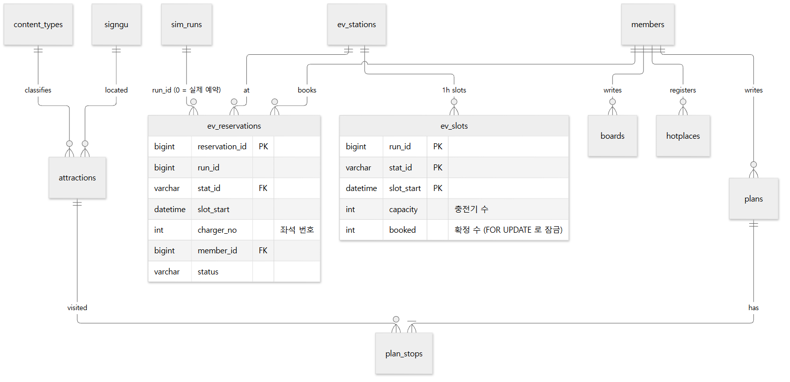

이미지를 클릭하면 같은 화면에서 확대됩니다. · [Mermaid 원본](docs/diagrams/erd.mmd)

스키마: [`src/main/resources/sql`](src/main/resources/sql) — 앱이 시작할 때 `CREATE TABLE IF NOT EXISTS` 로 만들고, 비어 있으면 CSV 에서 관광지·충전소를 채운다.

## 8. 실행 방법

준비: JDK 17+, MySQL 8 (수업 계정 `ssafy`/`ssafy`), Tomcat 11.

**STS / Eclipse**: `Import → Existing Maven Projects` → 프로젝트를 Tomcat 11 서버에 추가 → 실행 → `http://localhost:8080/enjoytrip/`

**명령줄** (Git Bash):

```bash
sh scripts/run.sh          # 빌드 + Tomcat 실행 → http://localhost:8090/enjoytrip/
sh scripts/run.sh test     # 단위 테스트 (MySQL 이 켜져 있으면 동시성 테스트까지)
```

- DB `enjoytrip` 과 테이블, 관광지·충전소 데이터는 **첫 실행 때 자동으로** 만들어진다.
- 관리자 계정을 만들려면 프로젝트 루트에 `.env` 파일(커밋 금지)을 두고 `ENJOYTRIP_ADMIN_PASSWORD=...` 를 넣는다 (이메일 `admin@enjoytrip.kr`). DB 계정이 다르면 `ENJOYTRIP_DB_USER`, `ENJOYTRIP_DB_PASSWORD`. localhost 가 아닌 주소로 배포하면 `ENJOYTRIP_APP_BASE_URL` 도 설정한다(비밀번호 재설정 링크용).
- Kafka 큐(선택): `docker compose up -d` 후 시뮬레이션 화면에서 대기열을 Kafka 로 고른다. 브로커가 없으면 메모리 큐로 자동 대체된다.
- 관광 데이터를 새로 받으려면: `DATA_GO_KR_API_KEY=... python scripts/fetch_attractions.py`

## 9. 보안·품질 체크

| 위협 | 대응 |
|---|---|
| 비밀번호 유출 | PBKDF2-HMAC-SHA256 600,000회 + 사용자별 salt + 서버 pepper (4회차 `PasswordHasher`), 해시 반복 횟수 상한(DoS 방지), 없는 이메일도 같은 시간 소모 |
| 비밀번호 찾기 악용 | 임시 비밀번호를 화면에 보여주지 않음. 256비트 1회용 토큰(15분, DB 에는 SHA-256 해시만)을 이메일 링크로 보내고, 재설정을 마칠 때까지 기존 비밀번호 유지. 일치 여부와 상관없이 같은 안내(계정 존재 노출 방지), 이메일당 10분 3회·IP당 10회 제한. 수업 환경엔 메일 서버가 없어 링크는 서버 콘솔에 출력(`ResetMailer` 만 바꾸면 실제 발송). 링크 주소는 Host 헤더가 아니라 `app.base-url` 설정으로 만들고, 설정이 없으면 localhost 접속에서만 허용(재설정 링크 오염 방지) |
| 오픈 리다이렉트 | 로그인 후 이동 경로(`next`)는 앱 내부 경로 문자만 허용하는 정규식으로 검사(`//`, 탭·역슬래시 우회 차단) |
| 세션 탈취 | 로그인 시 세션 ID 재발급(세션 고정 방지), HttpOnly + SameSite=Lax 쿠키 |
| CSRF | 모든 POST 에 세션 토큰(`CsrfFilter`, 폼 hidden 필드 / fetch 헤더) |
| XSS | JSP 출력은 `<c:out>`/`fn:escapeXml`, JS 는 `ET.escapeHtml`, JSON 을 `<script>` 에 넣을 때 `<` 이스케이프 |
| SQL 인젝션 | 모든 쿼리 PreparedStatement, 검색 컬럼은 허용 목록, LIKE 와일드카드 이스케이프 |
| 업로드 | 선언 타입 + 매직 바이트 모두 확인, 서버가 만든 UUID 파일명, 5MB 제한, `/uploads` 는 파일명 정규식으로 경로 조작 차단 + nosniff |
| 권한 | 계획·핫플·게시글 수정/삭제는 작성자 또는 관리자만(서버에서 재확인), 공지·회원 관리·뉴스 수집은 관리자만 |
| 외부 데이터 | 뉴스 RSS XML 파서에서 DOCTYPE·외부 엔티티 차단(XXE), 링크는 http/https 만 렌더링 |

테스트: `./mvnw test` → 23개 (동시성 2, 게시판 4, 뉴스 파서 4, 사진 검증 4, 검색 조건 3, CSV 2, 재설정 토큰·요청 제한 2, 로그인 후 이동 경로 검사 2) 모두 통과.

## 10. 다음 회차로

- **DB 관통(11/06)**: 이미 JDBC DAO 로 구현했으므로 ERD 정규화 검토, 인덱스(근처 충전소 검색에 공간 인덱스), 트랜잭션 격리 수준 비교를 이어서 한다.
- **Spring 회차**: Controller → `@RestController`, DAO → MyBatis, 큐 → Spring Kafka 로 옮기기 쉽게 계층을 나눠 두었다.

## AI 활용 기록

강사님 권고(AI 는 멘토)에 따라 Claude Code 를 설계 토론·코드 리뷰·반복 작업에 썼다. 컨셉(충전 예약 몰림, Kafka, 이야기형 화면 ①+③)은 팀이 정했고,
기능별 구현은 AI 에이전트가 수업 패턴(BE_06 ControllerHelper·Service·DAO)을 따르도록 지시한 뒤 curl·브라우저·단위 테스트로 검증했다.
