# EnjoyTrip EV — 전국 관광지 DB 구축 (DB PJT)

> **아카이브 정보** · 6차 관통 프로젝트(DB PJT, 2026-11-06) · 팀: 3인 (김진영 외 2명) · 원본: SSAFY GitLab (교육생 전용, 외부 접근 불가)
> 5차 백엔드([05-enjoytrip-ev-backend](../05-enjoytrip-ev-backend/))의 DB 를 다시 설계한 차수다. 공개 저장소라 수업 제공 원본 파일(`docs/ssafy-provided/`)과 16MB 초기화 덤프는 빼고 옮겼다. 앱은 첫 실행 때 같은 데이터를 CSV 에서 자동 적재한다.

SSAFY 16기 광주 3반 관통 프로젝트 **6회차(DB PJT)**. 5회차까지 만든 Servlet/JSP MVC 웹 애플리케이션 **EnjoyTrip EV**의 DB 를 다시 설계하고,
SSAFY 가 제공한 **전국 관광지 데이터(50,915곳)**를 이식해 시도·구군 단위로 조회할 수 있게 만들었다.

- 팀: 김진영 외 2명
- 기술: Java 17, Servlet 6.1 / JSP / JSTL, Tomcat 11, **MySQL 8 (JDBC)**, Jackson 3, Kafka(선택), Bootstrap 5, Leaflet + OpenStreetMap
- 데이터: 싸피 제공 전국 관광지 50,915곳 + 한국관광공사 KorService2(광주·전남) CSV 중 겹치지 않는 385곳 = **51,300곳**, 시도 17 / 구군 234, 환경부 충전소(8,072곳), Open-Meteo(날씨·일출/일몰), Google News RSS

---

## 1. DB 설계

### 1-1. ERD

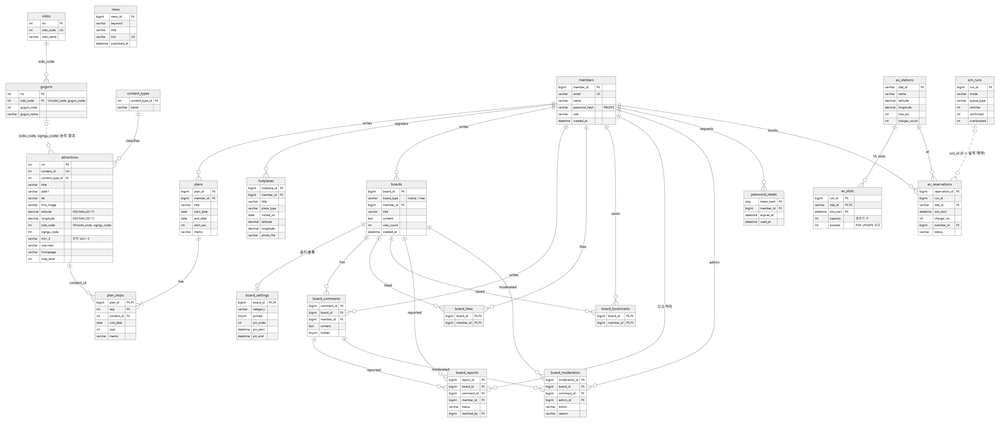

이미지를 클릭하면 같은 화면에서 확대됩니다. · [Mermaid 원본](docs/diagrams/erd.mmd) · [SVG](docs/diagrams/erd.svg)

실선은 FOREIGN KEY 제약, 점선은 FK 를 걸지 않은 논리 관계다. 적재 표시용(`data_seed_state`, `board_seed_state`)과 화면에서 쓰지 않는 예전 지역 테이블(`signgu`)은 그림에서 뺐다.

### 1-2. 주요 제약·인덱스

| 테이블 | PK | UNIQUE / INDEX | FK·DEFAULT 등 |
|---|---|---|---|
| `sidos` | `no` | `uk_sidos_code(sido_code)` | — |
| `guguns` | `no` | `uk_guguns_sido_gugun(sido_code, gugun_code)` | `sido_code → sidos`. 구군 코드는 시도마다 1부터 다시 시작하므로 쌍이 키 |
| `attractions` | `no` (대리키) | `uk_attractions_content(content_id)`, `idx_attractions_region_type(sido_code, signgu_code, content_type_id)`, `idx_attractions_type_list`, `idx_attractions_list` (1-5 참고) | `content_type_id → content_types`. 위경도 `DECIMAL(20,17)`. 지역 FK 는 지역 코드가 다른 385곳 때문에 걸지 않음 |
| `plan_stops` | `(plan_id, seq)` | — | `plan_id → plans` (CASCADE), `content_id → attractions.content_id` |
| `members` | `member_id` | `email` UNIQUE | `role` DEFAULT `'USER'`, `created_at` DEFAULT `CURRENT_TIMESTAMP` |
| `board_likes` / `board_bookmarks` | `(board_id, member_id)` | — | 복합 PK 로 회원당 1건 보장 |
| `ev_slots` | `(run_id, stat_id, slot_start)` | — | 예약 시 `SELECT … FOR UPDATE` 로 행 잠금 |
| `news` | `news_id` | `link` UNIQUE, `published_at` INDEX | 중복 수집 방지 |

### 1-3. 설계 결정

- **대리키 `no` + `content_id` UNIQUE**: 싸피 원본 구조를 따르면서, 기존 `plan_stops.content_id` FK 가 계속 동작하도록 `content_id` 의 유일성은 유지했다.
- **(시도, 구군) 복합 키**: 구군 코드는 시도마다 1부터 다시 시작한다(예: 서울 강남구 1, 부산 강서구 1). 코드 하나로 비교하면 다른 시도 데이터가 섞이므로 `uk_guguns_sido_gugun` 과 `idx_attractions_region` 을 쌍으로 만들었다. 화면 드롭다운 값은 `시도코드 × 1000 + 구군코드`(예: 부산 해운대구 = 6016)로 합쳐 넘기고 DAO 에서 다시 나눈다.
- **위경도 `DECIMAL(20,17)`**: 싸피 원본 정밀도를 그대로 보존한다.
- **분류(lcls1~3) 보존**: 싸피 데이터에는 없는 컬럼이라, 겹치는 3,279곳은 갱신하되 이 값은 덮어쓰지 않았다.

### 1-4. 제공 스키마(`ssafy_trip`) 대비 변경·추가

수업에서 받은 기본 스키마(테이블 4개, 원본은 수업 자료라 공개 저장소에는 올리지 않음)를 토대로, 기존 4개는 다듬고 기능에 필요한 20개를 추가해 **총 24개**로 만들었다.

**기존 4개 테이블 변경**

| 제공 테이블 | 우리 테이블 | 바꾼 점 | 이유 |
|---|---|---|---|
| `sidos` | `sidos` | `sido_code` UNIQUE 추가 | FK 참조 대상 컬럼은 유일해야 한다 |
| `guguns` | `guguns` | `(sido_code, gugun_code)` 복합 UNIQUE, `gugun_code` 인덱스 | 구군 코드는 시도마다 1부터 다시 시작 → 단독으로는 식별 불가 |
| `contenttypes` | `content_types` | 이름 `NOT NULL` | 화면 필터 라벨로 쓰므로 비면 안 됨 |
| `attractions` | `attractions` | `content_id` NOT NULL + UNIQUE, `title`·위경도 NOT NULL, `area_code`/`si_gun_gu_code` → `sido_code`/`signgu_code`, 분류 `lcls1~3` 추가, `(sido_code, signgu_code)`·`content_type_id` 인덱스 | 여행 계획(`plan_stops`)이 `content_id` 로 참조, 지도 표시에 위경도 필수, 지역+유형 조회가 가장 많음 |

- 제공 스키마의 `attractions.si_gun_gu_code → guguns.gugun_code` FK 는 `gugun_code` 가 유일하지 않아 다른 시도의 구군을 가리킬 수 있다. 그래서 단일 FK 대신 `(sido_code, signgu_code)` 쌍으로 비교하고 복합 인덱스로 조회 성능을 확보했다 (1-3 참고).

**추가한 20개 테이블**

| 기능 | 테이블 | 요구사항 |
|---|---|---|
| 회원 | `members`, `password_resets` | F107, F108 |
| 여행 계획 | `plans`, `plan_stops` | F104 |
| 핫플레이스 | `hotplaces` | F105 |
| 뉴스 | `news` | F106 |
| 게시판 | `boards`, `board_settings`, `board_comments`, `board_likes`, `board_bookmarks`, `board_reports`, `board_moderation` | F109, F110 |
| 충전소·예약 | `ev_stations`, `ev_slots`, `ev_reservations`, `sim_runs` | F114, F115, F116 |
| 운영용 | `data_seed_state`, `board_seed_state` (초기 데이터 적재 여부), `signgu` (이전 회차 지역표, 호환용) | — |

### 1-5. 인덱스 설계 — 조회 패턴 분석과 EXPLAIN 검증

관광지 화면(F101~F103)의 쿼리는 항상 `ORDER BY (사진 없음), title, content_id LIMIT 12` 로 정렬해 한 페이지만 가져온다. 처음 인덱스(`type`, `(sido, signgu)` 단일 용도)는 WHERE 만 보고 만들어서, 5만 건을 다 읽은 뒤 정렬(filesort)하는 경우가 생겼다. 조회 조건 3가지를 `EXPLAIN ANALYZE` 로 재고 인덱스를 다시 짰다.

| 인덱스 | 컬럼 | 쓰는 조회 |
|---|---|---|
| `idx_attractions_region_type` | `(sido_code, signgu_code, content_type_id)` | 지역 + 유형 (가장 흔한 조회). 앞 두 컬럼만으로 지역 단독 조회도 처리 |
| `idx_attractions_type_list` | `(content_type_id, (first_image IS NULL OR first_image = ''), title, content_id)` | 유형만 고른 전국 조회. `content_type_id` FK 용 인덱스도 겸함 |
| `idx_attractions_list` | `((first_image IS NULL OR first_image = ''), title, content_id)` | 필터 없는 전체 목록. MySQL 8 함수 인덱스로 정렬식과 똑같은 식을 인덱스에 넣어 정렬 없이 앞 12건만 읽음 |

측정: MySQL 8.0, 관광지 51,300건, `EXPLAIN ANALYZE` 실제 시간 (첫 페이지 12건)

| 조회 | 예전 실행 계획 | 예전 | 새 실행 계획 | 새 |
|---|---|---|---|---|
| 부산 해운대구 + 관광지 | 두 인덱스 교집합(index_merge) → 1만3천 행 읽고 정렬 | 4.8 ms | `idx_attractions_region_type` 로 44행만 조회 | **0.23 ms** |
| 전국 관광지(유형만) | 1만3천 행 읽고 filesort | 86 ms | 정렬된 인덱스 순서로 읽다가 12건에서 멈춤 | **2.1 ms** |
| 전체 목록 | 5만1천 행 Table scan + filesort | 316 ms | `idx_attractions_list` 앞 12건만 | **0.2 ms** |

- 이미 만들어진 DB 는 앱이 시작할 때 `AppInitListener.upgradeAttractionIndexes` 가 새 인덱스를 먼저 만들고 예전 인덱스를 지운다(FK 가 쓸 인덱스가 끊기지 않게). SQL 만으로 옮길 때는 `enjoytrip_migrate.sql` 에 같은 문장이 있다.
- 이름 검색(`title LIKE '%키워드%'`)은 앞에 `%` 가 붙어 B-Tree 인덱스로 범위를 좁히지 못한다(5만 행을 커버링 인덱스로 훑음, 21.5ms). 검색량이 늘면 `FULLTEXT ... WITH PARSER ngram` 으로 바꾸는 것을 다음 과제로 남겼다.

## 2. DDL 과 데이터 적재

| 파일 | 용도 |
|---|---|
| [`enjoytrip_schema.sql`](enjoytrip_schema.sql) | **DB Schema (DDL) 제출본.** `CREATE DATABASE` + 테이블 24개. 데이터 없음. `mysql -u ssafy -p < enjoytrip_schema.sql` |
| [`src/main/resources/sql/*.sql`](src/main/resources/sql) | 앱이 시작할 때 실행하는 같은 DDL (`CREATE TABLE IF NOT EXISTS`). `01-core` 회원·관광지·시도/구군 → `10-ev` → `20-plan` → `30-hotplace` → `40-board` → `45-board-community` → `50-news` 순 |
| [`enjoytrip_migrate.sql`](enjoytrip_migrate.sql) | 기존 `enjoytrip` 을 새 구조로 바꾸고 `ssafy_trip` 데이터를 옮기는 이식 스크립트 (앱 없이 SQL 만으로 이식할 때) |
| [`data/attractions-ssafy.csv.gz`](src/main/resources/data/attractions-ssafy.csv.gz) | 싸피 관광지 50,915곳 (3.4MB). [`scripts/export_ssafy_attractions.py`](scripts/export_ssafy_attractions.py) 로 `ssafy_trip` 에서 내보냄 |
| [`data/sidos.csv`](src/main/resources/data/sidos.csv), [`data/guguns.csv`](src/main/resources/data/guguns.csv) | 시도 17 / 구군 234 |
| `enjoytrip_init.sql` (약 16MB, 용량 때문에 공개 저장소에는 없음 · 앱 첫 실행 때 같은 데이터가 자동 적재됨) | 스키마 + 기준 데이터(관광지 51,300 · 시도 17 · 구군 234 · 콘텐츠 유형) 덤프. 앱 자동 적재와 같은 결과. **`DROP DATABASE enjoytrip` 으로 시작하므로 로컬의 회원·게시글·예약이 모두 지워진다.** `mysql -u ssafy -p < enjoytrip_init.sql` |

앱이 시작할 때(`AppInitListener`) 적재 순서:

1. DDL 실행 → 2. 콘텐츠 유형 → 3. `sidos` → 4. `guguns` → 5. 기존 CSV 관광지 3,664곳 → 6. **싸피 관광지 50,915곳** (`content_id` 가 겹치면 갱신, lcls1~3 유지) → 7. 충전소 · 관리자 · 게시판 샘플

- 각 단계는 테이블이 비어 있을 때만 넣는다. 싸피 관광지는 `data_seed_state` 에 표시를 남겨 재시작해도 다시 넣지 않는다.
- 예전 구조의 `enjoytrip` 이 있으면 `attractions` 를 새 구조로 바꾼 뒤 넣는다. 회원·게시글·예약은 지우지 않는다.

### 이식 검증

| 확인 | 결과 |
|---|---|
| `ssafy_trip.attractions` | 50,915 (content_id 중복·NULL 없음) |
| `enjoytrip.attractions` | 51,300 = 50,915 + 385 |
| `sidos` / `guguns` | 17 / 234 |
| 빈 DB 에서 앱만 실행 | 이식한 DB 와 `attractions` 컬럼 차이 0 |
| `enjoytrip_schema.sql` 을 빈 DB 에 실행 | 테이블 24개, FK 25개, 오류 없음 |
| 단위 테스트 `./mvnw test` | 62개 실행, 실패 0 (건너뜀 9) |

### 알려진 한계

- 기존 CSV 에만 있던 385곳은 지역 코드가 싸피 체계와 달라 시도·구군 필터로는 찾을 수 없다 (전체 목록·이름 검색은 된다). 그래서 지역 FK 를 걸지 않았다.
- 싸피 원본에서 `si_gun_gu_code` 가 NULL 인 54곳도 같은 이유로 필터에 나오지 않는다.
- 예전 지역 테이블 `signgu` 는 남아 있지만 화면에서는 쓰지 않는다.

## 3. Model (Service / DAO)

| 도메인 | Service | DAO (인터페이스 → JDBC 구현) | 주요 테이블 |
|---|---|---|---|
| 관광지 | `AttractionService` | `AttractionDao` → `JdbcAttractionDao` | attractions, content_types, sidos, guguns |
| 회원 | `MemberService` → `BasicMemberService` | `MemberDao` → `JdbcMemberDao` | members, password_resets |
| 여행 계획 | `PlanService` | `PlanDao` → `JdbcPlanDao` | plans, plan_stops |
| 핫플레이스 | `HotplaceService` | `HotplaceDao` → `JdbcHotplaceDao` | hotplaces |
| 게시판 | `BoardService`, `BoardCommunityService` | `BoardDao` → `JdbcBoardDao`, `BoardCommunityDao` → `JdbcBoardCommunityDao` | boards, board_* |
| 뉴스 | `NewsService` | `NewsDao` → `JdbcNewsDao` | news |
| 충전소·예약 | `EvService` | `EvDao` → `JdbcEvDao`, `SimRunDao` → `JdbcSimRunDao` | ev_stations, ev_slots, ev_reservations, sim_runs |

이번 회차에 바꾼 DAO: `JdbcAttractionDao` — 지역명을 `guguns` 와 조인해 가져오고(`gugun_name AS signgu_name`), 시군구 필터는 `sido_code` 와 `signgu_code` 를 함께 비교한다. 컨트롤러·화면은 그대로다.

## 4. 요구사항

[개선된 요구사항 목록 → docs/requirements.md](docs/requirements.md)

| 구분 | 기능 | 상태 |
|---|---|---|
| 필수 | **F101~F103 지역별 관광지 조회 (전국 시도·구군, 콘텐츠 유형 필터)** · F107 회원 관리 · F108 로그인/로그아웃/비밀번호 찾기 | 완료 |
| 추가 | F104 여행 계획(드래그앤드롭·최적화·충전 경로) · F105 핫플레이스 · F111~F114 날씨/사진/일출일몰/충전소 | 완료 |
| 심화 | F106 뉴스 크롤링 · F109 공지사항 · F110 통합 게시판 | 완료 |
| 팀 고유 | F115 충전기 시간대 예약 · F116 예약 몰림 시뮬레이션(메모리 큐 / Kafka) | 완료 |

## 5. 실행 화면

| 지역별 관광지 — 부산 해운대구 전체 335곳 (F101) | 콘텐츠 유형 필터 — 해운대구 관광지 44곳 (F102) |
|---|---|
| 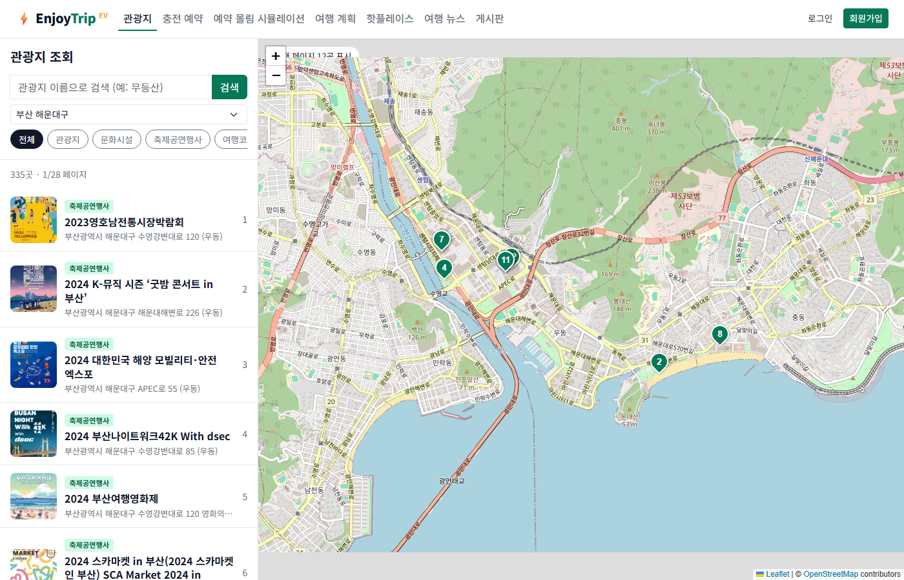 | 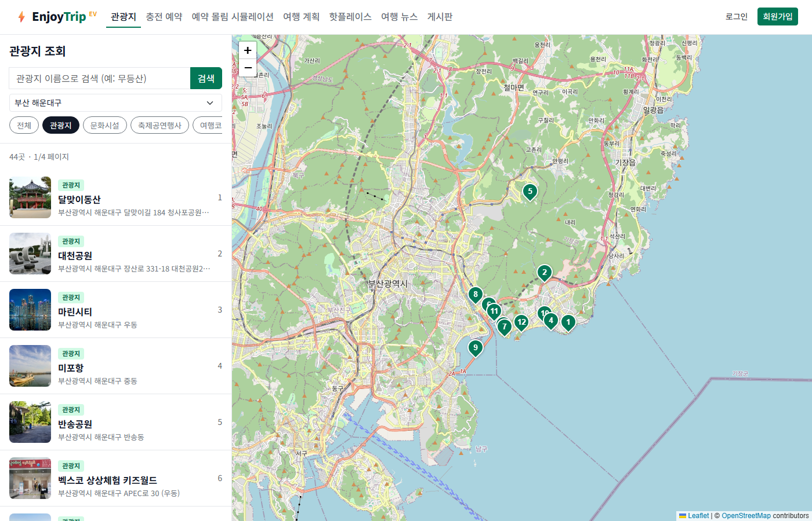 |
| **로그인 (F108)** | **회원가입 (F107, AJAX 이메일 확인)** |
| 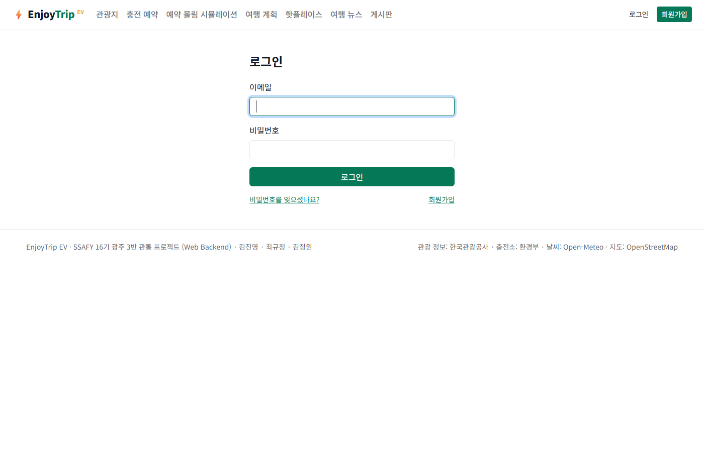 | 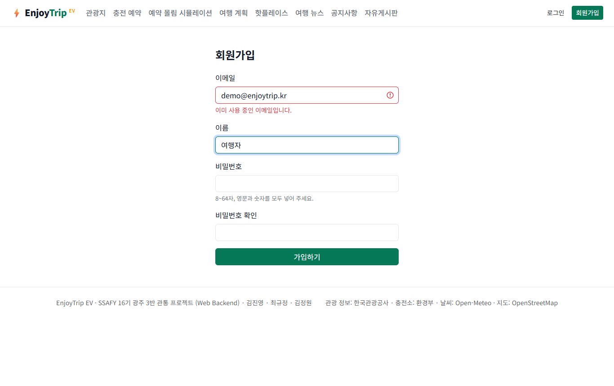 |
| **여행 계획 + 충전 경로 (F104)** | **핫플레이스 (F105)** |
| 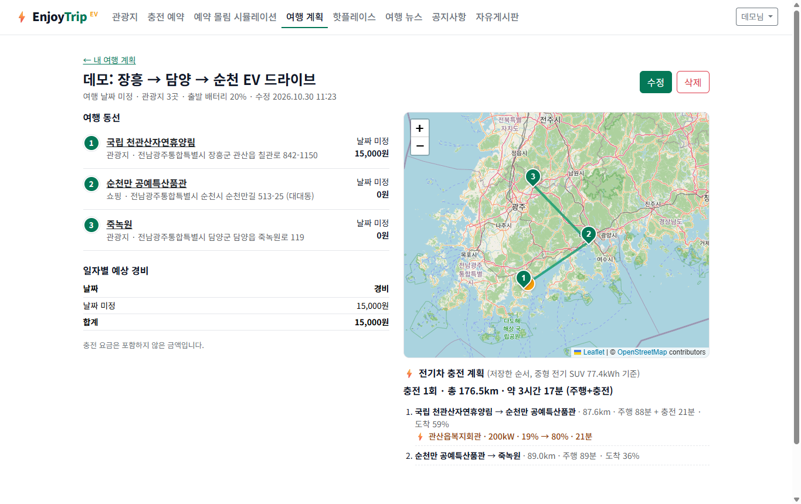 | 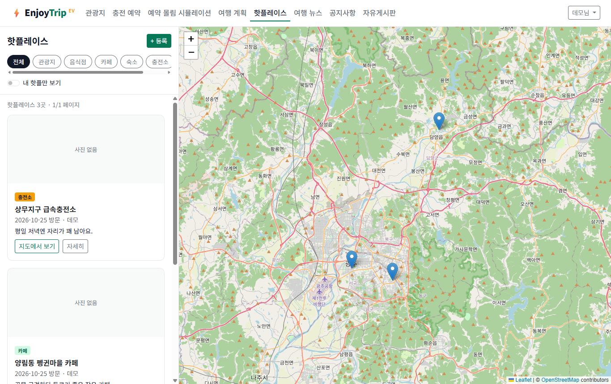 |
| **게시판 목록 (F110) / 뉴스 (F106)** | **게시글 상세 (F110)** |
| 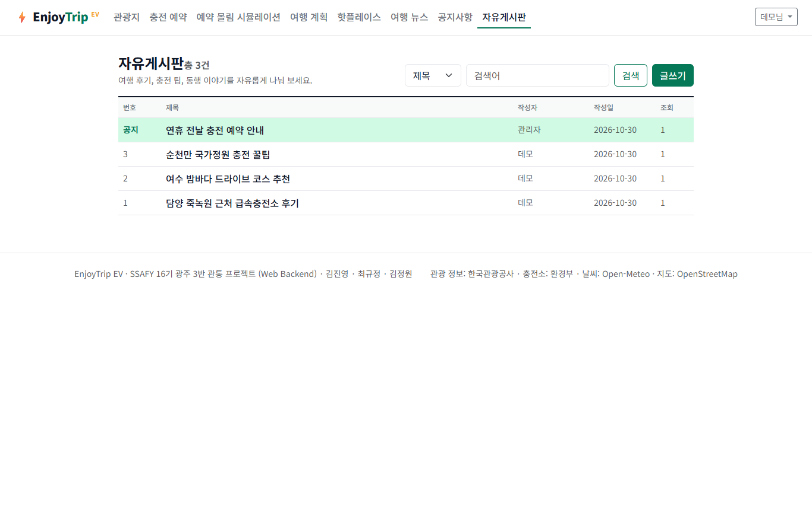 | 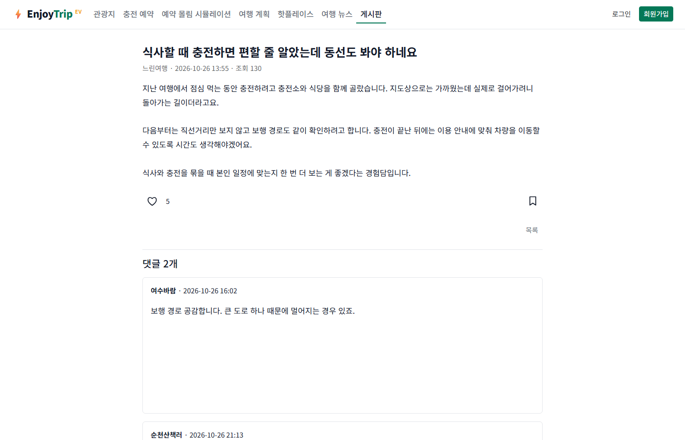 |
| **메인** | **충전소 시간대 예약 (F115)** |
| 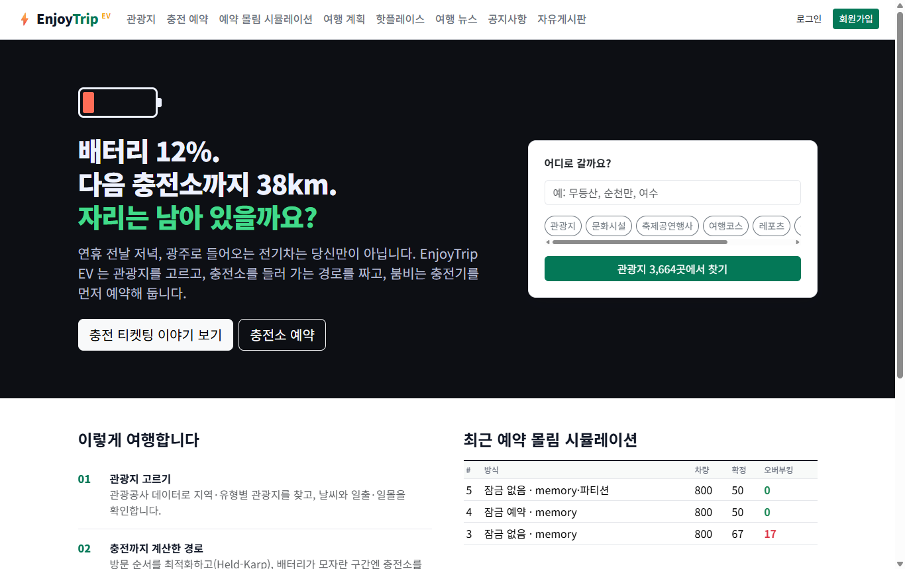 | 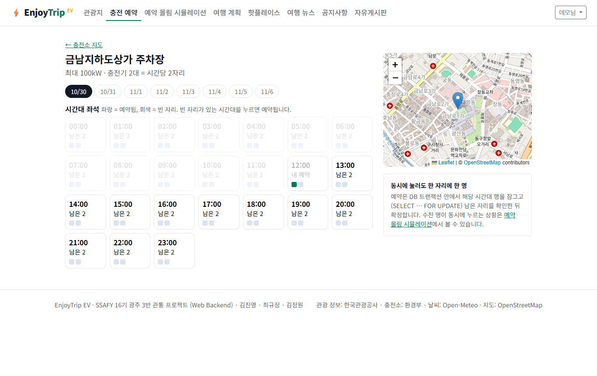 |

## 6. 실행 방법

준비: JDK 17+, MySQL 8 (수업 계정 `ssafy`/`ssafy`), Tomcat 11.

**STS / Eclipse**: `Import → Existing Maven Projects` → 프로젝트를 Tomcat 11 서버에 추가 → 실행 → `http://localhost:8080/enjoytrip/`

**명령줄** (Git Bash):

```bash
sh scripts/run.sh          # 빌드 + Tomcat 실행 → http://localhost:8090/enjoytrip/
sh scripts/run.sh test     # 단위 테스트 (MySQL 이 켜져 있으면 동시성 테스트까지)
```

- DB `enjoytrip` 과 테이블, 시도·구군, 관광지 51,300곳, 충전소 데이터는 **첫 실행 때 자동으로** 만들어진다 (2장 참고). 처음부터 다시 받고 싶으면 `DELETE FROM data_seed_state;` 후 재시작한다.
- 스키마만 따로 만들려면 `mysql -u ssafy -p < enjoytrip_schema.sql`.
- 관리자 계정을 만들려면 프로젝트 루트에 `.env` 파일(커밋 금지)을 두고 `ENJOYTRIP_ADMIN_PASSWORD=...` 를 넣는다 (이메일 `admin@enjoytrip.kr`). DB 계정이 다르면 `ENJOYTRIP_DB_USER`, `ENJOYTRIP_DB_PASSWORD`. localhost 가 아닌 주소로 배포하면 `ENJOYTRIP_APP_BASE_URL` 도 설정한다(비밀번호 재설정 링크용).
- Kafka 큐(선택): `docker compose up -d` 후 시뮬레이션 화면에서 대기열을 Kafka 로 고른다. 브로커가 없으면 메모리 큐로 자동 대체된다.
- 싸피 관광지를 새로 내보내려면 `scripts/export_ssafy_attractions.py` (`ssafy_trip` 에 싸피 덤프가 올라가 있어야 한다). 관광공사 API 로 받으려면 `DATA_GO_KR_API_KEY=... python scripts/fetch_attractions.py`.

## 7. 아키텍처와 다이어그램

### 아키텍처 (MVC)

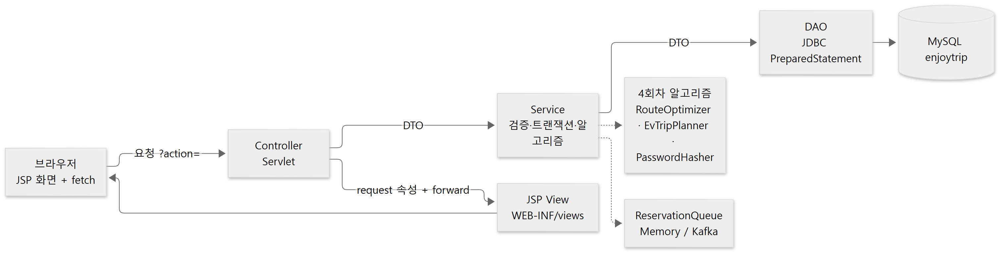

- **Controller**: `@WebServlet` 하나가 기능 하나, `action` 파라미터로 분기 (수업 BE_06 패턴). 공통 처리는 `ControllerHelper`(forward/redirect/JSON/로그인 확인/flash).
- **Service**: 싱글턴. 입력 검증(`ValidationException` → 화면 메시지), 트랜잭션 경계(예약·여행 계획 저장), 알고리즘 호출.
- **DAO**: 인터페이스 + `Jdbc*Dao` 구현. 이번 회차 지역 체계 변경도 DAO 구현만 바꿔 처리했다.
- **View**: JSP 는 `WEB-INF/views` 아래 두어 컨트롤러를 거치지 않은 직접 접근을 막았다.

### Usecase Diagram

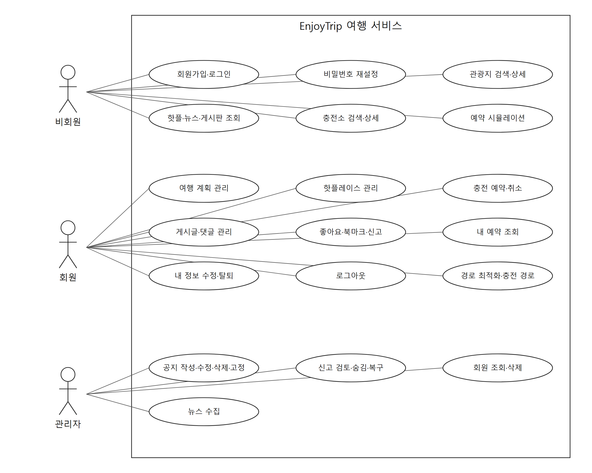

[SVG 원본](docs/diagrams/usecase.svg) · [그림 생성 코드](docs/diagrams/render_usecase.py)

### Class Diagram

계층별 핵심 클래스만 표시 (전체: `src/main/java/com/ssafy/enjoytrip`).

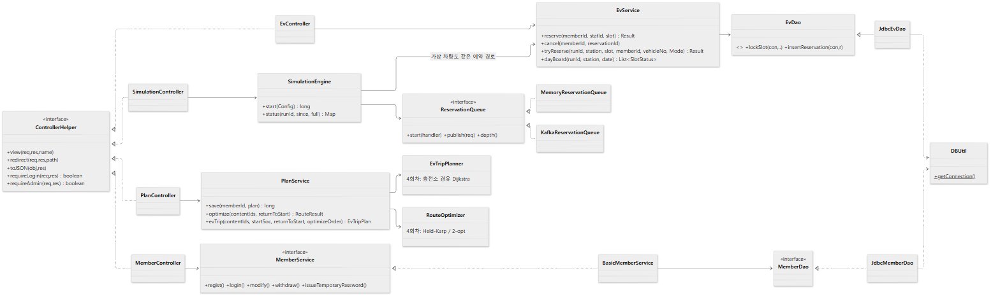

| 패키지 | 클래스 |
|---|---|
| controller | Main · Member · Attraction · Ev · Simulation · Plan · Hotplace · Board · News · Upload + `ControllerHelper` |
| model.service | `MemberService`/`BasicMemberService`, AttractionService, EvService, PlanService, HotplaceService, BoardService, NewsService |
| model.dao | 인터페이스 + `Jdbc*Dao`: Member, Attraction, Ev, SimRun, Plan, Hotplace, Board, News |
| model.dto | Member, Attraction, EvStation, Reservation, SlotStatus, SimRunSummary, Plan, PlanStop, Hotplace, Board, News, Page, SearchCondition … |
| simulation | SimulationEngine, SimulationRun, ReservationRequest, ReservationQueue, MemoryReservationQueue, KafkaReservationQueue |
| algorithm | 4회차 모듈 그대로 (geo, route, ev, trip, security, search, sort, recommend) |
| filter / listener / util | CsrfFilter · AppInitListener(스키마·기준 데이터 자동 적재) · DBUtil, Passwords, PhotoStorage, Csv |

## 8. 이전 회차에서 이어진 기능

<details>
<summary>5회차 팀 고유 주제 — 충전소 예약이 몰려도 한 자리에 한 대만 (펼치기)</summary>

> 배터리 12%. 다음 충전소까지 38km. **자리는 남아 있을까요?**

충전소 × 1시간 슬롯을 콘서트 좌석처럼 예약한다. 좌석 수 = 충전기 대수.

```sql
-- LOCKED (실제 서비스 경로): 트랜잭션 안에서 슬롯 행을 잠그고 남은 자리를 확인
SELECT capacity, booked FROM ev_slots WHERE run_id=? AND stat_id=? AND slot_start=? FOR UPDATE;
-- booked < capacity 일 때만
INSERT INTO ev_reservations (...) VALUES (...);
UPDATE ev_slots SET booked = booked + 1 WHERE ...;
COMMIT;
```

비교용 **NAIVE** 모드는 "몇 명 예약했지?"를 잠금 없이 센 뒤 넣는다. 세는 순간과 넣는 순간 사이에 다른 요청이 같은 숫자를 보고 끼어든다.

**시뮬레이션 결과** (가상 차량 800대, 도심 급속충전소 16곳 = 좌석 50, 0.4초 동안 몰림, 작업자 16명):

| 방식 | 대기열 | 확정 | 오버부킹 | 소요 |
|---|---|---|---|---|
| 잠금 없음 (NAIVE) | 메모리 큐(공유) | 67 | **17건** | 2.1s |
| **잠금 예약 (LOCKED)** | 메모리 큐(공유) | 50 | **0건** | 1.7s |
| 잠금 없음 | 메모리 큐 · **충전소별 줄** | 50 | **0건** | 3.3s |

- 세 번째 줄이 **Kafka 파티션**과 같은 원리다: 메시지 키 = 충전소 ID → 같은 충전소 요청은 한 파티션에 대기 번호 순으로 쌓이고 컨슈머 한 명이 차례로 처리 → 잠금 없이도 선착순·정원 준수. 대신 충전소 하나가 몰리면 그 줄만 길어진다.
- 실제 서비스 경로는 큐를 무엇으로 쓰든 **LOCKED** 로 처리해 DB 가 최종 정합성을 지킨다.
- 단위 테스트 `EvServiceConcurrencyTest`: 32개 스레드가 같은 순간 같은 슬롯을 예약 → LOCKED 는 확정 수 = 충전기 수, NAIVE 는 정원 초과를 재현.

시뮬레이션 흐름: 도심 기준 급속충전소 K곳 선택 → 차량마다 배터리 잔량·희망 충전소 1~3지망 결정(도심에 가까울수록 몰리는 지프 분포) → 차량이 큐에 줄을 섬(줄 선 순서 = 대기 번호) → 작업자가 `EvService.tryReserve` 로 **실제 DB 예약**(회원 예약과 같은 코드) → 만석이면 다음 지망으로 다시 줄 서기 → 끝나면 DB 에서 슬롯별 정원 초과를 집계. 화면은 250ms 마다 AJAX 로 상태를 받아 ① 배터리 격자, ③ 좌석 배치도, 로그를 그린다.

| 충전 티켓팅 시뮬레이션 | 이야기 인트로 |
|---|---|
| 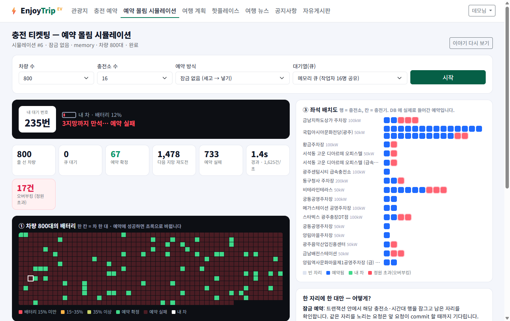 | 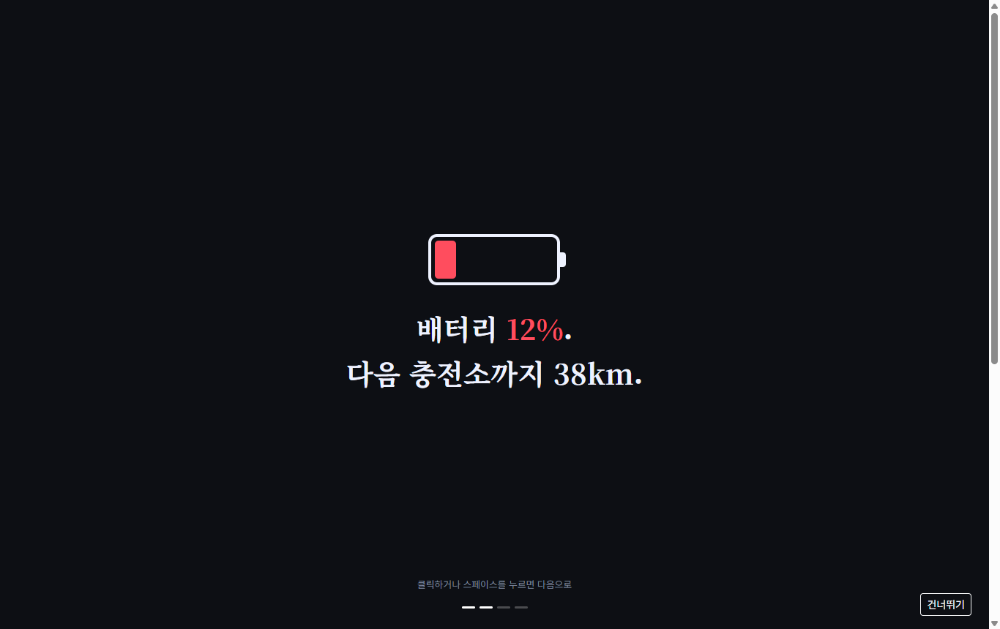 |

화면 방향: 레퍼런스(VastHorizon, Solar-Atlas)의 "이야기로 열고 시각화로 몰입시키는" 방식만 가져오고, 디자인은 EV 주제에 맞춰 ① 배터리 게이지(어두운 톤) → ③ 충전 티켓팅 좌석 배치도(밝은 톤)로 만들었다.

</details>

<details>
<summary>통합 게시판 확장 (2026-10-30)</summary>

공지사항과 자유게시판의 메뉴·목록을 `/board`로 통합했다. 공지는 관리자 전용 글 유형으로 유지하며 기존 `type=notice/free` URL도 필터로 사용할 수 있다.

좋아요·북마크·댓글·내 활동, 분류·정렬·검색 상태 유지, 신고·관리자 숨김/복구, 공지 고정 순서·기간을 지원한다. 새 스키마는 앱 재시작 시 추가 생성되며 기존 글은 유지한다.

[게시판 사용 방법·구조·검증 명령](docs/board-community.md)

</details>

## 9. 보안·품질 체크

| 위협 | 대응 |
|---|---|
| 비밀번호 유출 | PBKDF2-HMAC-SHA256 600,000회 + 사용자별 salt + 서버 pepper (4회차 `PasswordHasher`), 해시 반복 횟수 상한(DoS 방지), 없는 이메일도 같은 시간 소모 |
| 비밀번호 찾기 악용 | 임시 비밀번호를 화면에 보여주지 않음. 256비트 1회용 토큰(15분, DB 에는 SHA-256 해시만)을 이메일 링크로 보내고, 재설정을 마칠 때까지 기존 비밀번호 유지. 일치 여부와 상관없이 같은 안내(계정 존재 노출 방지), 이메일당 10분 3회·IP당 10회 제한. 수업 환경엔 메일 서버가 없어 링크는 서버 콘솔에 출력(`ResetMailer` 만 바꾸면 실제 발송). 링크 주소는 Host 헤더가 아니라 `app.base-url` 설정으로 만들고, 설정이 없으면 localhost 접속에서만 허용(재설정 링크 오염 방지) |
| 오픈 리다이렉트 | 로그인 후 이동 경로(`next`)는 앱 내부 경로 문자만 허용하는 정규식으로 검사(`//`, 탭·역슬래시 우회 차단) |
| 세션 탈취 | 로그인 시 세션 ID 재발급(세션 고정 방지), HttpOnly + SameSite=Lax 쿠키 |
| CSRF | 모든 POST 에 세션 토큰(`CsrfFilter`, 폼 hidden 필드 / fetch 헤더) |
| XSS | JSP 출력은 `<c:out>`/`fn:escapeXml`, JS 는 `ET.escapeHtml`, JSON 을 `<script>` 에 넣을 때 `<` 이스케이프 |
| SQL 인젝션 | 모든 쿼리 PreparedStatement, 검색 컬럼은 허용 목록, LIKE 와일드카드 이스케이프 |
| 업로드 | 선언 타입 + 매직 바이트 모두 확인, 서버가 만든 UUID 파일명, 5MB 제한, `/uploads` 는 파일명 정규식으로 경로 조작 차단 + nosniff |
| 권한 | 계획·핫플·게시글 수정/삭제는 작성자 또는 관리자만(서버에서 재확인), 공지·회원 관리·뉴스 수집은 관리자만 |
| 외부 데이터 | 뉴스 RSS XML 파서에서 DOCTYPE·외부 엔티티 차단(XXE), 링크는 http/https 만 렌더링 |

테스트: `./mvnw test` → 62개 실행, 실패 0, 건너뜀 9 (2026-11-06 기준).

## 10. 다음 회차로

- **DB 후속**: 385곳의 지역 코드를 싸피 체계로 맞춘 뒤 `attractions → guguns` FK 추가, 근처 충전소 검색에 공간 인덱스, 트랜잭션 격리 수준 비교.
- **Spring 회차**: Controller → `@RestController`, DAO → MyBatis, 큐 → Spring Kafka 로 옮기기 쉽게 계층을 나눠 두었다.

## AI 활용 기록

강사님 권고(AI 는 멘토)에 따라 Claude Code 를 설계 토론·코드 리뷰·반복 작업에 썼다. 컨셉(충전 예약 몰림, Kafka, 이야기형 화면 ①+③)은 팀이 정했고,
기능별 구현은 AI 에이전트가 수업 패턴(BE_06 ControllerHelper·Service·DAO)을 따르도록 지시한 뒤 curl·브라우저·단위 테스트로 검증했다.

**6회차(DB) — 스키마 검증·개선에 AI 활용**

- `ssafy_trip` 과 기존 `enjoytrip` 스키마를 나란히 비교하게 해서 차이(PK, 위경도 정밀도, 지역 코드 체계)를 찾았다.
- AI 가 찾은 문제: 구군 코드가 시도마다 다시 시작해 코드 하나로 필터하면 다른 시도가 섞인다 → (시도, 구군) 쌍 비교와 복합 UNIQUE 로 고쳤다.
- PK 를 대리키로 바꿀 때 `plan_stops` FK 가 깨지지 않도록 `content_id` UNIQUE 를 먼저 만드는 순서를 정했다.
- 이식 전후 백업, 행 수 대조(50,915 / 51,300), 빈 DB 에서 앱만 실행한 결과와의 컬럼 비교로 검증했다. 최종 판단(385곳 보존, 지역 FK 미설정)은 팀이 했다.
